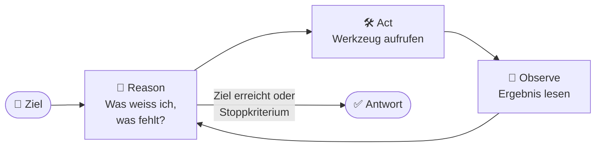

:::tldr
Ein **Chatbot** antwortet. Ein **Workflow** arbeitet Schritte ab, die **Code** festlegt. Ein **Agent** entscheidet **selbst**, welcher Schritt als Nächstes kommt – in der **ReAct-Schleife**: überlegen → Werkzeug aufrufen → Ergebnis beobachten → wieder überlegen, bis ein Stoppkriterium greift. Die wichtigste Regel: **Nimm die einfachste Stufe, die das Problem löst.** Jede Stufe darüber kostet mehr, ist schwerer zu testen und braucht mehr Absicherung.
:::

## Vier Stufen

| Stufe | Wer bestimmt die Schritte? | Wann | Beispiel |
|---|---|---|---|
| **Einzelner Call** | niemand – eine Anfrage, eine Antwort | klar umrissene Umwandlung | E-Mail klassifizieren, Rechnungsdaten extrahieren |
| **Workflow** | **Code** | Schritte sind bekannt, Reihenfolge fest oder einfach verzweigt | Ticket → Kategorie → passende Vorlage → Entwurf → Prüfung |
| **Agent** | **das Modell** | Weg nicht vorhersehbar, Zwischenergebnisse bestimmen den nächsten Schritt | Bug finden und beheben, offene Recherche |
| **Mehrere Agenten** | mehrere Modelle mit Rollen | Aufgabe zerfällt in unabhängige Teile oder braucht unabhängige Prüfung | Audit über 200 Dateien, Recherche mit Gegenprüfung |

Anthropic fasst Workflows und Agenten als **agentische Systeme** zusammen und unterscheidet sie so: Workflows orchestrieren LLMs und Werkzeuge über **vordefinierte Codepfade**; Agenten steuern ihren Ablauf und ihre Werkzeugnutzung **selbst**.

:::bildlich Fahrplan, Navi und Taxifahrer
- Ein **einzelner Call** ist eine Auskunft am Schalter: Frage rein, Antwort raus.
- Ein **Workflow** ist ein **Bus mit Fahrplan**: Die Haltestellen stehen fest, der Fahrer entscheidet nur, ob er an einer Verzweigung links oder rechts fährt.
- Ein **Agent** ist ein **Taxifahrer** mit Ziel: Er wählt die Route selbst, weicht Staus aus, fragt bei Unklarheit nach – und muss wissen, wann er angekommen ist.
:::

## Der Grundbaustein: das erweiterte LLM

Alle Stufen bauen auf demselben Baustein auf: einem Sprachmodell, das um **Retrieval** (Wissen nachschlagen), **Tools** (Werkzeuge aufrufen) und **Gedächtnis** erweitert ist. Ein Modell allein hat kein Gedächtnis zwischen zwei Aufrufen und kann ein Werkzeug nur **anfordern**, nicht selbst ausführen – das erledigt die Umgebung darum herum, der [[Harness]] (Lektion [Agent = Modell + Harness](#/l/agents/harness)).

## Die ReAct-Schleife

**ReAct** steht für *Reason + Act*: Das Modell überlegt, ruft ein Werkzeug auf, beobachtet das Ergebnis und überlegt erneut – so lange, bis es eine Antwort **ohne** Werkzeugaufruf liefert oder ein Stoppkriterium greift.

**Beispiel «Wie viele offene Rechnungen über CHF 10 000 haben wir?»**

1. *Reason:* Ich brauche die Rechnungsdaten. → *Act:* `rechnungen_suchen(status="offen")` → *Observe:* 214 Treffer, paginiert.
2. *Reason:* Ich muss nach Betrag filtern. → *Act:* `rechnungen_suchen(status="offen", min_betrag=10000)` → *Observe:* 17 Treffer.
3. *Reason:* Ich habe die Antwort. → Antwort ohne Werkzeugaufruf: «17 offene Rechnungen über CHF 10 000.»

:::gem Die Beobachtung kommt aus der echten Welt
Der Vorteil eines Agenten gegenüber einem reinen Sprachmodell ist nicht, dass er «schlauer» denkt, sondern dass er **nachschaut**: Die Beobachtung stammt aus einer Datenbank, einem Test, einer Suche. Ein Agent ist deshalb so gut wie sein Feedback. Tests, Linter, echte Daten und klare Fehlermeldungen sind die besten Werkzeuge, die du ihm geben kannst.
:::

## Was einen Agenten ausmacht

Ein Agent = **LLM + Werkzeuge + Schleife + Stoppkriterium**. Fehlt eines, ist es etwas anderes:

| Fehlt … | … dann ist es |
|---|---|
| Werkzeuge | ein Chatbot |
| Schleife | ein einzelner Werkzeugaufruf |
| Stoppkriterium | ein Endloslauf, der erst im Timeout oder beim Budget-Ende stoppt |

:::falle «Agent» als Modewort
Viele «Agenten» in Produktpräsentationen sind in Wahrheit Workflows – und das ist gut so. Gefährlich wird es umgekehrt: Wer für eine Aufgabe mit festen Schritten einen frei entscheidenden Agenten baut, bezahlt mit höheren Kosten, längerer Laufzeit, schwer reproduzierbaren Fehlern und mehr Angriffsfläche – ohne Mehrwert. Anthropic empfiehlt ausdrücklich, die einfachste Lösung zu suchen und Komplexität nur zu erhöhen, wenn sie nötig ist; manchmal heisst das, gar kein agentisches System zu bauen.
:::

## Wann lohnt sich ein Agent?

Ein Agent lohnt sich, wenn **alle drei** Bedingungen zutreffen:

1. **Der Weg ist nicht vorhersehbar.** Welche Schritte nötig sind, zeigt sich erst unterwegs.
2. **Es gibt prüfbares Feedback.** Tests, Daten oder klare Kriterien zeigen, ob ein Schritt erfolgreich war.
3. **Fehler sind auffangbar.** Ergebnisse werden geprüft, bevor sie wirken (Entwurf, Draft-PR, Freigabe).

Fehlt Punkt 1, reicht ein Workflow. Fehlt Punkt 2, rät der Agent. Fehlt Punkt 3, ist er ein Risiko.

:::berater Im Kundengespräch
«Wir wollen einen KI-Agenten» ist meist eine Lösung auf der Suche nach einem Problem. Die bessere Einstiegsfrage: «Welche Schritte sind heute bekannt, und wo muss jemand unterwegs entscheiden?» Sind die Schritte bekannt, bauen wir einen Workflow – günstiger, testbar, nachvollziehbar. Nur dort, wo wirklich entschieden werden muss, kommt ein Agent hinein. Typischer Einwand: «Ein Agent ist doch flexibler.» – Ja, und genau diese Flexibilität bezahlen Sie mit Kosten, Laufzeit und Unvorhersehbarkeit.
:::

:::spickzettel
- **Call** (eine Antwort) → **Workflow** (Code bestimmt Schritte) → **Agent** (Modell bestimmt Schritte) → **Multi-Agent**
- **Einfachste Stufe nehmen**, die das Problem löst
- Grundbaustein: **erweitertes LLM** = Modell + Retrieval + Tools + Gedächtnis
- **ReAct:** Reason → Act → Observe → … bis Antwort ohne Werkzeugaufruf
- Agent = **LLM + Werkzeuge + Schleife + Stoppkriterium**
- Agent lohnt sich bei **unvorhersehbarem Weg + prüfbarem Feedback + auffangbaren Fehlern**
:::

:::selbstcheck 3
