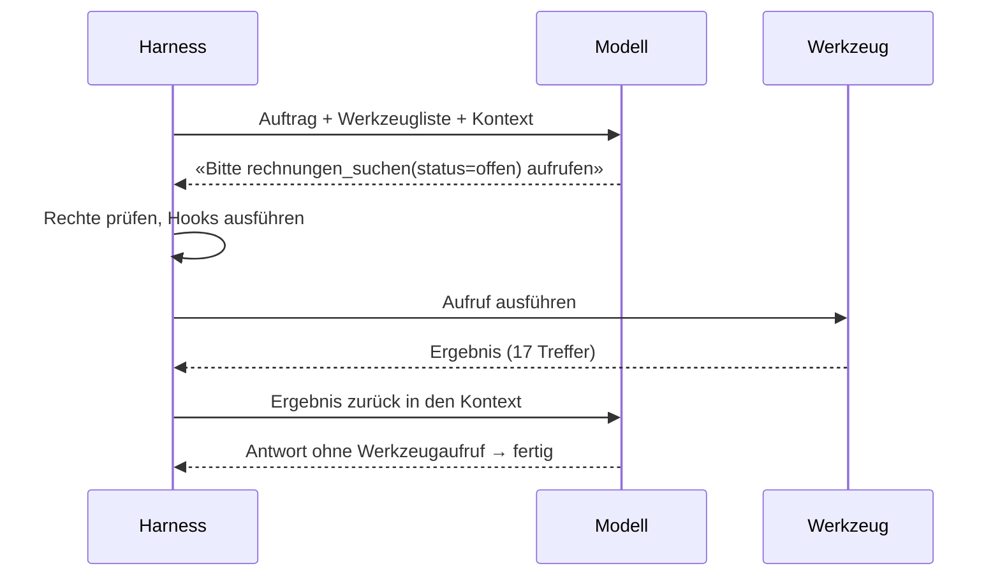

:::tldr
Ein Sprachmodell nimmt Text und gibt Text aus – mehr nicht. Es hat **kein Gedächtnis** zwischen Aufrufen, **keine Schleife** und kann ein Werkzeug nur **anfordern**, nicht ausführen. Alles andere – Schleife, Werkzeuge, Kontextpflege, Gedächtnis, Rechte, Prüfung – ist der **[[Harness]]**. Faustregel: **Agent = Modell + Harness.** Und der Harness entscheidet oft mehr über das Ergebnis als die Wahl des Modells.
:::

## Was das Modell allein kann – und was nicht

| Fähigkeit | Modell allein | Mit Harness |
|---|---|---|
| Text verstehen und erzeugen | ✅ | ✅ |
| sich an den letzten Aufruf erinnern | ❌ | ✅ Verlauf, Gedächtnis, Notizen |
| ein Werkzeug ausführen | ❌ nur anfordern | ✅ Harness führt aus und liefert das Ergebnis zurück |
| weiterarbeiten, bis das Ziel erreicht ist | ❌ antwortet einmal | ✅ Schleife mit Stoppkriterium |
| Grenzen einhalten | ❌ nur per Bitte im Prompt | ✅ Rechte, Sandbox, Freigaben |

:::bildlich Das Genie mit Amnesie
Das Modell ist ein **hochbegabter Mitarbeiter mit schwerer Amnesie**: Er löst jedes Problem brillant, vergisst aber nach jedem Satz alles, kann das Büro nicht verlassen und hat keine Hände. Der Harness gibt ihm ein **Notizbuch** (Gedächtnis), einen **Arbeitsauftrag mit «mach weiter, bis fertig»** (Schleife), einen **Werkzeugkasten** (Tools) und eine **Tür mit Schloss** (Rechte). Erst dann wird aus dem Genie ein Kollege.
:::

## Wie ein Werkzeugaufruf wirklich abläuft

Das Modell entscheidet **was**, der Harness entscheidet **ob** und führt aus. Darum sitzen Sicherheitsregeln, Budgets und Freigaben im Harness – nicht im Prompt.

## Die Komponenten eines Harness

| Komponente | Löst das Problem … | Beispiel in Claude Code |
|---|---|---|
| **Model Interface** | welches Modell läuft, austauschbar | `/model`, Modellwahl pro Subagent |
| **Tool Registry** | welche Werkzeuge es gibt und wie Aufrufe geroutet werden | Read, Edit, Bash, MCP-Server |
| **Context Manager** | Kontextfenster verwalten: verdichten, nachladen, weglassen | Auto-Compaction, `/compact`, Tool Search |
| **Execution Engine** | Werkzeuge ausführen, Fehler abfangen, stoppen | Agentic Loop, `max_turns` |
| **Memory / State** | was nach 50 Schritten noch zählt | CLAUDE.md, Auto Memory, Aufgabenlisten |
| **Feedback Loop** | Selbstprüfung: Tests laufen lassen, Fehler zurückspielen | Bash für Tests, Stop-Hooks |
| **Permissions / Safety** | was der Agent ungefragt darf | Permission-Regeln, Sandbox, Modi |
| **Orchestration** | mehrere Agenten koordinieren | Subagenten, Workflows, Agent Teams |

:::gem Der Harness schlägt oft das Modell
Auf öffentlichen Bestenlisten für Coding-Agenten (z. B. SWE-bench Verified, Terminal-Bench) erreicht **dasselbe Modell** in verschiedenen Harnesses deutlich unterschiedliche Werte – laut der Harness-Masterclass oft zehn Punkte und mehr, teils stärker als ein Modellwechsel (Stand Juni 2026). Wer nur Modelle vergleicht, vergleicht die falsche Schicht. Für die Praxis heisst das: Werkzeuge, Prüfschleife und Kontextpflege verbessern lohnt sich meist mehr als das nächstgrössere Modell.
:::

## Dicke und dünne Harnesses

| | Dick («batteries included») | Dünn (minimal) |
|---|---|---|
| Beispiel | Claude Code | minimale Open-Source-Harnesses |
| Systemprompt + Werkzeuge | belegen viel Kontext (laut Masterclass oft über 10 000 Token) | sehr wenig (unter ca. 1000 Token) |
| Mitgeliefert | Subagenten, Hooks, Skills, Plan-Modus, Rechte | wenige Kernwerkzeuge, Rest selbst bauen |
| Stärke | Kohärenz über lange Aufgaben, wenig Eigenbau | Kontrolle, Transparenz, viel Kontextbudget für eigene Daten |

**Anbindung ans Modell** – eine Designentscheidung, keine Nebensache:

- **API-Key:** Abrechnung pro Token, volle Kontrolle, ideal für Automatisierung.
- **Abo-Login:** keine zusätzlichen Token-Kosten, an einen Anbieter gebunden.
- **Anbieterneutral («bring your own key»):** derselbe Harness gegen verschiedene Modelle, auch lokale.

:::falle Sicherheit ins Prompt schreiben
«Lösche nie Dateien» im Systemprompt ist eine Bitte an das Modell. Das Modell kann sie missverstehen oder durch eine [[Prompt Injection]] überschrieben bekommen. Der Harness dagegen kann den Aufruf **technisch verweigern** – über Rechte, Hooks oder eine Sandbox. Regel: **Was garantiert gelten muss, gehört in den Harness, nicht ins Prompt.**
:::

## Harness als Dienst

Die Entwicklung geht weg von «ich rufe eine LLM-API auf und baue alles selbst» hin zu **Harness-APIs**, die Schleife, Werkzeuge, Kontextpflege, Hooks und Sandbox fertig mitbringen. Bei Anthropic sind das das **Claude Agent SDK** (die Bausteine von Claude Code als Bibliothek) und **Claude Managed Agents** (Anthropic betreibt Schleife, Sandbox und Werkzeuge). Welche Variante wann passt: Lektion [Frameworks](#/l/agents/frameworks).

:::berater Im Kundengespräch
«Welches Modell ist das beste?» ist die häufigste – und oft die falsche – Frage. Die wichtigere lautet: «Welcher Harness passt zu unserem Ablauf, und wo sitzen bei uns Werkzeuge, Prüfung und Grenzen?» Typischer Einwand: «Wir warten auf das nächste, bessere Modell.» – Ein besseres Modell im selben schwachen Harness bringt wenig. Ein guter Harness profitiert dagegen von jedem neuen Modell automatisch.
:::

:::spickzettel
- Modell allein: Text rein, Text raus – **kein Gedächtnis, keine Schleife, keine Ausführung**
- **Agent = Modell + Harness**; Harness = alles, was nicht das Modell ist
- Modell **fordert** Werkzeug an, Harness **prüft und führt aus**
- Komponenten: Model Interface · Tool Registry · Context Manager · Execution Engine · Memory · Feedback Loop · Permissions · Orchestration
- Harness erklärt oft **mehr Ergebnis-Unterschied** als das Modell
- Dick (Claude Code) vs. dünn (minimal): Funktionsfülle gegen Kontrolle und Kontextbudget
- Muss-Regeln in den **Harness**, nicht ins Prompt
:::

:::selbstcheck 3
