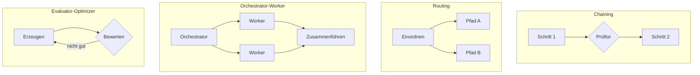

:::tldr
Die meisten erfolgreichen Agenten-Systeme bestehen nicht aus komplexen Frameworks, sondern aus **einfachen, kombinierbaren Mustern**: **Prompt Chaining** (Schritte hintereinander mit Prüftoren), **Routing** (erst einordnen, dann spezialisiert bearbeiten), **Parallelisierung** (Teile gleichzeitig oder dieselbe Aufgabe mehrfach), **Orchestrator-Worker** (Teilaufgaben erst zur Laufzeit festlegen) und **Evaluator-Optimizer** (erzeugen, bewerten, verbessern). Wähle das Muster nach der **Form der Aufgabe** – und kombiniere erst, wenn eines allein nicht reicht.
:::

## Die fünf Bausteine

| Muster | Ablauf | Passt, wenn … | Beispiel |
|---|---|---|---|
| **Prompt Chaining** | Schritt 1 → Prüftor (Code) → Schritt 2 → … | die Aufgabe in feste Teilschritte zerfällt | Gliederung → Prüfung der Gliederung → Text |
| **Routing** | Klassifikator → spezialisierter Pfad | Eingaben klar unterscheidbare Kategorien haben | Kundenanfrage → Rückerstattung, Technik oder Allgemeines |
| **Parallelisierung – Sectioning** | unabhängige Teile gleichzeitig | Teile sich nicht gegenseitig brauchen | 40 Verträge je einzeln auf Kündigungsfristen prüfen |
| **Parallelisierung – Voting** | dieselbe Aufgabe mehrfach, Mehrheit oder Richter | Fehlalarme oder übersehene Fälle teuer sind | drei unabhängige Prüfungen auf Sicherheitslücken |
| **Orchestrator-Worker** | Orchestrator zerlegt **dynamisch**, Worker erledigen, Orchestrator fügt zusammen | die Teilaufgaben erst zur Laufzeit bekannt sind | Änderung, die je nach Codebasis unterschiedlich viele Dateien betrifft |
| **Evaluator-Optimizer** | Erzeuger → Bewerter mit Kriterien → Überarbeitung, bis erfüllt oder N Runden | klare Qualitätskriterien existieren | Übersetzung mit Glossar-Prüfung, Code bis Tests grün |

Dazu kommt **Plan-and-Execute** für lange Aufgaben: Ein starkes Modell erstellt einen Plan (als Datei oder Schema), einfachere Ausführer arbeiten ihn ab, der Planer passt bei Abweichungen an.

:::bildlich Die Küche eines Restaurants
- **Chaining** ist das **Rezept**: erst schneiden, dann anbraten, dann abschmecken – und vor dem Anrichten probiert der Koch (Prüftor).
- **Routing** ist der **Pass**: Die Bestellung geht je nach Gericht an die Grill- oder die Pastastation.
- **Sectioning** sind mehrere **Köche**, die gleichzeitig Vorspeise, Hauptgang und Dessert machen.
- **Orchestrator-Worker** ist der **Küchenchef** bei einem Bankett: Er entscheidet erst beim Blick auf die Gästeliste, wer was übernimmt.
- **Evaluator-Optimizer** ist der **Sous-Chef**, der jeden Teller prüft und zurückschickt, bis er stimmt.
:::

## Die Details, die den Unterschied machen

- **Prüftore im Chaining sind Code, nicht Modell:** Schema gültig? Länge eingehalten? Pflichtfelder da? Ein deterministisches Tor stoppt Fehler, bevor sie sich durch die Kette ziehen.
- **Routing auf kleinem Modell:** Das Einordnen ist eine einfache Aufgabe; ein kleines, schnelles Modell reicht und spart Kosten. Schwierige Fälle gehen an das stärkere Modell.
- **Parallel heisst: Ergebnisse per Schema einsammeln.** Zehn Fliesstext-Antworten zusammenzufügen ist fehleranfällig; zehn gleich strukturierte Objekte nicht.
- **Evaluator-Optimizer braucht eine Bremse:** Abbruch nach N Runden **ohne Fortschritt** – sonst poliert das System endlos.

:::gem Der Prüfer ist ein eigener Auftrag
«Prüf deine Antwort selbst» im selben Aufruf bringt wenig: Das Modell ist auf seine eigene Lösung eingestimmt. Wirksamer ist ein **eigener Aufruf oder Agent mit anderem Auftrag**, z. B. «Versuche, diesen Befund zu widerlegen». Diese **adversariale Prüfung** hebt die Präzision deutlich – ein Befund wird nur berichtet, wenn er den Widerlegungsversuch übersteht.
:::

## Mehrere Agenten – wann ja, wann nein

**Ja**, wenn die Aufgabe in **unabhängige** Teile zerfällt (Parallelität), für einen Kontext zu gross ist oder eine **unabhängige Prüfung** braucht.

**Nein**, wenn die Teile eng zusammenhängen und jeder alles wissen muss – dann ist **ein** Agent mit gutem Kontext besser und billiger.

Wenn mehrere, dann mit **Übergabevertrag** pro Rolle:

| Teil des Vertrags | Inhalt |
|---|---|
| Auftrag | eine klar umrissene Aufgabe |
| Eingabe | Schema (JSON), nicht das ganze Transkript |
| Ausgabe | Schema, damit der nächste Schritt es maschinell verarbeiten kann |
| Abbruch | wann der Agent aufgibt und was er dann meldet |

:::falle Fünf Agenten plaudern frei
Mehrere Agenten, die sich gegenseitig freie Texte schicken, wirken in Demos beeindruckend – und verbrennen Tokens, verlieren Informationen zwischen den Übergaben und sind kaum zu debuggen. Multi-Agent-Läufe kosten ein **Vielfaches** eines Einzelagenten. Darum: Rollen, Schemas, Abbruchbedingungen – und erst klein testen (ein Ordner, eine Frage), dann skalieren.
:::

## Lange Läufe über mehrere Kontextfenster

Für Aufgaben über Stunden haben sich diese Gewohnheiten bewährt:

1. **Einrichtungsschritt:** Umgebung vorbereiten, Aufgabenliste als Datei anlegen (`progress.md`, `tasks.json`), Startskript für Tests.
2. **Inkrementell arbeiten:** pro Durchgang ein Teilziel, danach Commit und Fortschrittsnotiz. Der nächste Durchgang liest zuerst Notiz und Git-Log.
3. **Nicht alles auf einmal:** Wer zu viel in einem Durchgang versucht, läuft mitten in der Arbeit aus dem Kontext.
4. **Fertig heisst getestet:** jedes Teilziel mit einem prüfbaren Kriterium.

## Anti-Muster

| Anti-Muster | Besser |
|---|---|
| Agent, wo ein Workflow reicht | Workflow; Agent nur für unvorhersehbare Wege |
| kein Stoppkriterium | Ziel, max. Schritte, Budget, Zeit |
| freies Geplauder zwischen Agenten | Rollen, Schemas, Abbruch |
| «prüf dich selbst» im selben Aufruf | eigener Prüfer mit anderem Auftrag |
| Ergebnis als Fliesstext an den nächsten Schritt | Schema |
| Werkzeugausgaben als vertrauenswürdig behandeln | als untrusted Input behandeln |
| überall das grösste Modell | Modell und Aufwand pro Rolle wählen |
| unbeaufsichtigt ohne Protokoll | Traces und Logs ab dem ersten Tag |

:::berater Im Kundengespräch
Kunden beschreiben Prozesse – keine Muster. Die Übersetzungsleistung: «Ihr Rechnungseingang ist ein **Routing** (Lieferant, Gutschrift, Mahnung), gefolgt von einer **Kette** mit Prüftor (Betrag und MWST rechnerisch prüfen) und einem **Evaluator** für Grenzfälle. Ein frei entscheidender Agent ist dafür nicht nötig.» Typischer Einwand: «Andere bauen Multi-Agent-Systeme.» – Mehrere Agenten lohnen sich bei unabhängigen Teilaufgaben oder unabhängiger Prüfung. Sonst zahlen Sie das Mehrfache für dasselbe Ergebnis.
:::

:::spickzettel
- **Chaining** (feste Schritte + Code-Prüftore) · **Routing** (einordnen, kleines Modell) · **Sectioning** (unabhängig parallel) · **Voting** (mehrfach, Mehrheit)
- **Orchestrator-Worker** = Teilaufgaben **erst zur Laufzeit** bekannt
- **Evaluator-Optimizer** = klare Kriterien + **Abbruch nach N Runden**
- **Plan-and-Execute** für lange Aufgaben, Plan als Datei
- Prüfer = **eigener Auftrag**, am besten «widerlege»
- Multi-Agent nur bei Unabhängigkeit oder unabhängiger Prüfung; **Übergabevertrag mit Schema**
- Lange Läufe: Fortschrittsdatei, ein Teilziel pro Durchgang, Commit, Test
:::

:::selbstcheck 3
