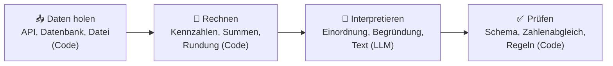

:::tldr
**Alles, was sich berechnen lässt, rechnet Code – das Sprachmodell interpretiert nur.** Ein LLM erzeugt wahrscheinliche Fortsetzungen, keine geprüften Werte: Es kann sich verrechnen, Zahlen vertauschen oder Daten erfinden, wenn keine echten da sind. Darum: **Daten aus verifizierten Quellen** holen, **Kennzahlen deterministisch** berechnen, dem Modell die **fertigen Zahlen** geben, seine Ausgabe **per Schema** prüfen und **jede Zahl im Ergebnis** gegen die Quelle abgleichen.
:::

## Warum Modelle bei Zahlen gefährlich sind

| Fehlerart | Beispiel |
|---|---|
| **Rechenfehler** | Marge 23,4 % statt 32,4 %, Summen, die nicht aufgehen |
| **Vertauschung** | Umsatz von 2025 und 2024 verwechselt |
| **Erfindung** | ein «aktueller Kurs» aus dem Trainingswissen statt aus der Datenquelle |
| **Scheinpräzision** | «Das KGV liegt bei 18,73» – ohne dass irgendwo ein KGV berechnet wurde |

Das Tückische: Erfundene Zahlen sehen genauso plausibel aus wie echte. Eine [[Halluzination]] bei Zahlen fällt oft erst auf, wenn jemand nachrechnet – oder gar nicht.

:::bildlich Buchhalter und Analystin
Ein gutes Team hat einen **Buchhalter**, der rechnet, und eine **Analystin**, die interpretiert. Der Buchhalter darf nicht kreativ sein; die Analystin darf nicht rechnen, sondern bekommt seine fertigen, geprüften Zahlen und sagt, was sie bedeuten. Ein Sprachmodell ist eine brillante Analystin – und ein unzuverlässiger Buchhalter. Also lass es nur das sein, worin es gut ist.
:::

## Das Prinzip in vier Schichten



1. **Daten holen – deterministisch.** Jede Zahl stammt aus einer verifizierten, externen Quelle (API, Datenbank, Buchhaltung), nie aus dem Gedächtnis des Modells.
2. **Rechnen – deterministisch.** Kennzahlen, Summen, Prozentwerte, Rundungen in Python. Getestet wie jeder andere Code.
3. **Interpretieren – LLM.** Das Modell bekommt die fertigen Zahlen und schreibt Einordnung, Begründung, Empfehlung.
4. **Prüfen – deterministisch.** Ausgabe gegen ein Schema validieren und jede genannte Zahl gegen die Quelldaten abgleichen.

```python
from decimal import Decimal, ROUND_HALF_UP

def mwst(netto: Decimal, satz: Decimal = Decimal("0.081")) -> Decimal:
    """MWST-Normalsatz 8,1 % (ESTV, Stand 27.11.2026); im Beispiel auf 5 Rappen gerundet."""
    betrag = netto * satz
    return (betrag / Decimal("0.05")).quantize(Decimal("1"), ROUND_HALF_UP) * Decimal("0.05")

kennzahlen = {
    "umsatz_chf": umsatz,
    "marge_pct": round(gewinn / umsatz * 100, 1),
    "mwst_chf": mwst(netto),
}
prompt = f"Ordne diese geprüften Kennzahlen ein. Rechne nicht neu, nenne nur diese Werte:\n{kennzahlen}"
```

:::gem Daten vor dem Aufruf einspeisen statt Werkzeug ohne Quelle
In einem Multi-Agenten-Projekt zur Aktienanalyse war für einen Sentiment-Analysten ein Werkzeugaufruf vorgesehen – aber ohne echten Zugang zur Datenquelle. Das Modell hat daraufhin **Reddit-Beiträge erfunden**. Die Lösung: Die Daten werden **vor** dem LLM-Aufruf von einem Skript geholt und direkt in den Prompt eingespeist. Kein Werkzeug, das ins Leere greift – kein Raum für Erfindung. Faustregel: Was du vorher weisst, gibst du mit; Werkzeuge nur dort, wo der Agent wirklich selbst entscheiden muss, was er braucht.
:::

## Script-Knoten und LLM-Knoten

In einem gut gebauten Agenten-System ist ein grosser Teil **gar kein LLM**:

| Komponente | Art | LLM-Aufruf? |
|---|---|---|
| Ablaufsteuerung (z. B. LangGraph-Graph, Routing nach Bedingung) | Skript | nein |
| Datenabruf (API, Crawler, Datenbank) | Skript | nein |
| Kennzahlen, Bewertungsmodell, Ranking | Skript | nein |
| Werkzeugausführung | Skript | nein |
| Bewertung aus Text extrahieren (Regex, Schema) | Skript | nein |
| Analyse, Einordnung, Begründung | LLM | ja |
| Abwägung zwischen Argumenten, finale Empfehlung | LLM | ja |

Das macht das System **günstiger** (nur die Interpretation kostet Tokens), **prüfbar** (Skripte haben Tests) und **auditierbar** (jeder Schritt ist nachvollziehbar).

## Ausgaben per Schema erzwingen

Statt Fliesstext verlangt man vom Modell ein **festes Format**, das Code prüfen kann:

```python
from pydantic import BaseModel, Field

class Einschaetzung(BaseModel):
    rating: int = Field(ge=1, le=5, description="1 = stark verkaufen, 5 = stark kaufen")
    begruendung: str = Field(max_length=800)
    genannte_kennzahlen: dict[str, float]   # jede Zahl, auf die sich die Begründung stützt
```

Mit **Structured Outputs** bzw. Werkzeugen mit `input_schema` liefert das Modell garantiert ein Objekt in dieser Form; **Validatoren** setzen Geschäftsregeln durch, die kein Prompt garantieren kann (Wertebereich, Pflichtfelder, Format).

:::falle Ein gültiges Schema ist noch keine richtige Zahl
Das Schema garantiert, dass `marge_pct` eine Zahl ist – nicht, dass es die **richtige** Zahl ist. Darum der vierte Schritt: **Jede Zahl, die das Modell nennt, wird gegen die Quelldaten abgeglichen.** Taucht eine Zahl auf, die weder in den Daten noch in den berechneten Kennzahlen vorkommt, wird die Ausgabe verworfen oder zur Korrektur zurückgeschickt.
:::

```python
def zahlen_pruefen(ausgabe: Einschaetzung, kennzahlen: dict) -> list[str]:
    fehler = []
    for name, wert in ausgabe.genannte_kennzahlen.items():
        if name not in kennzahlen:
            fehler.append(f"{name}: nicht in den Quelldaten")
        elif abs(float(kennzahlen[name]) - wert) > 0.05:
            fehler.append(f"{name}: genannt {wert}, berechnet {kennzahlen[name]}")
    return fehler   # leer = in Ordnung, sonst zurück an das Modell oder verwerfen
```

:::falle «Temperatur auf 0, dann rechnet es richtig»
Eine niedrige Temperatur macht Ausgaben **gleichförmiger**, nicht **richtiger**. Ein Modell, das bei Temperatur 0 falsch rechnet, rechnet dann eben jedes Mal gleich falsch. Gegen Rechenfehler hilft nur, nicht das Modell rechnen zu lassen.
:::

:::berater Im Kundengespräch
Gerade in Finanz-, Versicherungs- und Treuhandprojekten ist das die wichtigste Architekturentscheidung: «Bei uns rechnet die KI nicht. Sie erklärt, was die Zahlen bedeuten – und jede Zahl in ihrer Antwort ist automatisch gegen die Buchhaltung geprüft.» Das ist auch das Argument gegenüber Revision und Aufsicht. Typischer Einwand: «Die neuen Modelle rechnen doch gut.» – Meistens. Aber «meistens» ist bei einem Jahresabschluss nicht das Kriterium; ein deterministischer Rechenkern mit Tests ist es.
:::

:::spickzettel
- **Code rechnet, LLM interpretiert**
- Jede Zahl aus **verifizierter Quelle**, nie aus dem Modellgedächtnis
- Vier Schichten: **Daten holen → Rechnen → Interpretieren → Prüfen**
- Bekannte Daten **vor dem Aufruf einspeisen**; Werkzeug ohne Quelle = Einladung zur Erfindung
- Ablauf, Datenabruf, Kennzahlen, Parsing = **Skript**; Einordnung, Abwägung = **LLM**
- Ausgabe per **Schema** + **Validatoren**; dann **Zahlenabgleich** gegen die Quelle
- Temperatur 0 macht **gleichförmig, nicht richtig**
- Geld: `Decimal`, Rundung explizit (CHF auf 5 Rappen)
:::

:::selbstcheck 3
