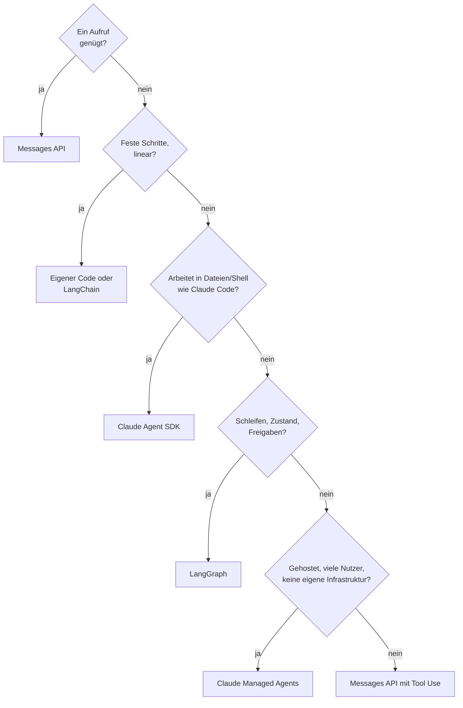

:::tldr
Die Wahl folgt der **Form des Ablaufs**: **ein Aufruf** → API direkt. **Lineare Kette** → einfacher Code oder LangChain. **Schleifen, Zustand, Verzweigungen, menschliche Freigaben** → **LangGraph**. **Ein Agent wie Claude Code in deiner App** (Dateien, Shell, Subagenten, Hooks) → **Claude Agent SDK**. **Gehostet, ohne eigene Infrastruktur** → **Claude Managed Agents**. Frameworks sparen Routinearbeit, verstecken aber Prompts und Antworten hinter Abstraktionen – darum: mit dem Einfachsten beginnen und verstehen, was darunter passiert.
:::

## Entscheidung in einem Satz

| Situation | Wahl |
|---|---|
| ein Modellaufruf, evtl. mit Schema | **Messages API** direkt |
| volle Kontrolle über jeden Aufruf, eigene Schleife, wenige Werkzeuge | **Messages API mit Tool Use** |
| lineare Pipeline mit vielen Integrationen (Loader, Vektor-DB) | **LangChain** |
| Schleifen, Zustand, Verzweigungen, Human-in-the-Loop, anbieterneutral | **LangGraph** |
| Agent soll arbeiten wie Claude Code – Dateien, Shell, Subagenten, Hooks, Rechte | **Claude Agent SDK** |
| gehostet, mit Gedächtnis und Multi-Agent, ohne eigene Infrastruktur | **Claude Managed Agents** |
| typsicher im Pydantic-Stil, wenig Magie | **Pydantic AI** |
| Teams mit Rollen als Abstraktion | **CrewAI**; im Microsoft-Umfeld **Microsoft Agent Framework** |
| Prompts systematisch gegen eine Metrik optimieren | **DSPy** |
| Schwerpunkt Dokumente und RAG-Pipelines | **LlamaIndex**, **Haystack** |

:::bildlich Werkzeug nach Werkstück
Du nimmst für eine Schraube einen Schraubenzieher, für eine Wand eine Bohrmaschine und für ein Haus einen Kran. Niemand kauft einen Kran, um ein Bild aufzuhängen. Frameworks sind Werkzeuge unterschiedlicher Grösse – die Form des Werkstücks (dein Ablauf) entscheidet, nicht die Bekanntheit des Herstellers.
:::

## LangChain und LangGraph

**LangChain** eignet sich für **lineare** Abläufe und bringt viele Integrationen mit. Seit Version 1.0 ist `create_agent` der schnelle Weg zu einem Agenten: anbieterneutral, mit **Middleware** etwa für menschliche Freigaben, Zusammenfassen am Token-Limit oder Schwärzen von Personendaten – und intern auf der LangGraph-Laufzeit.

**LangGraph** modelliert die Anwendung als **Graph** – sobald Schleifen, Zustand oder Freigaben ins Spiel kommen:

| Baustein | Bedeutung |
|---|---|
| **State** | gemeinsamer Zustand aller Schritte (oft ein Pydantic-Modell) |
| **Nodes** | Funktionen, die den Zustand verändern – LLM-Aufruf oder normaler Code |
| **Edges** | was als Nächstes läuft |
| **Conditional Edge** | der Ort der Entscheidung: Werkzeug-Knoten oder Ende? |
| **Reducer** | wie Updates zusammengeführt werden (z. B. Nachrichten anhängen) |
| **Checkpointer** | Zustand speichern: pausieren, nach Absturz fortsetzen, zurückspulen |

```python
class AgentState(TypedDict):
    messages: Annotated[list, add_messages]

g = StateGraph(AgentState)
g.add_edge(START, "denken")
g.add_conditional_edges("denken", braucht_werkzeug, {"ja": "werkzeuge", "nein": END})
g.add_edge("werkzeuge", "denken")              # Zyklus zurück
app = g.compile(checkpointer=checkpointer)     # pausierbar, mit Kurzzeitgedächtnis
```

:::gem Der Graph selbst kostet nichts
In LangGraph-Systemen ist das Rückgrat **gewöhnlicher Code**: Routing, Bedingungen, Werkzeugausführung und Checkpointing rufen kein Sprachmodell auf. Nur die Knoten, die wirklich interpretieren, kosten Tokens. Das macht LangGraph attraktiv für die Trennung von deterministischen Schritten und LLM-Interpretation (Lektion [Rechnen vs. Interpretieren](#/l/agents/rechnen-vs-interpretieren)).
:::

**Faustregel:** Mit `create_agent` starten; einen eigenen StateGraph erst bauen, wenn Standardschleife und Middleware den Ablauf nicht mehr abdecken.

## Claude Agent SDK

Die Bausteine von Claude Code als Bibliothek – für Python und TypeScript (Stand 27.11.2026):

- **`query()`** für einen einmaligen Auftrag mit einem Strom von Nachrichten; **`ClaudeSDKClient`** für fortlaufende Gespräche.
- Eingebaute Werkzeuge für Dateien und Shell, Subagenten, **Hooks** als Python-Funktionen, eigene Werkzeuge prozessintern (`@tool` + `create_sdk_mcp_server`).
- Rechte, Settings und Sandbox funktionieren wie in Claude Code; Obergrenzen über `max_turns` und `max_budget_usd`.
- Grundlage auch der GitHub Action `anthropics/claude-code-action`.

Passt, wenn dein Agent **in einer Codebasis oder einem Dateisystem arbeiten** soll – Code prüfen, Berichte aus Dateien erstellen, Migrationen durchführen.

## Claude Managed Agents

Anthropic betreibt Schleife, Sandbox und Werkzeuge; du konfigurierst den Agenten und rufst ihn per API auf. Dazu kommen gehostetes Gedächtnis (Memory Stores), Ergebnisdefinitionen, Multi-Agent-Orchestrierung und Webhooks bei Abschluss (Stand 27.11.2026). Passt für **Produkte mit vielen Nutzern** und lange, autonome Aufgaben ohne eigene Infrastruktur.

:::falle Datenfrage bei gehosteten Agenten
Bei Managed Agents laufen Daten und Ausführung in der Infrastruktur des Anbieters. Für Kundendaten, Berufsgeheimnisse oder Personendaten gelten deshalb die Fragen aus der Lektion [Datenfrage Schweiz](#/l/ai-security/datenfrage-schweiz): Vertrag (DPA), Kontotyp, Datenstandort, Pseudonymisierung. Bequemlichkeit ersetzt keine Datenschutzprüfung.
:::

## Die weiteren

| Framework | Stärke | Hinweis |
|---|---|---|
| **Pydantic AI** | typsichere Agenten, Ausgaben als validierte Objekte | gut, wenn das Team ohnehin mit Pydantic arbeitet |
| **CrewAI** | Agenten als Team mit Rollen (Recherche, Schreiben, Review) | schnell im Prototyp; Übergaben trotzdem per Schema festlegen |
| **Microsoft Agent Framework** | vereint AutoGen und Semantic Kernel (v1.0 seit 03.04.2026) | im Microsoft-Stack; AutoGen und Semantic Kernel gelten als Altbestand |
| **DSPy** | Ziel als Signatur, Optimierer sucht beste Anweisungen und Beispiele | lohnt sich, wenn es eine Metrik gibt und Prompt-Tuning zäh wird |
| **LlamaIndex, Haystack** | Dokument- und RAG-Pipelines | Schwerpunkt Wissen, weniger Agentensteuerung |

:::falle Framework zuerst, Problem danach
Anthropic hält fest, dass die erfolgreichsten Umsetzungen meist **keine** komplexen Frameworks nutzten, sondern einfache, kombinierbare Muster. Frameworks erleichtern den Einstieg, erzeugen aber Abstraktionsschichten, die Prompts und Antworten verdecken und das Debuggen erschweren – und sie verleiten dazu, Komplexität einzubauen, wo eine einfachere Lösung reicht. Wer ein Framework nutzt, sollte verstehen, was es darunter tut.
:::

## Entscheidungsweg



:::berater Im Kundengespräch
Kunden fragen oft «LangChain oder etwas anderes?», bevor der Ablauf klar ist. Die bessere Reihenfolge: Ablauf skizzieren (welche Schritte, wo Schleifen, wo Freigaben, wo Daten), dann das kleinste Werkzeug wählen, das diese Form abbildet. Typischer Einwand: «Mit einem Framework sind wir flexibler für später.» – Flexibilität, die man nicht braucht, bezahlt man mit Debugging-Aufwand. Ein Wechsel von direktem API-Code zu LangGraph ist später gut machbar; das Entfernen eines tief verankerten Frameworks oft nicht.
:::

:::spickzettel
- Wahl nach **Ablaufform**, nicht nach Bekanntheit
- Ein Aufruf → **API** · linear → **Code / LangChain** · Schleifen + Zustand + Freigaben → **LangGraph**
- Arbeitet wie Claude Code in Dateien/Shell → **Claude Agent SDK** · gehostet, viele Nutzer → **Managed Agents**
- LangGraph: **State, Nodes, Edges, Conditional Edge, Reducer, Checkpointer**
- `create_agent` zuerst, eigener StateGraph erst bei Bedarf
- Pydantic AI (typsicher) · CrewAI (Rollen) · DSPy (Prompt-Optimierung) · LlamaIndex/Haystack (RAG)
- Frameworks **verdecken Prompts** – verstehen, was darunter passiert
- Gehostet = **Datenfrage** prüfen
:::

:::selbstcheck 3
