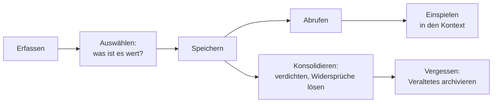

:::tldr
Ein Sprachmodell ist von Natur aus **vergesslich**: Jeder Aufruf beginnt bei null, und es kennt nur, was in diesem Moment im **Kontextfenster** liegt. Das Kontextfenster ist der **Arbeitsspeicher** – schnell, aber begrenzt, flüchtig und bei jedem Aufruf bezahlt. **Memory** ist die **Festplatte**: Was wichtig ist, wird herausgeschrieben, bleibt über Sitzungen hinweg erhalten und wird beim nächsten Mal gezielt zurückgeholt. Ein gutes System entscheidet bewusst, **was** auf die Festplatte kommt, **wann** es zurück in den Arbeitsspeicher geholt wird – und **was** wieder vergessen werden darf.
:::

:::bildlich RAM und Festplatte
Ein Computer rechnet im **Arbeitsspeicher (RAM)**: schnell, aber nach dem Ausschalten leer. Was bleiben soll, wird auf die **Festplatte** geschrieben und beim nächsten Start wieder geladen – aber nicht alles auf einmal, sondern nur, was gerade gebraucht wird. Ein KI-System ohne Memory ist ein Computer ohne Festplatte: Nach jedem Neustart ist alles weg.
:::

## Kurzzeit und Langzeit

| | Kurzzeit: Kontextfenster | Langzeit: Memory |
|---|---|---|
| Bild | Arbeitsspeicher (RAM) | Festplatte |
| Was | alles, was **diese** Anfrage enthält: Anweisungen, Dokumente, Verlauf | was **zwischen** Sitzungen bleibt: Notizen, Regeln, Wissensbasis |
| Lebensdauer | eine Anfrage bzw. eine Sitzung | dauerhaft, bis gelöscht |
| Grösse | begrenzt (z. B. 1 Mio. Tokens) | praktisch unbegrenzt |
| Kosten | jeder Token bei **jedem** Aufruf | Speicher günstig; bezahlt wird nur, was zurückgeholt wird |
| Zugriff | das Modell «sieht» alles direkt | muss **gesucht und eingespielt** werden |

## Vier Gedächtnistypen

| Typ | Frage | Beispiele |
|---|---|---|
| **Arbeitsgedächtnis** | Was liegt gerade vor? | Prompt, aktueller Verlauf |
| **Episodisch** | Was ist wann passiert? | Gesprächsprotokolle, Tageslog, frühere Sitzungen |
| **Semantisch** | Was gilt als Fakt? | Präferenzen («Anna will knappe Antworten»), Produktwissen, Wissensbasis |
| **Prozedural** | Wie macht man etwas? | `CLAUDE.md`, Skills, Checklisten, Vorlagen |

:::gem Speichern ist kein Lernen
Wer jede Nachricht speichert, ertrinkt im Rauschen: Duplikate, Widersprüche, Veraltetes. Gute Memory-Systeme haben einen **eigenen Schritt**, der entscheidet, was es wert ist, behalten zu werden, und regelmässig **aufräumt** – Doppeltes zusammenführen, Widersprüche auflösen, Überholtes archivieren. Erst dadurch wird Wissen **besser** statt nur **grösser** (Lektion [Claude-Memory pflegen](#/l/ai-memory/claude-memory-pflegen)).
:::

## Was kein Memory ist

- **Ein langer Chatverlauf:** Er liegt nur im Arbeitsspeicher dieser Sitzung und wird bei jedem Aufruf neu bezahlt. Eine neue Sitzung beginnt ohne ihn.
- **Kompaktierung:** Das Zusammenfassen eines langen Verlaufs spart Platz in **dieser** Sitzung, überdauert sie aber nicht.
- **Training:** Das Modell lernt während der Nutzung nichts dazu. Memory ist etwas, das **aussen** gespeichert und wieder **hineingegeben** wird.

:::falle «Claude kennt mich doch schon»
Wenn Claude in einer neuen Sitzung etwas über dich «weiss», dann nur, weil ein Memory-System es ihm **in den Kontext gelegt** hat – etwa das Memory der Claude-App, eine `CLAUDE.md` oder Projektwissen. Fehlt dieser Mechanismus oder ist er ausgeschaltet, beginnt jede Sitzung bei null. Wer das versteht, kann gezielt steuern, **was** Claude beim Start weiss – und was nicht.
:::

:::berater Im Kundengespräch
Die Frage «Kann die KI sich an unsere Kunden erinnern?» beantwortest du mit einer Gegenfrage: «**Was** soll sie sich merken, **wie lange**, und **wer** darf es sehen?» Ein Assistent, der wiederkehrende Anfragen beantwortet und besser werden soll, **braucht** Langzeit-Memory – sonst ist das ein Fehler im Design. Aber jedes gespeicherte Detail über Personen ist auch eine Datenschutzfrage. Memory ist deshalb immer zugleich eine technische und eine organisatorische Entscheidung.
:::

:::spickzettel
- LLM ist **vergesslich**: jeder Aufruf beginnt bei null
- **Kontextfenster = Arbeitsspeicher**: begrenzt, flüchtig, bei jedem Aufruf bezahlt
- **Memory = Festplatte**: bleibt zwischen Sitzungen, wird **gesucht und eingespielt**
- Typen: **Arbeits-**, **episodisches** (was wann), **semantisches** (Fakten), **prozedurales** Gedächtnis (wie)
- Ablauf: **erfassen → auswählen → speichern → abrufen → einspielen**, dazu **konsolidieren** und **vergessen**
- **Speichern ≠ Lernen** – ohne Aufräumen wird Memory zu Rauschen
- **Kein** Memory: langer Chatverlauf, Kompaktierung, Training während der Nutzung
:::

:::selbstcheck 3
