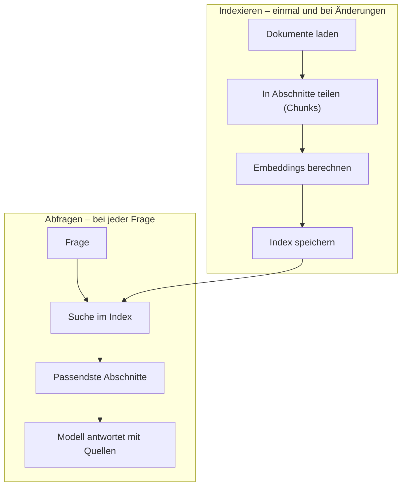

:::tldr
Ein Sprachmodell weiss viel – aber nichts über **deine** Dokumente, nichts Aktuelles, und es erfindet im Zweifel selbstsicher. **RAG** (Retrieval-Augmented Generation) löst das wie eine **Prüfung mit offenem Buch**: Vor jeder Antwort werden die passenden Stellen aus deinen Unterlagen **gesucht** und dem Modell **mitgegeben**; es antwortet daraus, mit Quellenangabe. Das Herzstück der Suche sind **Embeddings**: Sie verwandeln Text in Zahlen, sodass **ähnliche Bedeutungen nahe beieinander liegen** – eine Landkarte der Bedeutungen.
:::

:::bildlich Prüfung mit offenem Buch und Bibliothekar
Bei einer Prüfung **ohne** Unterlagen schreibt man, was man noch zu wissen glaubt – manchmal richtig, manchmal plausibel erfunden. Bei einer Prüfung **mit offenem Buch** schlägt man nach. RAG geht noch einen Schritt weiter: Ein **Bibliothekar** legt dir zu jeder Frage die fünf passendsten Seiten hin, und du antwortest daraus – mit Seitenangabe.
:::

## Wie RAG abläuft

1. **Indexieren:** Dokumente werden in Abschnitte (**Chunks**) geteilt, jeder Abschnitt bekommt ein Embedding, alles kommt in einen Suchindex.
2. **Abfragen:** Die Frage bekommt ebenfalls ein Embedding; der Index liefert die ähnlichsten Abschnitte; das Modell antwortet daraus und nennt die Quellen.

## Embeddings: eine Landkarte der Bedeutungen

Ein **Embedding** ist eine Liste von Zahlen (ein Vektor), die die **Bedeutung** eines Textes beschreibt. Texte mit ähnlicher Bedeutung bekommen ähnliche Vektoren – sie liegen auf der «Landkarte» nahe beieinander, auch wenn sie andere Wörter verwenden.

| Frage | Passender Abschnitt | Warum gefunden |
|---|---|---|
| «Wie lange habe ich Zeit zum Kündigen?» | «Die Kündigungsfrist beträgt drei Monate auf Ende eines Quartals.» | gleiche Bedeutung, andere Wörter |
| «Vierbeiner in der Mietwohnung?» | «Die Haltung von Hunden und Katzen bedarf der Zustimmung der Vermieterin.» | Bedeutungsnähe «Vierbeiner» – «Hunde und Katzen» |

:::falle Vektorsuche findet keine Codes
Embeddings sind stark bei **Bedeutung**, aber schwach bei **exakten Zeichenfolgen**: Artikelnummern, Fehlercodes, Namen, Paragrafen. Fragt jemand nach «Fehlercode XR-204», findet die Vektorsuche womöglich allgemeine Abschnitte über Fehlercodes – aber nicht genau diesen. Dafür braucht es zusätzlich eine **Volltextsuche** (z. B. BM25). Die Kombination heisst **Hybrid-Suche** und ist in der Praxis Standard (Lektion [RAG optimieren](#/l/ai-memory/rag-optimieren)).
:::

## Wann RAG – und wann nicht

| Situation | Empfehlung |
|---|---|
| Wenige, stabile Dokumente, die zusammen in den Prompt passen | **direkt in den Prompt**, mit Prompt Caching – einfacher als RAG |
| Hunderte oder tausende Dokumente | **RAG** |
| Bestand ändert sich laufend | **RAG** – neue Dokumente werden nachindexiert, ohne Training |
| Antworten müssen Quellen nennen | **RAG** |
| Modell soll einen Stil lernen | **kein RAG** – das ist Verhalten, nicht Wissen |

:::gem RAG lernt nicht
RAG sucht bei **jeder** Frage neu zusammen. Es wird nicht klüger, wenn viele Fragen gestellt werden, und Widersprüche zwischen Dokumenten bleiben bestehen. Wer will, dass Wissen mit der Zeit **wächst und sich ordnet**, stellt neben RAG eine gepflegte Wissensbasis – etwa ein Wiki, in das gute Antworten zurückfliessen (Lektion [Wissensarchitektur wählen](#/l/ai-memory/wissensarchitektur)).
:::

:::berater Im Kundengespräch
Viele Kunden sagen «Wir brauchen ein eigenes KI-Modell mit unseren Daten» und meinen RAG. Die Klärung in einem Satz: «Wir trainieren kein Modell, sondern geben dem bestehenden bei jeder Frage die passenden Seiten aus Ihren Unterlagen mit – darum bleibt es aktuell und kann Quellen nennen.» Wichtiger Zusatz: Auch Embeddings von Personendaten sind **keine Anonymisierung**; wer Personendaten indexiert, muss die Datenfrage klären.
:::

:::spickzettel
- **RAG** = vor der Antwort passende Stellen **suchen und mitgeben** → Prüfung mit offenem Buch
- Zwei Phasen: **Indexieren** (laden → chunken → embedden → speichern) und **Abfragen** (suchen → mitgeben → antworten mit Quellen)
- **Embedding** = Zahlenvektor für Bedeutung; ähnlich = **nahe** auf der Landkarte
- Vektorsuche: **Bedeutung**; Volltext: **exakte Begriffe** → zusammen **Hybrid**
- RAG für **grosse, sich ändernde** Bestände mit **Quellenpflicht**; kleine, stabile Basis → **direkt in den Prompt** mit Caching
- RAG **lernt nicht**; für wachsendes Wissen gepflegte Wissensbasis daneben
- Embeddings sind **nicht anonym**
:::

:::selbstcheck 3
