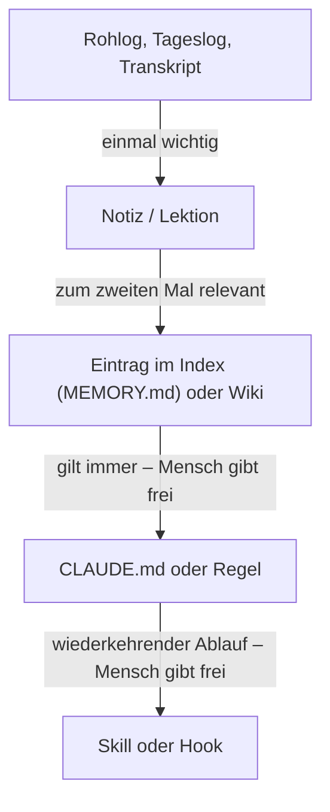

:::tldr
Claude hat je nach Oberfläche verschiedene Gedächtnisse. In der **App**: Memory pro Projekt, Chat-Suche, Projektanweisungen und -wissen. In **Claude Code**: die **`CLAUDE.md`** (schreibt der Mensch), Regeln in `.claude/rules/` und **Auto Memory** (schreibt Claude selbst, Index `MEMORY.md`). In der **API**: das **Memory Tool**, bei dem deine Anwendung speichert. Für alle gilt: **Was immer geladen wird, bleibt klein** (rund 200 Zeilen), **jeder Eintrag hat Datum und Quelle**, **Mensch und Agent schreiben getrennt**, und regelmässiges **Konsolidieren** verhindert, dass Memory zu einem Haufen widersprüchlicher Post-its wird.
:::

:::bildlich Pinnwand, Handbuch und Notizbuch
Ein gut organisiertes Büro hat drei Ablagen: das **Handbuch** mit verbindlichen Regeln (schreibt die Leitung – `CLAUDE.md`), das **Notizbuch** jeder Mitarbeiterin mit eigenen Erfahrungen (schreibt sie selbst – Auto Memory) und die **Pinnwand**, auf der nur das Wichtigste hängt (der Index, der immer geladen wird). Einmal pro Woche wird die Pinnwand aufgeräumt – und was sich bewährt hat, wandert nach Rücksprache ins Handbuch.
:::

## Die Gedächtnisse im Überblick (Stand 27.11.2026)

| Funktion | Wo | Wer schreibt | Typ |
|---|---|---|---|
| Memory der App | Claude-App | Claude | semantisch, pro Projekt getrennt, einsehbar und abschaltbar |
| Chat-Suche | Claude-App | – | episodisch: frühere Chats durchsuchen |
| Projektanweisungen und -wissen | Claude-App | Mensch | prozedural und semantisch |
| **`CLAUDE.md`** | Claude Code | **Mensch** | prozedural: Regeln, Befehle, Konventionen |
| `.claude/rules/*.md` | Claude Code | Mensch | prozedural, mit `paths` nur bei passenden Dateien geladen |
| **Auto Memory** (`MEMORY.md`) | Claude Code | **Claude** | semantisch und episodisch: Lernnotizen pro Repository |
| Memory Tool | Claude-API | Claude, gespeichert von **deiner App** | beliebig, Dateien unter `/memories` |
| Memory Stores | Managed Agents | Claude | geteilte Dokumente für mehrere Agenten |

## Claude Code im Detail

**`CLAUDE.md`** – die Anweisungen des Menschen (ausführlich in der Lektion [CLAUDE.md](#/l/claude-code/claude-md)):
- Ebenen: Organisation → persönlich (`~/.claude/CLAUDE.md`) → Projekt → lokal (`CLAUDE.local.md`, nicht einchecken).
- **Unter 200 Zeilen** pro Datei anpeilen; was nur für einen Teil gilt, in eine Regel mit `paths`.
- Sie ist **Kontext, keine Durchsetzung** – was zwingend gelten muss, gehört in Einstellungen oder Hooks.

**Auto Memory** – Claudes eigene Notizen:
- Ort: `~/.claude/projects/<projekt>/memory/` mit `MEMORY.md` als **Index** (eine Zeile pro Eintrag) und einer Datei pro Thema.
- Geladen werden in jede Sitzung die **ersten 200 Zeilen oder 25 KB** von `MEMORY.md`, je nachdem, was zuerst erreicht ist; Themendateien liest Claude bei Bedarf.
- **Maschinenlokal:** nicht zwischen Rechnern geteilt, nicht im Repository.
- Steuern mit `/memory` (anzeigen, ein/aus) oder `autoMemoryEnabled: false`.
- «Merk dir: immer pnpm» landet im Auto Memory; «schreib das in die CLAUDE.md» ist eine Anweisung.

:::falle Wichtige Entscheide nur im Auto Memory
Auto Memory ist bequem – aber es liegt **nur auf diesem Rechner**, ist für das Team unsichtbar und geht beim Rechnerwechsel verloren. Entscheide, die das Projekt betreffen («Wir verwenden Postgres statt MongoDB, weil …»), gehören deshalb als kurze Entscheidungsnotiz **ins Repository** (z. B. `docs/decisions/`), wo sie geprüft, geteilt und versioniert werden.
:::

## Pflege: damit Memory besser statt nur grösser wird

**Hygieneregeln:**
- **Index klein halten:** Was immer geladen wird, bleibt unter rund 200 Zeilen; Details in Themendateien.
- **Datum, Quelle, Geltungsbereich** bei jedem Eintrag. Ändert sich ein Fakt, wird er **ersetzt**, nicht ergänzt – die alte Fassung bleibt in Git.
- **Getrennte Besitzer:** Der Mensch besitzt `CLAUDE.md` und Regeln, der Agent seine Notizen.
- **Regelmässig konsolidieren:** wöchentlich oder alle zwei Wochen Duplikate zusammenführen, Widersprüche auflösen, Veraltetes archivieren – gern als geplanter Lauf, der einen Vorschlag zur Freigabe macht.

**Beförderungsleiter** – Bewährtes steigt eine Stufe auf:

Agenten **schlagen vor**, Menschen **entscheiden** ab der Stufe `CLAUDE.md`. Beim Befördern wird die untere Stufe aufgeräumt.

:::gem Memory ist ein Angriffsweg
Eine [[Prompt Injection]], die es ins Memory schafft, wirkt in **jeder künftigen Sitzung** – man spricht von **Memory Poisoning**. Darum: Herkunft fremder Inhalte markieren, fremden Text nie als Anweisung speichern, **keine Secrets** ins Memory, Schreibzugriff des Agenten auf einen Ordner begrenzen und Beförderungen in Regeln nur nach menschlicher Prüfung. Beim Memory Tool der API zusätzlich: Pfade ausserhalb von `/memories` ablehnen und pro Nutzer trennen.
:::

:::berater Im Kundengespräch
Wenn ein Team klagt «Claude macht immer wieder denselben Fehler», ist die Frage: **Wo ist die Korrektur gelandet?** Im Chat (weg), im Auto Memory eines Rechners (nur dort) oder in der `CLAUDE.md` des Repos (für alle)? Die Faustregel fürs Team: Dieselbe Korrektur zum zweiten Mal → in die `CLAUDE.md` oder eine Regel. Ein mehrstufiger Ablauf, der immer wieder erklärt wird → Skill. Etwas, das zwingend gelten muss → Hook oder Einstellung.
:::

:::spickzettel
- App: **Memory pro Projekt**, Chat-Suche, Projektanweisungen und -wissen
- Claude Code: **`CLAUDE.md`** (Mensch, < 200 Zeilen) · **Rules** mit `paths` · **Auto Memory** (Claude)
- Auto Memory: `~/.claude/projects/<projekt>/memory/MEMORY.md`, lädt **200 Zeilen / 25 KB**, **maschinenlokal**
- API: **Memory Tool**, deine App speichert unter `/memories` – Pfade prüfen, pro Nutzer trennen
- Pflege: **Index klein**, **Datum + Quelle**, **ersetzen statt anhängen**, **Git**, **konsolidieren**
- **Beförderungsleiter**: Rohlog → Notiz → Index → CLAUDE.md/Regel → Skill/Hook; Mensch gibt frei
- Entscheide ins **Repository**, nicht nur ins Auto Memory
- **Memory Poisoning**: keine Secrets, Herkunft markieren, Schreibrechte begrenzen
:::

:::selbstcheck 3
