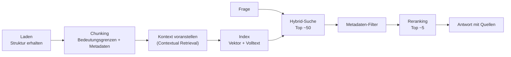

:::tldr
Ein RAG-Prototyp ist in einem Nachmittag gebaut – ein verlässliches RAG nicht. Die grössten Hebel in der Reihenfolge ihrer Wirkung: **sauberes Chunking** an Bedeutungsgrenzen mit **Metadaten**, **Hybrid-Suche** (Vektor **und** Volltext), **Reranking** der Top-Treffer und **Contextual Retrieval**, bei dem jeder Abschnitt vor dem Indexieren einen kurzen Satz Dokumentkontext bekommt. Anthropic berichtet, dass Contextual Retrieval die fehlgeschlagenen Suchen um **49 %** senkt, zusammen mit Reranking um **67 %**. Und: Viele RAG-Probleme sind **stille Fehler** beim Embedding, die keine Fehlermeldung erzeugen.
:::

:::bildlich Grob ins Regal greifen, dann aufschlagen
Ein guter Bibliothekar greift zuerst **grob** ins richtige Regal und zieht fünfzig Bücher heraus, die passen könnten – nach Stichwort **und** nach Thema (Hybrid-Suche). Dann schlägt er jedes kurz auf und legt dir nur die **fünf besten** hin (Reranking). Und weil auf jedem Buchrücken steht, aus welcher Reihe und welchem Jahr es stammt, verwechselt er nichts (Metadaten, Contextual Retrieval).
:::

## Die Pipeline mit ihren Hebeln

## 1. Laden und Chunking

- **Laden mit Struktur:** PDFs und Webseiten so umwandeln, dass **Überschriften und Tabellen** erhalten bleiben. Eine zerrissene Tabelle ist für jedes Modell unlesbar.
- **An Bedeutungsgrenzen schneiden:** Überschrift, Absatz, Abschnitt – nicht stur alle 500 Zeichen. Faustregel **200–500 Tokens** pro Chunk mit **10–20 % Überlappung**.
- **Semantisches Chunking:** schneiden, wo das Thema wechselt; jeder Chunk ist dann ein geschlossener Gedanke.
- **Metadaten mitführen:** Quelle, Datum, Abteilung, Sprache, Gültigkeit. Sie ermöglichen **Filter** («nur gültige Reglemente», «nur Kanton Bern») und **Zitate**.

## 2. Hybrid-Suche

| Suchart | Stark bei | Schwach bei |
|---|---|---|
| **Vektor** (Embeddings) | Bedeutung, Synonyme, Umschreibungen | Codes, Namen, Nummern |
| **Volltext** (BM25) | exakte Begriffe, IDs, Paragrafen | Umschreibungen |
| **Hybrid** | beides – Ergebnisse werden zusammengeführt (Rank Fusion) | – |

Hybrid ist **Standard, nicht Kür**.

## 3. Reranking

Die Suche holt grob die **Top ~50**. Ein **Reranker** (Cross-Encoder) liest dann Frage und jeden Kandidaten **zusammen** und behält die echten **Top ~5**. Das ist langsamer als die Vektorsuche und darum nur auf die Vorauswahl anzuwenden – bringt aber oft mehr als ein grösseres Sprachmodell.

## 4. Contextual Retrieval

Ein Abschnitt wie «Der Umsatz stieg um 3 % gegenüber dem Vorquartal» ist allein nutzlos: Welche Firma, welches Quartal? Bei **Contextual Retrieval** schreibt ein Sprachmodell vor dem Indexieren **ein, zwei Sätze Kontext** aus dem Gesamtdokument davor: «Dieser Abschnitt stammt aus dem Q3-Bericht 2026 der Muster AG, Bereich Schweiz.» Der Kontext fliesst in Embedding **und** Volltextindex. Die Zusatzkosten beim Indexieren lassen sich mit **Prompt Caching** des Gesamtdokuments stark senken.

:::falle Stille Fehler bei Embeddings
Viele RAG-Systeme liefern schlechte Treffer, ohne dass irgendwo ein Fehler erscheint. Häufige Ursachen:
- **Fehlende Präfixe:** Manche Embedding-Modelle erwarten «query:» vor der Frage und «passage:» vor dem Dokument. Ohne sinkt die Trefferquote still.
- **Zu lange Chunks:** Über der maximalen Eingabelänge des Modells wird **still abgeschnitten** – der Rest des Abschnitts ist unsichtbar.
- **Falsches Distanzmass** oder fehlende Normalisierung zwischen Modell und Datenbank.
- **Modell gewechselt, Index nicht:** Frage und Index müssen mit **demselben** Modell eingebettet sein. Modell-ID und Version im Index speichern; ein Wechsel heisst **alles neu einbetten**.
- **Nur englisches Modell** für deutsche Texte – für Deutsch ein mehrsprachiges Modell wählen und an eigenen Fragen testen.
:::

## Weitere Techniken – erst bei Bedarf

| Technik | Idee | Wann |
|---|---|---|
| Query Rewriting / Multi-Query | Frage umformulieren oder auffächern | vage oder mehrteilige Fragen |
| HyDE | Modell entwirft eine plausible Antwort, gesucht wird damit | kurze Fragen, lange Dokumente |
| Parent-Child | in kleinen Chunks suchen, den grösseren Abschnitt liefern | präzise Treffer, aber Kontext nötig |
| GraphRAG | Entitäten und Beziehungen als Graph | Fragen über Zusammenhänge im ganzen Bestand |
| Agentic RAG | ein Agent entscheidet, ob, wo und wie oft er sucht | komplexe Recherchen |

## Wo der Index liegt

| Situation | Wahl |
|---|---|
| Ausprobieren, kleine Mengen | Chroma oder sqlite-vec |
| Postgres ist schon da, bis einige Millionen Vektoren | **pgvector** |
| Produktion mit Filtern und echter Last | **Qdrant** (oder Weaviate, Milvus) |
| Kein eigener Betrieb gewünscht | verwaltete Dienste (Datenstandort prüfen) |

:::gem Mit dem Einfachsten beginnen, mit Messungen eskalieren
Die bewährte Reihenfolge: **Hybrid + Reranking** zuerst, dann **Contextual Retrieval**, dann – nur wenn ein Testset eine Lücke zeigt – die fortgeschrittenen Techniken. Jede Änderung wird **gemessen** (Lektion [RAG-Qualität messen](#/l/ai-memory/rag-messen)), sonst optimiert man nach Gefühl.
:::

:::berater Im Kundengespräch
Wenn ein Kunde sagt «Unser RAG findet die falschen Dokumente», prüfst du in dieser Reihenfolge: (1) Wie wird gechunkt – zerrissene Tabellen, harte Schnitte? (2) Gibt es Metadaten und Filter? (3) Nur Vektor oder Hybrid? (4) Gibt es Reranking? (5) Stimmen Präfixe, Längen und Modellversion der Embeddings? In den meisten Projekten liegt die Ursache in den ersten zwei Punkten – nicht beim Sprachmodell.
:::

:::spickzettel
- **Laden mit Struktur**; Chunking an **Bedeutungsgrenzen**, ~**200–500 Tokens**, **10–20 % Überlappung**
- **Metadaten** (Quelle, Datum, Gültigkeit …) für **Filter** und **Zitate**
- **Hybrid** = Vektor (Bedeutung) + **BM25** (exakte Begriffe) – Standard
- **Reranking**: Top ~50 → Cross-Encoder → **Top ~5**
- **Contextual Retrieval**: 1–2 Sätze Kontext pro Chunk; Fehlschläge **−49 %**, mit Reranking **−67 %**; Kosten mit **Caching** senken
- Stille Fehler: **Präfixe**, **Längenlimit**, **Distanzmass**, **Modellversion**, **englisches Modell für Deutsch**
- Index: Chroma/sqlite-vec (klein) · **pgvector** (Postgres da) · **Qdrant** (Produktion)
- Einfach beginnen, **mit Messungen eskalieren**
:::

:::selbstcheck 3
