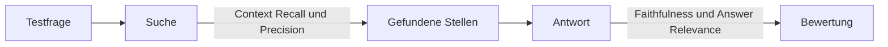

:::tldr
Ein RAG-System kann an **zwei Stellen** versagen: Die **Suche** findet die richtigen Abschnitte nicht – oder das **Modell** macht aus guten Abschnitten eine falsche Antwort. Darum misst man beides getrennt. Für die Suche: **Context Recall** (wurde alles Nötige gefunden?) und **Context Precision** (waren die Treffer relevant?). Für die Antwort: **Faithfulness** (ist sie durch die Quellen gedeckt?) und **Answer Relevance** (beantwortet sie die Frage?). Grundlage ist ein **Testset aus 20–50 echten Fragen** mit bekannten Soll-Quellen – inklusive Fragen, auf die es **keine** Antwort gibt.
:::

:::bildlich Bibliothekar und Referent getrennt prüfen
Wenn ein Vortrag falsch war, gibt es zwei Verdächtige: Hat der **Bibliothekar** die falschen Bücher gebracht – oder hat der **Referent** die richtigen Bücher falsch wiedergegeben? Wer nur die Note für den Vortrag kennt, weiss nicht, wen er schulen muss. Darum prüft man beide getrennt.
:::

## Die vier Kennzahlen

| Kennzahl | Frage | Prüft | Typische Ursache bei schlechtem Wert |
|---|---|---|---|
| **Context Recall** | Wurden alle nötigen Stellen gefunden? | Suche | Chunking, Embedding-Modell, fehlende Volltextsuche |
| **Context Precision** | Waren die gefundenen Stellen relevant, und standen die richtigen oben? | Suche | kein Reranking, fehlende Filter |
| **Faithfulness** | Ist jede Aussage der Antwort durch die Quellen gedeckt? | Antwort | Prompt erlaubt Ergänzungen aus dem Gedächtnis, kein «nicht gefunden» |
| **Answer Relevance** | Beantwortet die Antwort die gestellte Frage? | Antwort | Prompt, Format, Frage missverstanden |

## Das Testset

1. **20–50 echte Fragen** sammeln – aus Support-Tickets, Mails, Gesprächen. Keine erfundenen Lehrbuchfragen.
2. Zu jeder Frage die **Soll-Quellen** festhalten (welches Dokument, welcher Abschnitt) und eine **Referenzantwort**.
3. **Fragen ohne Antwort** im Bestand aufnehmen. Das System soll dort «nicht gefunden» sagen, statt zu erfinden.
4. **Kategorien** vergeben (z. B. Mietrecht, Nebenkosten, Hausordnung), um Ergebnisse pro Bereich zu sehen.
5. **Nicht** dieselben Fragen als Beispiele in den Prompt legen.

## Wie bewertet wird

| Prüfung | Wie | Werkzeug |
|---|---|---|
| Soll-Quelle unter den Top-k? (Recall@k) | **Code**: Quellen-IDs vergleichen | eigenes Skript |
| Antwort durch Quellen gedeckt? | **Modell als Prüfer** mit Rubrik: Aussagen zerlegen, jede gegen die Quellen prüfen | Ragas, DeepEval, eigener [[LLM-as-Judge]] |
| «Nicht gefunden» bei Fragen ohne Antwort? | **Code** oder Prüfer | eigenes Skript |
| Prüfer verlässlich? | **Mensch** bewertet 20–30 Fälle zum Eichen | – |

:::falle Nur die Endantwort bewerten
Wer nur fragt «War die Antwort gut?», sieht eine Zahl, aber keine Ursache. Sinkt die Qualität nach einer Änderung, weiss niemand, ob die **Suche** oder die **Antwort** schlechter wurde. Und ein Wechsel des Sprachmodells hilft nichts, wenn die richtigen Stellen gar nicht gefunden werden – was häufig der Fall ist. Erst die getrennten Kennzahlen zeigen, **wo** der Hebel liegt.
:::

## Mit dem Testset optimieren

Jede Änderung läuft gegen **dasselbe** Testset:

| Änderung | erwartete Wirkung |
|---|---|
| Chunking an Überschriften statt fix | Context Recall ↑ |
| Hybrid statt nur Vektor | Recall ↑ bei Codes, Namen, Paragrafen |
| Reranking ergänzt | Context Precision ↑ |
| Contextual Retrieval | Recall und Precision ↑ |
| Prompt: «nur aus den Quellen, sonst ‹nicht gefunden›» | Faithfulness ↑ |
| anderes Embedding-Modell | alles neu einbetten, dann Recall vergleichen |

Bei kleinen Testsets sind Unterschiede von wenigen Prozentpunkten oft Zufall. Aussagekräftiger ist der **gepaarte Vergleich**: Wie viele Fragen löst **nur** die neue Version, wie viele **nur** die alte (Lektion [Prompts testen](#/l/prompting/prompts-testen))?

:::gem Ergebnisse pro Kategorie
Ein Durchschnitt von 85 % kann verbergen, dass eine ganze Kategorie bei 40 % liegt – etwa alle Fragen zu Tabellen in PDFs. Ergebnisse **pro Kategorie** zeigen solche Lücken sofort und sagen, wo sich die Arbeit lohnt.
:::

:::berater Im Kundengespräch
«Unser RAG funktioniert eigentlich gut» heisst meistens: Niemand hat gemessen. Ein Testset mit 30 echten Fragen ist in einem Tag gebaut und bringt drei Dinge: eine Ausgangszahl für die Abnahme, eine Diagnose, **wo** es hakt (Suche oder Antwort), und eine Absicherung gegen Verschlechterungen bei jeder späteren Änderung – neues Modell, neue Dokumente, neuer Prompt.
:::

:::spickzettel
- Zwei Fehlerquellen: **Suche** und **Antwort** → getrennt messen
- Suche: **Context Recall** (alles gefunden?) · **Context Precision** (relevant und oben?) · Recall@k
- Antwort: **Faithfulness** (durch Quellen gedeckt?) · **Answer Relevance** (Frage beantwortet?)
- Testset: **20–50 echte Fragen**, **Soll-Quellen**, Referenzantwort, **Fragen ohne Antwort**, Kategorien
- Bewerten: **Code** für Quellen, **LLM-as-Judge** für Faithfulness, **Mensch** zum Eichen; Ragas, DeepEval
- Jede Änderung gegen **dasselbe** Testset, **gepaart** vergleichen, Ergebnisse **pro Kategorie**
:::

:::selbstcheck 3
