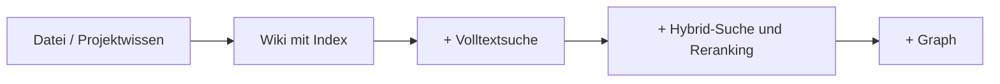

:::tldr
Es gibt nicht «die» Wissenslösung. Vier Bausteine decken fast alle Fälle ab: **Projektwissen** direkt im Prompt (klein, stabil), ein **gepflegtes Wiki** als Markdown in Git (wachsendes, geordnetes Wissen), **RAG** (tausende Dokumente, Suche mit Quellen) und ein **Knowledge Graph** (Fragen über Zusammenhänge). Die Faustregel: **das Einfachste nehmen, das funktioniert**, und erst eskalieren, wenn Messungen es verlangen. Ebenso wichtig wie die Technik sind **Pflege** (wer schreibt, wer räumt auf, wer gibt frei) und **Datenschutz** – denn eine Wissensbasis ohne Eigentümer verkommt, und eine mit Personendaten ohne Zweck und Löschfrist ist ein Risiko.
:::

:::bildlich Vom Ordner zur Bibliothek
Ein kleines Team braucht einen **gut sortierten Ordner** (Projektwissen). Wächst das Wissen, braucht es ein **Handbuch**, das jemand pflegt (Wiki). Bei tausenden Dokumenten braucht es einen **Bibliothekar** mit Katalog (RAG). Und wer wissen will, **wer mit wem wann was** entschieden hat, braucht eine **Landkarte der Beziehungen** (Graph). Niemand baut für fünf Ordner eine Nationalbibliothek.
:::

## Die vier Bausteine

| Baustein | Gut für | Grenze | Aufwand |
|---|---|---|---|
| **Projektwissen / Prompt** | wenige, stabile Dokumente; Regeln, Vorlagen | Kontextgrösse, Kosten pro Aufruf (mit Caching gering) | sehr gering |
| **Gepflegtes Wiki / Vault** (Markdown in Git) | wachsendes Wissen, das sich ordnen soll; Entscheide, Lektionen, Konzepte | ohne Suchindex etwa einige hundert Seiten | gering bis mittel, braucht Pflege |
| **RAG** | tausende Dokumente, laufende Änderungen, Quellenpflicht | lernt nicht; Qualität hängt an Aufbereitung | mittel bis hoch |
| **Knowledge Graph / GraphRAG** | Zusammenhänge, Mehrfaktenfragen, Fragen über den ganzen Bestand | Aufbau und Pflege aufwendig; bei Detailfragen ist klassisches RAG oft besser | hoch |

Jeder Schritt nach rechts nur, wenn ein **Testset** zeigt, dass der vorherige nicht reicht.

## Das gepflegte Wiki: wachsendes Wissen

Ein Ansatz, der 2026 viel Beachtung fand, ist das **LLM Wiki** nach Andrej Karpathy: Statt bei jeder Frage aus Rohdokumenten neu zu suchen, schreibt das Modell ein **verlinktes Wiki** und hält es aktuell.

- **Drei Ebenen:** unveränderliche **Rohquellen** → vom Modell geschriebenes **Wiki** (Zusammenfassungen, Konzept- und Vergleichsseiten) → eine **Schema-Datei** mit Struktur und Regeln (z. B. `CLAUDE.md`).
- **Drei Abläufe:** **Ingest** (Quelle einarbeiten, Widersprüche markieren), **Query** (aus dem Wiki antworten, gute Antworten zurückschreiben), **Lint** (regelmässig Widersprüche, verwaiste Seiten, Lücken suchen).
- **Schreibrechte begrenzen:** Das Modell schreibt frei nur in Eingangsordner, Notizen und neue Seiten; kuratierte Seiten und die Schema-Datei nur nach Freigabe.

Damit **wächst** Wissen mit jeder Frage – anders als bei RAG, das jedes Mal neu sucht. Für sehr grosse Bestände kombiniert man beides: Wiki für das Kernwissen, RAG für die Rohdokumente.

:::gem Markdown in Git als Quelle der Wahrheit
Egal welche Architektur: Die **Quelle der Wahrheit** sollte lesbares Markdown (oder die Originaldokumente) in einem versionierten Speicher sein. Ein Vektorindex oder Graph ist **abgeleitet** und jederzeit neu erzeugbar. So bleibt jede Änderung nachvollziehbar und umkehrbar, und ein Wechsel der Technik zerstört kein Wissen.
:::

## Pflegeprozess

| Frage | Antwort im Projekt |
|---|---|
| **Wer ist Eigentümer?** | eine Person oder Rolle pro Wissensbereich |
| **Wie kommt Neues hinein?** | definierter Ingest: Quelle, Datum, Geltungsbereich, Prüfung |
| **Wer schreibt was?** | Menschen: Regeln und kuratierte Seiten; Agent: Notizen, Entwürfe, Vorschläge |
| **Wie wird aufgeräumt?** | regelmässige Konsolidierung (z. B. alle zwei Wochen) als Vorschlag zur Freigabe |
| **Wann verfällt etwas?** | Ablaufdaten für sich ändernde Fakten; Veraltetes archivieren |
| **Woran sieht man Erfolg?** | Testset mit Fragen, die das Wissen voraussetzen; wiederholte Fehler sinken |

:::falle Datenschutz erst am Schluss
Eine Wissensbasis sammelt schnell Personendaten: Namen in Protokollen, Kundendetails in Mails, Gesundheitsangaben in Dossiers. Unter dem **revDSG** braucht jede Bearbeitung einen **Zweck**, sie muss **verhältnismässig** sein (nur was nötig ist), und Daten dürfen nicht länger als nötig aufbewahrt werden. Für eine Wissensarchitektur heisst das:
- **Minimieren:** keine Personendaten ins Wissen, die nicht gebraucht werden; besonders schützenswerte Daten (Gesundheit u. a.) möglichst gar nicht.
- **Zugriff steuern:** nicht jede Person und jeder Agent sieht alles; Metadaten-Filter nach Berechtigung.
- **Löschen können:** Löschfristen, und ein Löschweg, der auch **Index und Embeddings** erfasst – Embeddings sind nicht anonym.
- **Datenstandort:** Wo laufen Embedding-Modell, Vektordatenbank und Sprachmodell? Bei Berufsgeheimnis lokale Embeddings und Speicher in der Schweiz bzw. EU prüfen.
:::

## Entscheidung an einem Beispiel

| Kunde | Bedarf | Empfehlung |
|---|---|---|
| Treuhandbüro, 10 Personen | Reglemente, Vorlagen, Checklisten (≈ 50 Dokumente) | **Projektwissen** in Claude-Projekten bzw. Skills, Caching; keine Suchinfrastruktur |
| Softwarefirma, 40 Personen | Architekturentscheide, Lektionen, Abläufe | **Wiki im Repository** (Entscheide, Lektionen) + `CLAUDE.md` + Konsolidierung |
| Versicherung | 20 000 Policen und Bedingungen, Quellenpflicht | **RAG** mit Hybrid, Reranking, Metadaten-Filter, Testset; Datenschutzprüfung |
| Beratung mit vielen Mandaten | «Welche Projekte hatten ähnliche Probleme, wer war beteiligt?» | **Wiki + RAG**, Graph erst bei gemessenem Bedarf |

:::berater Im Kundengespräch
Drei Fragen klären die Architektur in einem Gespräch: **Wer** soll sich erinnern (Menschen im Chat, Claude Code, eine eigene Anwendung)? **Was** soll erinnert werden (Regeln, Fakten, Erlebnisse, Dokumente)? **Wie gross** wird es (Dutzende Notizen oder zehntausende Dokumente)? Die vierte Frage stellst du gleich danach: **Wer pflegt es?** Ohne Antwort darauf ist jede Architektur nach einem Jahr ein Archiv voller Widersprüche.
:::

:::spickzettel
- Bausteine: **Projektwissen** · **Wiki/Vault** · **RAG** · **Graph**
- Faustregel: **Datei → Wiki → Volltext → Hybrid + Rerank → Graph**, nur mit **Messung** eskalieren
- **LLM Wiki**: Rohquellen → Wiki → Schema; **Ingest, Query, Lint**; Wissen **wächst**
- **Quelle der Wahrheit**: Markdown/Originale in **Git**, Index abgeleitet
- Pflege: **Eigentümer**, Ingest-Prozess, **Konsolidierung**, Ablaufdaten, **Testset**
- **revDSG**: Zweck, Minimierung, Zugriff, **Löschen inkl. Embeddings**, Datenstandort, Berufsgeheimnis
- Drei Klärungsfragen: **Wer erinnert sich? Was? Wie gross?** – und **wer pflegt?**
:::

:::selbstcheck 3
