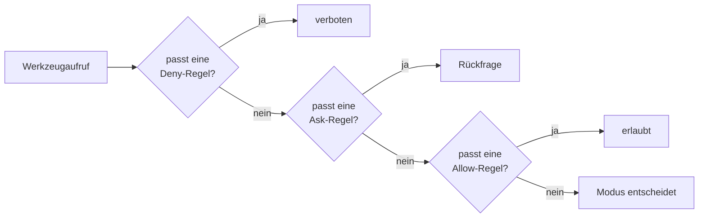

:::tldr
Permission-Regeln in `settings.json` legen pro Werkzeug fest: erlaubt, nachfragen oder verboten. **Deny gewinnt immer.** Der Modus bestimmt, wie viel ohne Rückfrage läuft. Regeln sind stark für Datei-Tools – bei Shell-Befehlen sind sie nur ein Lärmfilter.
:::

## Wo die Regeln stehen

Claude Code liest Einstellungen aus mehreren Dateien. Für Sicherheit ist entscheidend, **wer** eine Datei ändern kann.

| Ebene | Datei | Wer kann sie ändern? | Gilt für |
|---|---|---|---|
| Managed | `/etc/claude-code/managed-settings.json` | nur Admin (sudo) | alle Projekte, nicht überschreibbar |
| User | `~/.claude/settings.json` | du | alle deine Projekte |
| Projekt | `.claude/settings.json` | alle mit Schreibrecht im Repo | dieses Repo, wird geteilt |
| Local | `.claude/settings.local.json` | du (nicht committed) | dieses Repo, nur du |

:::bildlich Hausordnung mit Hierarchie
Die Managed Settings sind die **Gesetze**, die User-Settings deine **persönlichen Regeln**, die Projekt-Settings die **Hausordnung der WG**. Die Hausordnung kann jeder Mitbewohner ändern – auch einer, der dir ein präpariertes Repo unterschiebt. Deshalb gehört Sicherheitsrelevantes nicht (nur) in die Hausordnung.
:::

:::falle Sicherheit nur in Projektdateien
Ein fremdes Repo kann eine `.claude/settings.json` mitbringen, die sich selbst Rechte gibt. Claude Code ignoriert deshalb einige Schlüssel in Projektdateien (etwa `defaultMode: "auto"` oder `"bypassPermissions"`). Trotzdem gilt: Deine Schutzregeln gehören in `~/.claude/settings.json`, für strenge Fälle in Managed Settings.
:::

## Aufbau einer Regel

```json
{
  "permissions": {
    "deny":  ["Read(./.env)", "Read(./.env.*)", "Read(~/.ssh/**)", "Read(~/.aws/**)", "WebFetch"],
    "ask":   ["Bash(git push *)"],
    "allow": ["Bash(npm run test *)", "Bash(git status)", "Bash(git diff *)"]
  }
}
```

Eine Regel besteht aus dem **Werkzeugnamen** und optional einem **Muster** in Klammern: `Read(pfad)`, `Edit(pfad)`, `Bash(befehl *)`, `WebFetch(domain:example.com)`, `mcp__github__*`.

## Die Auswertung: deny → ask → allow

Claude Code prüft in **fester Reihenfolge**: zuerst alle Deny-Regeln, dann Ask, dann Allow. Der erste Treffer entscheidet. Wie spezifisch eine Regel ist, spielt keine Rolle.



Daraus folgen drei Regeln, die du dir merken solltest:

1. **Ein breites Deny lässt sich nicht durch ein engeres Allow aufbrechen.** `deny: ["Read(./secrets/**)"]` plus `allow: ["Read(./secrets/public.txt)"]` – die Datei bleibt gesperrt.
2. **Deny aus jeder Ebene gilt.** Ein Deny in deinen User-Settings kann kein Projekt aufheben.
3. **Deny und explizite Ask-Regeln gelten in jedem Modus**, auch im Bypass-Modus.

:::gem Ein nacktes Deny entfernt das Werkzeug ganz
`"deny": ["WebFetch"]` ohne Klammer nimmt das Werkzeug komplett aus Claudes Kontext. Claude weiss dann gar nicht mehr, dass es existiert – das spart Token und verhindert Versuche. Dasselbe gilt für `"mcp__*"`, um alle MCP-Werkzeuge auszuschalten.
:::

## Pfad-Syntax: die häufigste Fehlerquelle

Pfade in Regeln folgen der gitignore-Syntax – mit einem Detail, das viele übersehen:

| Schreibweise | Bedeutung |
|---|---|
| `//pfad` | absolut ab Wurzel, z. B. `Read(//etc/**)` |
| `~/pfad` | relativ zum Home, z. B. `Read(~/.ssh/**)` |
| `/pfad` | relativ zur **Settings-Datei** – in den User-Settings also `~/.claude/pfad`! |
| `pfad` oder `./pfad` | relativ zum aktuellen Arbeitsordner |

:::falle Der Slash-Irrtum
`"Read(/secrets/**)"` in `~/.claude/settings.json` sperrt **nicht** `/secrets`, sondern `~/.claude/secrets`. Für absolute Pfade braucht es zwei Slashes: `"Read(//secrets/**)"`.
:::

Weitere Details, die in Audits immer wieder auffallen:

- **`Read`-Deny sperrt auch Edit und Write** auf denselben Pfad – aber nicht `NotebookEdit`. Für Pfade, die niemand ändern darf, zusätzlich `Edit(pfad)` sperren.
- **`Write(pfad)` matcht nie.** Für Schreibsperren immer `Edit(pfad)` verwenden.
- **`Read`-Denies wirken auf erkannte Shell-Lesebefehle** wie `cat`, `head`, `sed` – aber nicht auf `grep -r muster .` oder ein Python-Skript, das Dateien öffnet. Dafür braucht es die Sandbox.

## Warum Bash-Regeln keine Grenze sind

`deny: ["Bash(curl *)"]` sieht nach Schutz aus. Es trifft aber nur Befehle, deren Text mit `curl ` beginnt:

```bash
curl https://example.com          # gesperrt
/usr/bin/curl https://example.com # läuft
sh -c 'curl https://example.com'  # läuft
python3 -c "import urllib.request; ..."  # läuft
```

Die offizielle Doku sagt es selbst: Bash-Regeln sind keine Sicherheitsgrenze. Sie taugen als **Lärmfilter** (häufige harmlose Befehle erlauben, damit nicht ständig Rückfragen kommen). Netzsperren gehören in die Sandbox.

:::merke
Für **Datei-Tools** sind Regeln eine echte Grenze. Für **Shell-Befehle** braucht es die Sandbox.
:::

## Die Permission-Modi

Der Modus legt fest, was ohne Rückfrage läuft, wenn keine Regel greift. Du wechselst ihn mit `Shift+Tab` oder per `--permission-mode`.

| Modus | Verhalten | Wofür |
|---|---|---|
| `default` (Manual) | fragt bei Änderungen und Befehlen | sicherer Alltag, fremde Projekte |
| `acceptEdits` | Datei-Änderungen ohne Rückfrage, Befehle fragen | eigenes Projekt, du reviewst den Diff |
| `plan` | nur lesen und planen, nichts ändern | verstehen, Plan erstellen |
| `auto` | ein Klassifikator entscheidet statt du | vertraute Routine – mit Risiko |
| `dontAsk` | was nicht erlaubt ist, wird verweigert statt gefragt | unbeaufsichtigte Läufe, CI |
| `bypassPermissions` | alles ohne Rückfrage (ausser Deny) | **nur** im isolierten Container |

### Der Auto Mode – bequem, aber eine Entscheidung

Seit Claude Code v2.1.283 (Stand November 2026) starten Terminal und VS Code im **Auto Mode**, wenn nichts anderes eingestellt ist. Ein Klassifikator-Modell prüft jeden Schritt und blockiert, was riskant aussieht. Das ist komfortabel – aber eine Prompt Injection, die der Klassifikator durchlässt, läuft ohne deine Freigabe.

Sperren lässt sich der Modus so (in User- oder Managed Settings):

```json
{
  "permissions": {
    "disableAutoMode": "disable",
    "disableBypassPermissionsMode": "disable",
    "defaultMode": "default"
  }
}
```

:::gem VS Code merkt sich den letzten Modus
In der VS-Code-Erweiterung gilt für jede neue Konversation zuerst `claudeCode.initialPermissionMode`, danach der **zuletzt im Indikator gewählte Modus**. Wer einmal Auto gewählt hat, bleibt dort. VS Code liest den Startmodus nie aus Projekt-Settings. Deshalb `claudeCode.initialPermissionMode` in den VS-Code-Einstellungen explizit setzen, z. B. auf `acceptEdits`.
:::

### Geschützte Pfade

Einige Pfade fragt Claude Code in `default` und `acceptEdits` **immer** nach, auch wenn eine Allow-Regel passt: `.git`, `.claude`, `.vscode`, `.devcontainer`, `.mcp.json`, Shell-rc-Dateien, `.gitconfig` und andere. Grund: Wer diese Dateien ändert, kann sich selbst mehr Rechte verschaffen oder Code bei deinem nächsten Shell-Start ausführen.

## Prüfen statt hoffen

Nach jeder Änderung:

1. `/permissions` in der Session zeigt alle aktiven Regeln **mit Herkunft** (welche Datei).
2. `/status` zeigt, welche Settings-Quellen geladen wurden.
3. **Gegenprobe:** Lass Claude eine gesperrte Datei lesen («Lies bitte ~/.ssh/id_ed25519»). Erwartung: Ablehnung ohne Rückfrage.

:::falle Selbst getippte !-Befehle testen nichts
Befehle, die du in der Session mit `!` selbst eingibst, laufen ausserhalb der Regeln und meist ausserhalb der Sandbox. Eine Gegenprobe muss **Claude** ausführen.
:::

:::berater Im Kundengespräch
Viele Teams haben Permissions «irgendwie» eingerichtet, aber nie geprüft. Ein wirkungsvoller Einstieg in jedes Audit: «Darf ich kurz `/permissions` und `/status` auf einem Entwicklerrechner sehen?» Fast immer finden sich Regeln am falschen Ort, `Write(...)`-Regeln ohne Wirkung oder ein Auto Mode, von dem niemand wusste.

Formuliere den Nutzen so: *«Wir verschieben die Sicherheit von ‹wir hoffen, dass jemand die Rückfrage liest› zu ‹es ist technisch ausgeschlossen›.»*
:::

:::spickzettel
- Reihenfolge **deny → ask → allow**, erster Treffer gewinnt, Deny gilt überall und in jedem Modus.
- Sicherheitsregeln in **User**- oder **Managed** Settings, nicht nur im Projekt.
- Pfade: `//absolut`, `~/home`, `/` = relativ zur Settings-Datei, `./` = Arbeitsordner.
- `Write(...)` matcht nie → `Edit(...)`. `Read`-Deny sperrt Edit/Write, nicht NotebookEdit.
- Bash-Regeln = Lärmfilter, keine Grenze → Sandbox.
- Auto Mode bewusst: `disableAutoMode`, in VS Code `initialPermissionMode` setzen.
- Prüfen mit `/permissions`, `/status` und einer Gegenprobe durch Claude.
:::

:::selbstcheck 3
