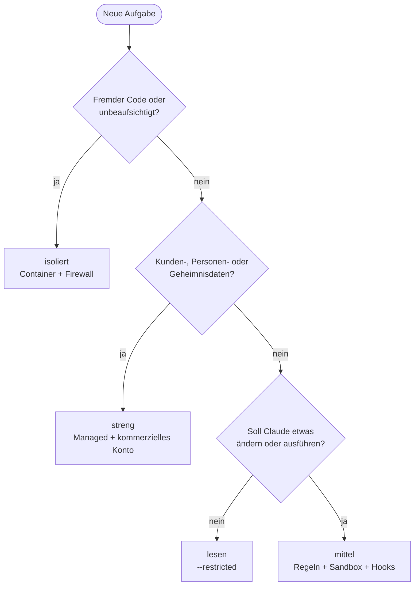

:::tldr
Regeln schützen die Datei-Tools, die Sandbox die Shell, Hooks sind Leitplanken, Managed Settings machen Regeln unveränderbar, und erst ein Container umschliesst den ganzen Prozess. Ein Profi wählt nicht «die stärkste Schicht», sondern **die passende Kombination für die Situation** – und begründet sie in einem Satz.
:::

## Wer deckt was ab?

Die zentrale Tabelle dieses Themas. Lies sie zeilenweise: Was tut Claude Code – und welche Schicht greift dort?

| Was Claude Code tut | Regeln | Sandbox | Hooks | Container |
|---|---|---|---|---|
| Read / Edit / Write | ✅ | ❌ | ✅ | ✅ |
| WebFetch / WebSearch | ✅ | ❌ | ✅ | ✅ |
| Bash-Befehle und Kindprozesse | ⚠️ nur Befehlstext | ✅ | ⚠️ nur Befehlstext | ✅ |
| MCP-Server (lokale Prozesse) | ✅ Aufruf | ❌ | ✅ Aufruf | ✅ |
| Hooks, Statuszeile, LSP | – | ❌ volle Rechte | – | ✅ |
| Selbst getippte `!`-Befehle | ❌ | ❌ meist | ❌ | ✅ |
| **Was ans Modell geht** | ❌ | ❌ | ❌ | ❌ |

Drei Folgerungen:

1. Für die **Datei-Tools** braucht es Regeln.
2. Für **Shell-Befehle** braucht es die Sandbox.
3. Für **alles Übrige** (Hooks, MCP-Server, eigene Befehle) braucht es einen Container.

Und die letzte Zeile gilt für alle: **Keine Isolation ändert, was das Modell liest.** Gegen Datenabfluss ans Modell hilft nur, die Daten gar nicht erst lesbar zu machen.

:::bildlich Gürtel, Hosenträger – und das Gebäude
Regeln sind der **Gürtel**, die Sandbox sind die **Hosenträger**. Beide halten dieselbe Hose, aber an verschiedenen Stellen. Der Container ist das **abgeschlossene Gebäude**: Selbst wenn beides reisst, bleibt der Schaden drinnen. Und die Datenfrage ist die Frage, welche Hose du überhaupt anziehst.
:::

## Hooks: Leitplanken, die immer greifen

Ein [[Hook]] ist ein Skript, das Claude Code an einem festen Punkt automatisch startet. Für Sicherheit zählt vor allem **PreToolUse**: Der Hook läuft vor jedem Werkzeugaufruf, bekommt den Aufruf als JSON und kann ihn blockieren.

```json
{
  "hooks": {
    "PreToolUse": [{
      "matcher": "Read|Edit|Bash",
      "hooks": [{
        "type": "command",
        "command": "\"$CLAUDE_PROJECT_DIR\"/.claude/hooks/block-secrets.sh",
        "timeout": 10,
        "onFailure": "block"
      }]
    }]
  }
}
```

```bash
#!/usr/bin/env bash
# block-secrets.sh – blockiert Zugriffe auf .env und Schlüsseldateien
command -v jq >/dev/null || { echo "jq fehlt" >&2; exit 2; }   # fail-closed
input=$(cat)
target=$(echo "$input" | jq -r '.tool_input.file_path // .tool_input.command // ""')
if echo "$target" | grep -Eq '(\.env|id_ed25519|id_rsa|\.aws/credentials)'; then
  echo "Blockiert: Zugriff auf Secrets ist nicht erlaubt." >&2
  exit 2
fi
exit 0
```

Die Regeln, die du kennen musst:

- **Exit 2 blockiert**, die Meldung auf stderr geht an Claude zurück.
- **Jeder andere Exit-Code – auch 1 – blockiert nicht.** Ein Sicherheits-Hook, der mit `exit 1` endet, erzwingt nichts.
- **`"onFailure": "block"`** (ab v2.1.295) sorgt dafür, dass auch Absturz, Timeout oder kaputtes JSON blockieren. Ohne das Feld läuft der Befehl bei einem kaputten Hook einfach durch.
- Hooks greifen auch bei **Subagents** und – ein Deny aus einem PreToolUse-Hook – selbst im **Bypass-Modus**.

:::falle Hooks sind Leitplanken, keine Wände
Ein Hook prüft Text. `eval`, Variablen oder Base64 umgehen jedes Textmuster. Und Hooks laufen **ausserhalb der Sandbox mit vollen Rechten** – Hook-Code aus einem fremden Repo ist fremder Code mit deinen Rechten. Harte Grenzen gehören in Regeln, Sandbox und Container; Hooks sind die zusätzliche Leitplanke.
:::

:::gem Exit 2 hat bei Stop-Hooks die umgekehrte Wirkung
Bei einem `Stop`-Hook bedeutet Exit 2: «Du darfst noch nicht aufhören.» So lassen sich Qualitäts-Gates bauen, z. B. «erst fertig, wenn alle Tests grün sind». Dasselbe Werkzeug, einmal als Bremse, einmal als Antrieb.
:::

## Managed Settings: Regeln, die niemand aufweicht

[[Managed Settings]] liegen unter Linux und WSL in `/etc/claude-code/managed-settings.json` und sind nur mit `sudo` änderbar. Genau das ist der Schutz: Weder ein Repo noch Claude selbst können sie ändern.

Nur dort wirken einige besonders strenge Schalter:

| Schalter | Wirkung |
|---|---|
| `allowManagedPermissionRulesOnly` | nur Regeln aus Managed gelten, «Ja, nicht mehr fragen» verschwindet |
| `allowManagedHooksOnly` | nur Managed-Hooks laufen |
| `allowManagedMcpServersOnly` | nur freigegebene MCP-Server |
| `sandbox.network.allowManagedDomainsOnly` | nur die zentrale Domain-Liste |

Für eine Einzelperson lohnt sich das bei sensiblen Daten. Der Preis: Lockern geht nur noch mit `sudo`. In Unternehmen verteilt die IT diese Datei zentral – das ist die Grundlage jeder KI-Governance auf Entwicklerrechnern.

## Der Container: der ganze Prozess im Pavillon

Ein [[Devcontainer]] umschliesst Claude Code **vollständig**: Dateien, Shell, Hooks, MCP-Server. Was nicht gemountet ist, existiert im Container nicht. Das ist stärker als jede Sperre.

Was ein Container für KI-Agenten haben muss:

- **Firewall mit Default-Deny** – Anthropic pflegt eine Referenz (`init-firewall.sh` im Repo `anthropics/claude-code/.devcontainer`), die nur Paketquellen, GitHub und die Claude-API erlaubt.
- **Nicht als root** arbeiten.
- **Keine Secret-Mounts**: kein `~/.ssh`, kein `~/.aws`, keine `.env` mit Produktionsschlüsseln.
- **Nie `/var/run/docker.sock` mounten** – damit könnte sich der Agent einen neuen Container ohne Grenzen bestellen.

:::merke
Nur im Container mit Firewall ist `--dangerously-skip-permissions` vertretbar. Und auch dort gilt: Der gemountete Projektordner ist **nicht** geschützt – Git ist das Sicherheitsnetz dafür.
:::

## Die vier Profile

In der Praxis wählst du nicht Schicht für Schicht, sondern ein Profil. Die Begründung passt in einen Satz.

| Profil | Wann | Kern |
|---|---|---|
| **lesen** | Code erklären, Review, fremdes Repo anschauen | `claude --restricted --setting-sources user` – keine Shell, kein WebFetch, Repo-Settings ignoriert |
| **mittel** | eigene Projekte, Alltag | Auto/Bypass gesperrt, Sandbox fail-closed, Deny für Secrets, `strictAllowlist`, Hooks mit `onFailure: block` |
| **streng** | Kunden-, Personen- oder Geheimnisdaten | mittel + Managed Settings, Lesesperre fürs Home, WebFetch/MCP gesperrt, eigene WSL-Distro, kommerzielles Konto |
| **isoliert** | fremder Code, unbekannte Pakete, unbeaufsichtigt, Bypass | ganzer Prozess im Devcontainer mit Firewall oder in einer VM |



:::gem Profile kombinieren sich
Ein fremdes Repo zuerst im Profil **lesen** verstehen lassen, dann zum Ausführen in **isoliert** wechseln. Das ist schneller und sicherer, als von Anfang an alles im Container zu machen – und viel sicherer, als ein fremdes Repo direkt mit `claude` zu öffnen, wo dessen Hooks und `.mcp.json` sofort mitlaufen können.
:::

## Sonderfall: unbeaufsichtigte Läufe

Bei `claude -p` (headless), im Agent SDK, in Cron-Jobs und CI gibt es **keinen Vertrauensdialog**. In einem fremden Ordner laufen dann Hooks, der `env`-Block und `.mcp.json`-Server ohne Rückfrage. Deshalb:

- Im fremden Repo `--setting-sources user` oder `--bare` verwenden.
- **Achtung:** `--bare` lädt auch deine eigenen Hooks nicht – die Grenzen müssen dann in Regeln und Sandbox stecken, mitgegeben per `--settings`.
- Den Modus **ausdrücklich** setzen, z. B. `--permission-mode dontAsk` mit engen `--allowedTools`. Der Standardmodus hat sich zwischen Versionen geändert.
- Ein Budget setzen (`--max-budget-usd`) und den Lauf ins Profil **isoliert** legen.

:::berater So berätst du einen CISO
Ein CISO will keine Werkzeugliste, sondern eine Entscheidungslogik. Zeig ihm die Profiltabelle und sag: *«Wir unterscheiden vier Situationen. Für jede gibt es eine feste Konfiguration, die zentral verteilt und mit Gegenproben nachgewiesen wird. Für Kunden- und Personendaten gilt zusätzlich: nur kommerzielle Konten, Managed Settings, und wo möglich synthetische Testdaten.»*

Erwarte die Frage nach dem **Restrisiko**. Ehrliche Antwort: Kein Profil verhindert, dass das Modell liest, was es lesen darf. Prompt Injection lässt sich nicht vollständig verhindern, nur in ihrer Wirkung begrenzen. Darum: Daten minimieren, Ausgänge schliessen, Menschen vor irreversiblen Aktionen.
:::

:::spickzettel
- Datei-Tools → **Regeln** · Shell → **Sandbox** · alles Übrige → **Container**.
- Nichts davon ändert, **was ans Modell geht**.
- Hooks: **Exit 2** blockiert, Exit 1 nicht · `onFailure: "block"` · Leitplanke, keine Wand.
- Managed Settings = unveränderbar ohne sudo, Basis für Governance.
- Container: Firewall, nicht root, keine Secrets, nie `docker.sock`.
- Profile: lesen · mittel · streng · isoliert – Begründung in einem Satz.
- Headless: kein Vertrauensdialog → `--setting-sources user`/`--bare`, Modus explizit, Budget.
:::

:::selbstcheck 3
