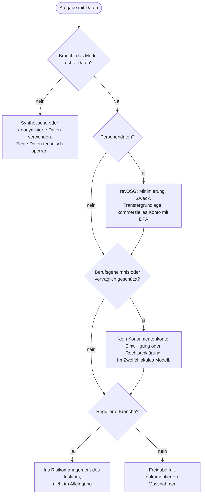

:::tldr
Technische Isolation schützt den Rechner, nicht die Daten, die das Modell liest. Darum steht vor jeder Konfiguration die Frage: **Welche Daten darf das Modell sehen?** Meist lautet die beste Antwort: keine echten. Wo doch, braucht es ein kommerzielles Konto, eine Grundlage für den Transfer und – bei Berufsgeheimnissen – eine rechtliche Abklärung.
:::

:::falle Keine Rechtsberatung
Diese Lektion nennt Prüfpunkte und hilft dir, die richtigen Fragen zu stellen. Sie ersetzt keine rechtliche Beurteilung. Bei Kunden-, Mandats- oder Geheimnisdaten gehört der Datenschutz- oder Rechtsdienst an den Tisch – als Berater sagst du das aktiv.
:::

## Der Kernsatz

Alles, was Claude öffnet oder was im Prompt steht, wird an Anthropic übertragen und dort verarbeitet (Datenspeicherung in den USA). Das gilt im Chat, in Claude Code und über die API gleichermassen. Kein Container und keine Sandbox ändern daran etwas.

:::bildlich Der Dolmetscher im Ausland
Ein LLM ist wie ein hervorragender Dolmetscher, der in einem Büro im Ausland sitzt. Jedes Dokument, das er für dich übersetzen soll, musst du ihm zuschicken. Du kannst dein eigenes Büro noch so gut abschliessen – die Frage ist, **was du in den Umschlag steckst**, unter welchem Vertrag er arbeitet und ob er Kopien behalten darf.
:::

## Der Entscheidungsweg

### 1. Braucht das Modell echte Daten?

Erstaunlich oft nicht. Ein Skript für Lohnabrechnungen, eine Auswertung von Kundendaten, ein Import für ein CRM – all das lässt sich mit **synthetischen Testdaten** entwickeln und testen. Das fertige Skript verarbeitet danach die echten Daten **lokal, ohne Modell**.

:::gem Das stärkste Argument im Kundengespräch
«Das Modell muss Ihre Kundendaten nie sehen. Es schreibt das Werkzeug, Ihre Daten bleiben bei Ihnen.» Dieser Satz entschärft die Mehrheit aller Datenschutz-Diskussionen – und er ist technisch umsetzbar: Ordner mit echten Daten per Permission-Deny und Sandbox-`denyRead` sperren und nur synthetische Daten im Projekt halten.
:::

### 2. Personendaten und das revDSG

Das revidierte Datenschutzgesetz ([[revDSG]], in Kraft seit 1. September 2023) gilt technologieneutral – der EDÖB hält fest, dass es direkt auf KI-Anwendungen anwendbar ist. Für dich als Berater heisst das:

- **Datenminimierung:** nur die Personendaten, die für den Zweck nötig sind.
- **Zweckbindung und Transparenz:** Betroffene müssen erkennen können, wofür ihre Daten verwendet werden.
- **Bekanntgabe ins Ausland:** Die Verarbeitung in den USA ist eine Bekanntgabe ins Ausland und braucht eine Grundlage.

**Zum USA-Transfer (Stand November 2026, volatil):** Seit dem 15. September 2024 gilt das Swiss-U.S. Data Privacy Framework – aber nur für **zertifizierte** US-Unternehmen. Anthropic war nach mehreren unabhängigen Prüfungen im November 2026 **nicht** auf der offiziellen Liste. Der Transfer stützt sich dann auf Standardvertragsklauseln mit Schweizer Zusatz im Data Processing Addendum (DPA). Prüfe den Status vor jedem Projekt selbst auf dataprivacyframework.gov – das kann sich ändern.

### 3. Der Kontotyp entscheidet

| | Konsumentenkonto (Free, Pro, Max) | Kommerziell (Team, Enterprise, API) |
|---|---|---|
| Training mit deinen Daten | nur mit Zustimmung («Help improve Claude») | nein (ausser bewusstes Opt-in) |
| Aufbewahrung | mit Zustimmung bis 5 Jahre, sonst 30 Tage; Feedback-Transkripte 5 Jahre | Standard 30 Tage; Zero Data Retention für geeignete Konfigurationen |
| Vertrag (DPA) | nein | ja |
| Für Kunden- und Personendaten | **ungeeignet** | Voraussetzung |

Wichtig: Auch **Claude Code mit einem Pro- oder Max-Abo** läuft unter den Konsumentenbedingungen. Wer im Unternehmen mit Kundendaten arbeitet, braucht ein kommerzielles Konto – und schickt nie Kundendaten über `/feedback` oder `/bug`.

### 4. Berufsgeheimnisse

- **Art. 321 StGB** schützt Berufsgeheimnisse von u. a. Anwältinnen, Ärzten, Revisoren und ihren Hilfspersonen.
- **Art. 62 DSG** («kleines Berufsgeheimnis») schützt vertrauliche Personendaten in allen Berufen.
- **Art. 13 BGFA** regelt das Anwaltsgeheimnis.

Für solche Daten gilt: nie über ein Konsumentenkonto, vorher Einwilligung oder Rechtsabklärung, anonymisieren – und im Zweifel ein **lokales Modell**. Bei Wissenssystemen (RAG) sollten mindestens Embeddings und Reranking lokal laufen, damit die Dokumente für die Suche den Rechner nicht verlassen.

### 5. Regulierte Branchen

Die **FINMA-Aufsichtsmitteilung 08/2024** erwartet von Beaufsichtigten, dass KI ins Risikomanagement eingebunden ist: klare Zuständigkeiten, ein Inventar der Anwendungen, Tests und Erklärbarkeit. Für Banken, Versicherungen und Vermögensverwalter ist ein KI-Projekt deshalb nie ein Alleingang der Fachabteilung.

## Technische Umsetzung der Datenfrage

Die Entscheidung «Diese Daten darf das Modell nicht sehen» muss technisch durchgesetzt werden:

- Ordner mit Personen- oder Geheimnisdaten per `Read(//pfad/**)` und `Edit(//pfad/**)` sperren, zusätzlich Sandbox-`denyRead` – besser: gar nicht erst im Arbeitsordner ablegen.
- `blockReadsOutsideWorkingDirectories: true`, damit Claude nur das Projekt sieht.
- Den `ide`-MCP-Server sperren, wenn im Editor sensible Dateien offen sein könnten (er gibt Auswahl und offene Dateien weiter).
- Telemetrie reduzieren: `DISABLE_TELEMETRY=1`, `DISABLE_ERROR_REPORTING=1`.
- Eigene Apps: Logs und Traces ohne Personendaten speichern.

## Die Beratung: Restrisiko ehrlich benennen

Auf Stufe Senior Consultant geht es nicht darum, jedes Risiko wegzukonfigurieren, sondern die Geschäftsleitung **entscheidungsfähig** zu machen.

:::berater Die Struktur für das Gespräch mit der Geschäftsleitung
1. **Nutzen zuerst:** Welche Aufgabe wird schneller, besser, günstiger? In CHF oder Stunden.
2. **Datenklassen:** öffentlich · intern · vertraulich · Personendaten · Berufsgeheimnis. Für jede Klasse: erlaubt, mit Auflagen, verboten.
3. **Betriebsmodell:** kommerzielles Konto mit DPA, zentral verteilte Managed Settings, Profile je Situation, Schulung.
4. **Restrisiko:** Prompt Injection ist nicht vollständig vermeidbar, nur in der Wirkung begrenzbar. Der Anbieter verarbeitet die Daten im Ausland. Menschen bleiben bei irreversiblen Aktionen in der Schleife.
5. **Entscheid und Verantwortung:** Wer gibt frei, wer überprüft, wann wird neu beurteilt (z. B. bei Änderung des DPF-Status)?

Ein Satz, der hängen bleibt: *«Wir entscheiden nicht, ob KI sicher ist. Wir entscheiden, welche Daten wir ihr unter welchen Bedingungen anvertrauen.»*
:::

:::falle Die zwei häufigsten Beratungsfehler
1. **«Das ist DSGVO-konform»** ohne Prüfung: Für Schweizer Unternehmen gilt primär das revDSG, und Konformität hängt am konkreten Einsatz, nicht am Werkzeug.
2. **Die Technik vor der Datenfrage:** Ein perfekt gehärteter Container nützt nichts, wenn darin Patientendaten über ein Pro-Abo verarbeitet werden.
:::

:::spickzettel
- Was das Modell liest, verlässt das Unternehmen – Isolation ändert das nicht.
- Erste Frage: **Braucht es echte Daten?** Meist nein → synthetisch entwickeln, lokal ausführen.
- revDSG: Minimierung, Zweck, Transfergrundlage. DPF-Status von Anthropic selbst prüfen (11/2026: nicht gelistet → SCC im DPA).
- Kundendaten nur mit **kommerziellem Konto** (Team, Enterprise, API) und DPA. Pro/Max = Konsument.
- Berufsgeheimnis (Art. 321 StGB, Art. 62 DSG): nie Konsumentenkonto, Abklärung, im Zweifel lokal.
- FINMA 08/2024: KI ins Risikomanagement.
- Beratung: Nutzen → Datenklassen → Betriebsmodell → Restrisiko → Verantwortung.
:::

:::selbstcheck 3
