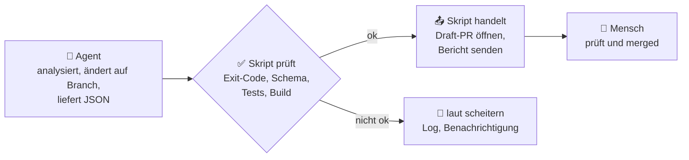

:::tldr
Ein Lauf ohne Mensch daneben muss **von sich aus** sicher sein: **begrenzt** (Schritte, Budget, Zeit), **prüfbar** (strukturierte Ausgabe, Exit-Code), **umkehrbar** (Draft-PR, Bericht – nie direkt auf `main`), **idempotent** (ein zweiter Lauf richtet keinen Schaden an) und **beobachtbar** (Protokoll, Kosten, Lebenszeichen). Folgenreiche Schritte wie Push, Versand oder Deployment macht das **umgebende Skript nach einer Prüfung** – nicht der Agent.
:::

## Die zehn Regeln

| # | Regel | Umsetzung |
|---|---|---|
| 1 | **Grenzen setzen** | `--max-turns`, `--max-budget-usd`, Timeout des Jobs |
| 2 | **Werkzeuge minimal** | `--allowedTools` explizit, `--permission-mode dontAsk` |
| 3 | **Passendes Sicherheitsprofil** | Bypass nur im isolierten Container ohne Secrets, nie als root |
| 4 | **Strukturierte Ausgabe** | `--output-format json` + `--json-schema`, Auswertung über Felder |
| 5 | **Folgenreiches ausserhalb des Agenten** | Commit, Push, Deploy, Mail im Skript nach Prüfung |
| 6 | **Ergebnisse umkehrbar** | Draft-PR, neue Datei, Bericht – nie Merge oder Push auf `main` |
| 7 | **Idempotent** | Branch-Name mit Datum, vorher prüfen «gibt es den PR schon?» |
| 8 | **Prompt ohne Vorwissen** | Ziel, Kontext, Regeln, Schritte, Abbruch, Berichtsformat |
| 9 | **Bericht und Benachrichtigung** | erledigt / offen / Kosten / Links; bei Fehler laut scheitern |
| 10 | **Beobachtbar** | Session-ID, Kosten, Exit-Code und Log pro Lauf aufbewahren |

:::bildlich Der Nachtwächter mit Dienstanweisung
Ein Nachtwächter arbeitet allein. Darum bekommt er eine **Dienstanweisung**: welche Räume er betreten darf (Werkzeuge), wie lange seine Schicht dauert (Grenzen), was er bei einem Problem tut (Abbruch), dass er **keine** Türen umbaut, sondern Mängel meldet (umkehrbar), dass er nach einem Stromausfall nicht alle Runden doppelt läuft (idempotent) und dass er am Morgen ein **Protokoll** hinlegt (Bericht). Ein Nachtwächter ohne Dienstanweisung ist kein Sicherheitsgewinn, sondern ein Risiko.
:::

## Idempotenz: zweimal laufen, einmal wirken

Geplante Läufe werden wiederholt: nach einem Absturz, durch einen versehentlichen zweiten Trigger, weil ein Planer einen verzögerten Lauf nachholt. Ein idempotenter Lauf erkennt, dass seine Arbeit schon erledigt ist.

| Muster | Beispiel |
|---|---|
| **Eindeutiger Name pro Zeitraum** | Branch `weekly/inhalte-2026-11-27` statt `weekly/inhalte` |
| **Vorher prüfen** | `gh pr list --head weekly/inhalte-2026-11-27` – gibt es den PR schon, nur ergänzen oder abbrechen |
| **Gleichzeitigkeit sperren** | `concurrency` in GitHub Actions, Lock-Datei im Skript |
| **Zustand ausserhalb des Agenten** | Fortschrittsdatei oder Datenbankeintrag «Woche 48 erledigt» |
| **Nur hinzufügen, nicht überschreiben** | neue Datei oder neuer PR statt Änderung bestehender Ergebnisse |

:::falle Doppelte PRs und doppelte Mails
Ein Lauf bricht nach dem Versand der Mail, aber vor dem Abschlussvermerk ab. Der nächste Lauf sieht «nicht erledigt» und schickt die Mail noch einmal. Abhilfe: zuerst den Zustand «in Arbeit» setzen, dann die Aktion ausführen, dann «erledigt» – und vor jeder Aktion prüfen, ob sie für diesen Zeitraum schon passiert ist.
:::

## Folgenreiches gehört ins Skript



Der Agent bekommt nur Werkzeuge für das, was **umkehrbar** ist (Dateien auf einem Branch ändern, Tests laufen lassen). Was nach aussen wirkt, entscheidet das Skript anhand prüfbarer Kriterien – und das letzte Wort hat ein Mensch.

:::praxis Leitplanken dieses Knowledge Hub
Die Wochen-Tasks dieses Projekts folgen genau diesem Muster: eigener Branch mit Datum, höchstens **ein Draft-PR** pro Lauf, höchstens drei Lektionen und zehn Fragen, `build.py --check` muss vor dem PR fehlerfrei sein, keine Änderungen an Code oder Workflows, neue Themen nur als Vorschlag, fremde Webinhalte als untrusted Input. Am 27.11.2026 hat ein Agent trotzdem einmal direkt auf `main` gepusht – in einer **interaktiven** Sitzung, weil die Regel nur für Wochen-Tasks formuliert war und kein Ruleset aktiv war. Die Lehre gilt für jede Automatisierung: Regeln für alle Situationen formulieren **und** technisch absichern.
:::

## Bericht und Beobachtbarkeit

Ein guter Abschlussbericht beantwortet in wenigen Zeilen:

```
Lauf: weekly/inhalte-2026-11-27 · Dauer 14 min · Kosten USD 1.84
Erledigt: 2 Lektionen aktualisiert (Quellen geprüft), 8 Fragen ergänzt
Offen: 1 Fakt «zu prüfen» (Preisangabe, Quelle widersprüchlich)
Ergebnis: Draft-PR #42
```

Dazu pro Lauf aufbewahren: **Session-ID**, **Exit-Code**, **Kosten**, **Log**. Wer die Kosten pro Woche aufzeichnet, sieht Ausreisser, bevor sie teuer werden.

:::gem Laut scheitern
Der schlimmste Fehler eines geplanten Laufs ist der **stille**: Er startet nicht, bricht ohne Meldung ab oder liefert leere Ergebnisse, die wie «nichts zu tun» aussehen. Jeder Lauf endet darum mit einem **Lebenszeichen** – Erfolg oder Fehler –, und jede fehlende Erwartung (Feld fehlt, Exit-Code ≠ 0, keine Ausgabe) führt zu einem **Fehler**, nicht zu einem stillen «ok».
:::

## Fehlerbilder

| Symptom | Ursache | Lösung |
|---|---|---|
| Lauf hängt bis zum Timeout | kein `--max-turns`, Agent dreht im Kreis | Grenzen; «N Runden ohne Fortschritt → Ende» |
| Kosten explodieren | grosses Modell überall, viele Agenten | `--max-budget-usd`, Modell pro Rolle, klein testen |
| CI grün, aber nichts passiert | Erfolg aus Text geraten | Exit-Code und JSON-Feld prüfen |
| doppelte PRs | nicht idempotent | Branch mit Datum, vorher prüfen, `concurrency` |
| Agent tut etwas Gefährliches | zu viele Werkzeuge, Bypass ohne Isolation | Werkzeuge begrenzen, `dontAsk`, Container |
| Anweisung aus Issue oder Webseite befolgt | Fremdtext als Anweisung gelesen ([[Prompt Injection]]) | Fremdinhalte als Daten, Schreibrechte minimal, Auslöser begrenzen |
| Zeitplan läuft seit Wochen nicht | Inaktivität, App zu, Funktion abgeschaltet | Lebenszeichen und Überwachung |

:::berater Im Kundengespräch
«Was passiert, wenn der Agent nachts etwas falsch macht?» Die Antwort muss konkret sein: «Er kann nur auf einem eigenen Branch arbeiten, höchstens 20 Schritte und 3 Franken pro Lauf verbrauchen, und sein Ergebnis ist ein Vorschlag, den morgens jemand prüft. Läuft etwas schief, gibt es eine Meldung – und ein zweiter Lauf macht nichts doppelt.» Typischer Einwand: «Das ist viel Aufwand für einen kleinen Job.» – Die Vorlage dafür ist einmal gebaut und gilt dann für jeden weiteren Lauf.
:::

:::spickzettel
- Unbeaufsichtigt = **begrenzt · prüfbar · umkehrbar · idempotent · beobachtbar**
- Grenzen: `--max-turns`, `--max-budget-usd`, Timeout · Werkzeuge: `--allowedTools` + `dontAsk`
- **Folgenreiches im Skript nach Prüfung**, letzte Entscheidung beim Menschen
- Ergebnis: **Draft-PR / Bericht**, nie Merge oder Push auf `main`
- Idempotenz: **Name mit Datum**, vorher prüfen, `concurrency`, Zustand ausserhalb
- Bericht: erledigt / offen / Kosten / Links; **laut scheitern**, Lebenszeichen
- Fremdtext aus Issues, Mails, Webseiten = **untrusted**
- Regeln für **alle** Situationen formulieren **und** technisch absichern
:::

:::selbstcheck 3
