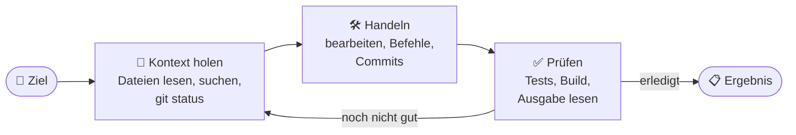

:::tldr
Claude Code ist ein **Agent**, kein Chatbot: Du gibst ein Ziel, und Claude liest selbst Dateien, führt Befehle aus, ändert Code und **prüft das Ergebnis** – in einer Schleife, bis die Aufgabe erledigt ist. Gestartet wird **im Projektordner** (`cd projekt && claude`). Die knappste Ressource ist das **Kontextfenster**: Es füllt sich schnell, und je voller es wird, desto schlechter arbeitet Claude.
:::

## Chatbot und Agent

| | Chatbot | Claude Code |
|---|---|---|
| Du gibst | eine Frage | ein **Ziel** |
| Sieht | nur, was du einfügst | dein Projekt, das Terminal, den Git-Stand |
| Werkzeuge | keine | Dateien lesen und bearbeiten, Befehle ausführen, Git, Websuche, MCP-Server |
| Fehler | du findest sie | Claude führt Tests aus, liest Fehler und korrigiert sich |
| Ablauf | ein Austausch | Dutzende Schritte hintereinander |

Claude Code ist der **[[Harness]]** um das Modell: die Schleife, die Werkzeuge, die Rechteverwaltung und die Kontextpflege, die aus einem Sprachmodell einen [[Agent|Agenten]] machen.

:::bildlich Der Handwerker statt des Beraters am Telefon
Ein Chatbot ist ein **Berater am Telefon**: Er sagt dir, welche Schraube du drehen sollst, aber drehen musst du selbst – und wenn es nicht passt, rufst du wieder an. Claude Code ist ein **Handwerker, der in deine Werkstatt kommt**: Er schaut sich um, nimmt das Werkzeug in die Hand, probiert, misst nach und meldet sich, wenn er fertig ist oder etwas Wichtiges entscheiden muss.
:::

## Der Agentic Loop



**Beispiel «Repariere die fehlschlagenden Tests»:** Claude führt die Tests aus und sieht, welche scheitern (Kontext). Es liest die betroffenen Dateien, findet den Fehler und ändert den Code (Handeln). Dann laufen die Tests erneut (Prüfen) – sind alle grün, ist die Aufgabe erledigt, sonst beginnt die nächste Runde.

:::gem Ohne Prüfschritt hört Claude zu früh auf
Claude beendet eine Aufgabe, wenn sie **fertig aussieht**. Gibt es keinen Test, keinen Build und keinen Vergleich, ist «sieht fertig aus» das einzige Signal – und du wirst zur Prüfschleife, die jeden Fehler selbst finden muss. Ein Befehl, der klar «bestanden» oder «gescheitert» meldet, schliesst die Schleife. Mehr dazu in der Lektion [Arbeitsweise](#/l/claude-code/arbeitsweise).
:::

## Wo Claude Code läuft

| Oberfläche | Stärke | Typisch für |
|---|---|---|
| **Terminal (CLI)** | alle Funktionen, skriptbar | tägliche Arbeit, Automatisierung (`claude -p`) |
| **VS Code / JetBrains** | Diffs im Editor, `@`-Verweise | Arbeit direkt am Code |
| **Desktop-App** | mehrere Sessions parallel, visuelle Diffs | parallele Aufgaben, Reviews |
| **Web** (`claude.ai/code`) | läuft in der Cloud, kein lokales Setup | lange Aufgaben, Repos ohne lokale Kopie |

Alle Oberflächen nutzen dieselbe Konfiguration im Projekt (`CLAUDE.md`, `.claude/`).

## Der erste Start

```bash
cd ~/projekte/app       # im Projektordner, unter WSL im Linux-Dateisystem
git status              # sauberer Ausgangspunkt? Sonst zuerst committen
claude                  # beim ersten Mal: Anmeldung im Browser
```

Danach im Gespräch zum Beispiel:

```
Erkläre mir in fünf Sätzen, was dieses Projekt macht und wie ich die Tests starte.
```

:::falle «Ich bin im Ordner, also kann Claude nichts anderes anfassen»
Der Startordner ist eine **Schreibgrenze**, keine Lesegrenze. Claude Code schreibt standardmässig nur dort, kann aber nach einer Rückfrage auch ausserhalb lesen – etwa `~/.ssh`. Und es läuft mit **deinen** Benutzerrechten. Echte Grenzen setzen Permission-Regeln, die Sandbox oder ein Container (Lektion [Sicherheit im Überblick](#/l/ai-security/ueberblick)).
:::

:::gem Vor dem ersten Auftrag committen
Ein sauberer Git-Stand vor dem Start ist das beste Sicherheitsnetz: Was Claude danach ändert, zeigt `git diff` Zeile für Zeile, und `git restore .` bringt alles zurück. Claude Code hat zusätzlich eigene Checkpoints, aber die erfassen nur Änderungen über seine Datei-Werkzeuge – nicht, was ein Bash-Befehl anrichtet.
:::

### Was beim Start passiert

Bevor du den ersten Prompt abschickst, lädt Claude Code einen Startzustand: die [[CLAUDE.md]]-Dateien (persönlich und Projekt), passende Regeln, die Auto-Memory-Notizen, die Settings mit den Rechten und die Liste der verfügbaren Werkzeuge, Skills und MCP-Server. Alles davon belegt Platz im [[Kontextfenster]] – deshalb lohnt es sich, den Startzustand schlank zu halten.

### Wie autonom arbeitet Claude?

Wie oft Claude vor einer Aktion fragt, bestimmt der **Rechte-Modus**. Seit Claude Code v2.1.283 starten Terminal und VS Code standardmässig im **Auto-Modus**: Ein separates Prüfmodell begutachtet die meisten Aktionen und blockiert nur, was riskant aussieht (Stand 27.11.2026). Wer jede Aktion selbst freigeben will, wechselt in den Modus **Manual** (`default`). Die Modi im Detail: Lektion [Befehle, Modi und Tastenkürzel](#/l/claude-code/befehle-und-modi).

:::berater Im Kundengespräch
«Claude Code ist ein Mitarbeiter, der in Ihrer Entwicklungsumgebung arbeitet – er liest, ändert, testet und meldet zurück.» Typischer Einwand: «Dann schreibt die KI ja einfach in unseren Code.» – Ja, und genau deshalb gehört sie in einen klaren Rahmen: Arbeit auf Branches, Prüfung durch Tests, Freigabe durch Menschen, technische Rechtegrenzen. Der Mehrwert entsteht im **Loop** – nicht im ersten Entwurf, sondern darin, dass Claude so lange prüft und korrigiert, bis die Tests grün sind.
:::

:::spickzettel
- Claude Code = **Agent**: Ziel statt Frage, handelt selbst, prüft selbst
- Loop: **Kontext holen → handeln → prüfen** → wiederholen bis erledigt
- Ohne **Prüfschritt** (Tests, Build) hört Claude auf, wenn es «fertig aussieht»
- Oberflächen: Terminal, VS Code/JetBrains, Desktop, Web – gleiche Projektkonfiguration
- Start: **`cd projekt && claude`**, vorher sauber committen
- Startordner = **Schreibgrenze, keine Lesegrenze**
- Knappste Ressource: das **Kontextfenster**
- Standard seit v2.1.283: **Auto-Modus** (Stand 27.11.2026)
:::

:::selbstcheck 3
