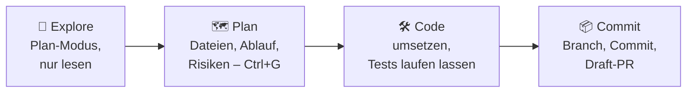

:::tldr
Der Standardablauf hat vier Schritte: **Explore** (lesen, im Plan-Modus) → **Plan** (Plan erstellen und prüfen) → **Code** (umsetzen und dabei prüfen) → **Commit** (beschreibender Commit, PR). Der grösste Hebel ist ein **Prüfschritt**, den Claude selbst ausführen kann: Tests, Build, Screenshot-Vergleich. Und wenn du Claude zweimal erfolglos korrigiert hast: **`/clear`** und mit einem besseren Auftrag neu beginnen.
:::

## Explore → Plan → Code → Commit

1. **Explore:** Mit Shift+Tab in den Plan-Modus (oder `claude --permission-mode plan`). «Lies `src/auth/` und erkläre, wie wir Sessions und Login handhaben.» Claude liest, ändert nichts.
2. **Plan:** «Ich will Google-Login ergänzen. Welche Dateien ändern sich, wie sieht der Ablauf aus? Erstelle einen Plan.» Mit **Ctrl+G** öffnest du den Plan im Editor und korrigierst ihn direkt.
3. **Code:** Plan freigeben oder mit Shift+Tab aus dem Plan-Modus. «Setze den Plan um, schreibe Tests für den Callback, lass sie laufen und behebe Fehler.»
4. **Commit:** «Committe mit beschreibender Nachricht und öffne einen Draft-PR.» Claude nutzt dafür `git` und `gh`.

:::bildlich Zuerst das Gelände ablaufen
Ein guter Architekt läuft zuerst über das Grundstück (Explore), zeichnet dann einen Plan, den die Bauherrschaft absegnet (Plan), erst dann wird gebaut (Code) – und am Schluss gibt es die Abnahme mit Protokoll (Commit und PR). Wer direkt baggert, baut schnell – oft am falschen Ort.
:::

:::gem Wann du den Plan weglassen darfst
Planen kostet Zeit. **Wenn du die Änderung in einem Satz beschreiben kannst** – Tippfehler, eine Log-Zeile, eine Umbenennung – lass Claude direkt machen. Planen lohnt sich, wenn der Weg unklar ist, mehrere Dateien betroffen sind oder du den Code nicht kennst.
:::

## Der grösste Hebel: ein Prüfschritt

Claude hört auf, wenn die Arbeit **fertig aussieht**. Mit einem Befehl, der «bestanden» oder «gescheitert» meldet, schliesst sich die Schleife von selbst: Claude arbeitet, prüft, liest das Ergebnis und bessert nach, bis die Prüfung besteht.

| Statt | Besser |
|---|---|
| «Implementiere `validate_iban`» | «Schreibe `validate_iban`. Testfälle: `CH93 0076 2011 6238 5295 7` gültig, `CH00 1234` ungültig. Lass die Tests laufen.» |
| «Der Build schlägt fehl» | «Der Build scheitert mit [Fehlermeldung]. Finde die Ursache, behebe sie, prüfe, dass der Build durchläuft. Ursache beheben, Fehler nicht unterdrücken.» |
| «Mach das Dashboard schöner» | «[Screenshot] Setze dieses Design um. Mach einen Screenshot vom Ergebnis, vergleiche, liste Unterschiede auf und behebe sie.» |
| «Behebe den Login-Fehler» | «Nach Session-Timeout schlägt der Login fehl. Prüfe `src/auth/`, vor allem Token-Refresh. Schreibe zuerst einen fehlschlagenden Test, dann den Fix.» |

**Wie hart die Prüfung greift**, wählst du (Stand 27.11.2026):

| Stufe | Wie | Wann |
|---|---|---|
| im Auftrag | «… lass die Tests laufen und bessere nach» | jede Aufgabe, sofort |
| über die Session | `/goal` mit Bedingung – ein Prüfer kontrolliert nach jedem Schritt | längere Aufgaben |
| deterministisch | **Stop-Hook**, der die Prüfung als Skript ausführt und das Beenden blockiert | unbeaufsichtigte Läufe |
| zweite Meinung | Review-Subagent mit frischem Kontext, z. B. `/code-review` | bevor du etwas als fertig zählst |

:::falle «Sieht gut aus» ohne Beweis
Lass Claude **Belege zeigen** statt Erfolg zu behaupten: die Testausgabe, den ausgeführten Befehl und seinen Rückgabewert, einen Screenshot. Belege prüfen geht schneller, als alles selbst nachzumachen – und funktioniert auch bei Sessions, die du nicht beobachtet hast. Ohne Prüfmöglichkeit gilt: nicht ausliefern.
:::

## Präzise Aufträge

- **Umfang abgrenzen:** welche Datei, welches Szenario, welche Testvorlieben («ohne Mocks»).
- **Auf Quellen zeigen:** «Schau in die Git-Historie von `ExecutionFactory` und fasse zusammen, wie die API entstanden ist.»
- **Vorhandene Muster nennen:** «`HotDogWidget.php` ist ein gutes Beispiel – folge dem Muster.»
- **Symptom, Ort und «fertig» beschreiben:** was passiert, wo es vermutlich liegt, woran man den Erfolg erkennt.
- **Reiche Eingaben nutzen:** `@datei`, Screenshots, Fehlerlogs per Pipe (`cat error.log | claude -p "erkläre den Fehler"`).

:::gem Lass dich interviewen
Für grössere Vorhaben: «Ich will [kurze Beschreibung] bauen. Interviewe mich ausführlich – Technik, Bedienung, Randfälle, Zielkonflikte. Danach schreib eine vollständige Spezifikation in `SPEC.md`.» Dann **neue Session** für die Umsetzung: frischer Kontext, klare Vorlage. Die besten Spezifikationen nennen betroffene Dateien, was **nicht** dazugehört, und enden mit einem End-to-End-Prüfschritt.
:::

## Korrigieren oder neu beginnen?

- **Früh korrigieren:** Esc stoppt sofort, der Kontext bleibt. Dann umlenken.
- **Zurückspulen:** Esc Esc oder `/rewind` stellt Gespräch und/oder Code wieder her.
- **Neu beginnen:** Wenn du **mehr als zweimal** dasselbe korrigiert hast, ist der Kontext voller gescheiterter Ansätze. `/clear` und ein besserer Auftrag, der das Gelernte enthält, schlägt fast immer die lange Session.

## Fünf Fehlmuster

| Muster | Symptom | Abhilfe |
|---|---|---|
| **Kitchen-Sink-Session** | Aufgabe A, dann eine Nebenfrage, dann zurück zu A | `/clear` zwischen Themen |
| **Korrekturschleife** | derselbe Fehler, die dritte Korrektur | `/clear`, besserer Startauftrag |
| **Überladene CLAUDE.md** | Regeln werden ignoriert | kürzen, auslagern, Muss-Regeln als Hook |
| **Vertrauen ohne Prüfung** | plausibel, aber Randfälle fehlen | Tests, Skripte, Screenshots als Pflicht |
| **Endlose Exploration** | «untersuch mal …» liest Hunderte Dateien | eng eingrenzen oder an Subagenten delegieren |

:::berater Im Kundengespräch
Die Produktivität mit Claude Code hängt weniger vom Modell ab als vom **Arbeitsablauf**. Teams, die «einfach machen lassen», erleben plausibel aussehende Fehler und lange Korrekturschleifen. Teams mit Plan-Schritt, Testpflicht und Draft-PR erleben einen Kollegen, der zuverlässig liefert. Typischer Einwand: «Planen kostet doch Zeit.» – Bei Ein-Satz-Änderungen ja, dort lässt man ihn weg. Bei allem anderen spart er die teuerste Zeit: die, in der man das Falsche gebaut hat.
:::

:::spickzettel
- **Explore** (Plan-Modus) → **Plan** (Ctrl+G) → **Code** (mit Tests) → **Commit** (Draft-PR)
- Plan weglassen, wenn die Änderung **in einen Satz** passt
- Grösster Hebel: **Prüfschritt**, den Claude selbst ausführt
- Prüfstufen: im Auftrag · `/goal` · **Stop-Hook** · Review-Subagent
- **Belege statt Behauptungen** (Testausgabe, Befehl, Screenshot)
- Präzise: Datei · Szenario · Muster · Symptom · «fertig» definieren
- Grosse Vorhaben: **Interview → SPEC.md → neue Session**
- Zweimal erfolglos korrigiert → **`/clear`** und besser neu starten
:::

:::selbstcheck 3
