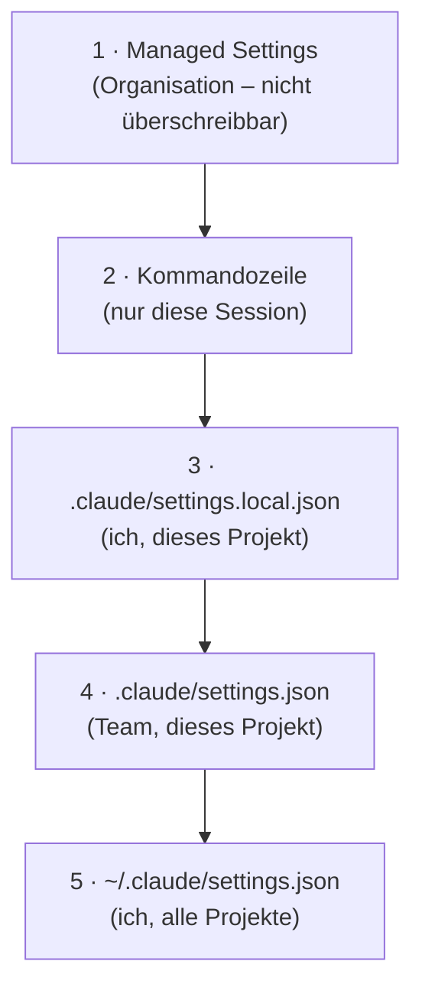

:::tldr
Fast jede Konfiguration gibt es **zweimal**: im Projekt (`.claude/`, committet, fürs Team) und im Home-Verzeichnis (`~/.claude/`, nur für dich). Persönliche Abweichungen im Projekt gehören in **`.claude/settings.local.json`**. Bei Konflikten gilt: **Managed > Kommandozeile > Local > Project > User**. Einzelwerte überschreiben sich, **Permission-Regeln werden zusammengeführt**. Und der wichtigste Unterschied: **CLAUDE.md ist Anleitung, `settings.json` ist Durchsetzung.**
:::

## Die Dateikarte

### Im Projekt (committet, Ausnahme `.local`)

| Pfad | Aufgabe |
|---|---|
| `CLAUDE.md` | Projektanweisungen, jede Session geladen |
| `CLAUDE.local.md` | deine privaten Projektnotizen (selbst anlegen und ignorieren) |
| `.mcp.json` | MCP-Server fürs ganze Team – im **Projekt-Root**, nicht in `.claude/` |
| `.worktreeinclude` | ignorierte Dateien (z. B. `.env`), die in neue Worktrees kopiert werden |
| `.claude/settings.json` | Rechte, Hooks, Modell, Statuszeile – **Team-Standard** |
| `.claude/settings.local.json` | **deine** Abweichungen; beim Anlegen durch Claude Code automatisch ignoriert |
| `.claude/rules/*.md` | Themen- oder pfadgebundene Anweisungen |
| `.claude/skills/<name>/SKILL.md` | wiederverwendbare Abläufe mit Begleitdateien, Aufruf `/name` |
| `.claude/commands/*.md` | Einzeldatei-Befehle – Vorläufer der Skills, nur noch für Altbestand |
| `.claude/agents/*.md` | Subagenten mit eigenem Kontextfenster |
| `.claude/agent-memory/<agent>/` | Gedächtnis einzelner Subagenten (von Claude geschrieben) |
| `.claude/output-styles/*.md` | Varianten für Ton und Format der Antworten |

### Im Home-Verzeichnis (nie im Repo)

| Pfad | Aufgabe |
|---|---|
| `~/.claude/CLAUDE.md` | persönliche Vorlieben für alle Projekte |
| `~/.claude/settings.json` | deine Standard-Settings für alle Projekte |
| `~/.claude/rules/`, `skills/`, `agents/` … | persönliche Pendants, überall verfügbar |
| `~/.claude/projects/<projekt>/memory/` | Auto Memory pro Projekt |
| `~/.claude/plugins/cache/…` | installierte Plugins |
| `~/.claude.json` | App-Zustand: Anmeldung, persönliche MCP-Server, Projektzustand |

:::bildlich Aktenschrank und Hausordnung
`.claude/` ist der **Aktenschrank**, der vor jeder Sitzung geöffnet wird. Die CLAUDE.md ist die **Tagesordnung**, die alle lesen. `rules/` sind Mappen, die nur beim passenden Thema herausgezogen werden. `settings.json` ist die **Hausordnung mit Schliessanlage**: Sie gilt, ob jemand sie gelesen hat oder nicht – eine verschlossene Tür bleibt verschlossen.
:::

:::falle Drei Ordner, die nichts bewirken
- **Kein `.claude/plugins/` im Projekt:** Installierte Plugins liegen global im Cache; im Projekt steht nur ihr Name unter `enabledPlugins` in der `settings.json`. Ein von Hand angelegter Ordner wird nie gelesen.
- **`.claude/hooks/` wird nicht automatisch ausgeführt:** Der Ordner ist nur eine Ablage-Konvention. Jeder Hook muss in einer `settings.json` registriert sein.
- **Keine eigene «statusline»-Datei:** Die Statuszeile ist der Schlüssel `statusLine` **in** der `settings.json`, der optional auf ein Skript zeigt.
:::

## Wer gewinnt? Die Rangordnung



- **Einzelwerte** (z. B. `model`): die höhere Ebene gewinnt.
- **Permission-Regeln** werden über alle Ebenen **zusammengeführt** statt überschrieben. Und: Ist etwas in den User-Settings erlaubt, in den Projekt-Settings aber verboten, gewinnt das Verbot.
- **CLAUDE.md-Dateien** werden nicht Schlüssel für Schlüssel verrechnet, sondern alle **gleichzeitig geladen**.

:::gem «Ja, und nicht mehr fragen» landet lokal
Wenn du bei einem Bash-Befehl «Yes, and don't ask again» wählst, speichert Claude Code die Freigabe als Allow-Regel in **`.claude/settings.local.json`** – also nur für dich in diesem Projekt. Wer sich wundert, warum ein Kollege bei demselben Befehl gefragt wird: Die Freigabe war nie im Team-Standard.
:::

:::falle Anleitung mit Durchsetzung verwechseln
«Immer `pytest` vor jedem Commit» in der CLAUDE.md ist eine **Bitte**. Claude hält sich meistens daran – aber nichts erzwingt es. Was garantiert passieren oder verhindert werden muss, gehört in die `settings.json`: als **Deny-Regel** oder als **Hook**, der bei Verstoss mit Exit-Code 2 blockiert. Ebenso bei Subagenten: «Ändere nichts» im Prompt ist Anleitung; `tools: Read, Grep, Glob` im Frontmatter ist Durchsetzung.
:::

## Was committet wird – und was nicht

| Committen (Team) | Lokal lassen (persönlich) |
|---|---|
| `CLAUDE.md`, `.claude/settings.json` | `CLAUDE.local.md`, `.claude/settings.local.json` |
| `.claude/rules/`, `skills/`, `agents/`, `output-styles/` | `~/.claude/…` (alles im Home) |
| `.mcp.json` – **Secrets nur als `${VARIABLE}`** | Tokens, API-Keys, persönliche MCP-Server |
| Hook-Skripte unter `.claude/hooks/` (registriert in `settings.json`) | persönliche Modellwahl, Ausnahmen |

```json
{
  "mcpServers": {
    "github": {
      "command": "npx",
      "args": ["-y", "@modelcontextprotocol/server-github"],
      "env": { "GITHUB_TOKEN": "${GITHUB_TOKEN}" }
    }
  }
}
```

## Diagnose: Was ist wirklich geladen?

| Befehl | Zeigt |
|---|---|
| `/context` | Platzverbrauch nach Kategorie, geladene Anweisungsdateien |
| `/memory` | CLAUDE.md-Dateien, Regeln, Auto Memory |
| `/status` | geladene Settings-Quellen (auch Managed Settings) |
| `/permissions` | gültige Allow-, Ask- und Deny-Regeln |
| `/hooks` | aktive Hooks mit Quelle |
| `/agents`, `/mcp` | Subagenten, MCP-Server und ihr Status |
| `/doctor` | Installations- und Konfigurationsprüfung |

:::berater Im Kundengespräch
Die Frage «Wo ist bei Ihnen eingestellt, was Claude darf?» bringt in Audits oft Überraschungen: Freigaben in persönlichen `settings.local.json`, Secrets in `.mcp.json`, Hooks, die nie registriert wurden. Die Empfehlung: Team-Standard im Repo, persönliche Abweichungen bewusst lokal, Sicherheitsregeln zentral über Managed Settings. Typischer Einwand: «Das ist doch Konfigurationsbürokratie.» – Es sind fünf Dateien. Der Gewinn: Jede neue Person und jeder Agent arbeitet ab der ersten Minute nach denselben Regeln.
:::

:::spickzettel
- Doppelt: **Projekt `.claude/`** (Team, committet) und **`~/.claude/`** (ich, lokal)
- Persönliches im Projekt: **`settings.local.json`**, `CLAUDE.local.md`
- Root: `CLAUDE.md`, **`.mcp.json`** (Secrets als `${VAR}`), `.worktreeinclude`
- Rangordnung: **Managed > CLI > Local > Project > User**
- Einzelwerte überschreiben, **Permission-Regeln werden zusammengeführt**, Deny gewinnt
- **CLAUDE.md = Anleitung · settings.json = Durchsetzung**
- Kein `.claude/plugins/`, Hooks müssen **registriert** sein, Commands → Skills
- Diagnose: `/context` · `/memory` · `/status` · `/permissions` · `/hooks`
:::

:::selbstcheck 3
