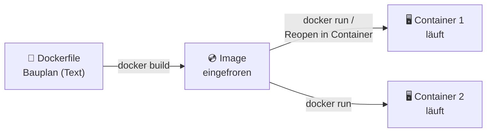

:::tldr
Ein **Dockerfile** ist der Bauplan, ein **Image** die daraus gebaute, eingefrorene Festplatte, ein **Container** der laufende Rechner, der aus dem Image gestartet wird. Was im Container entsteht, ist beim Löschen weg – ausser es liegt in einem **Volume** (Docker-Lagerraum) oder in einem **Bind Mount** (Fenster auf einen echten Ordner). Und: Ein Bind Mount ist **keine Kopie**. Was der Container dort ändert, ändert er an deinem Original.
:::

## Wozu Container?

Der Klassiker: **«Bei mir läuft's aber!»** Ein Programm funktioniert auf deinem Laptop, beim Kollegen aber nicht – weil dort eine andere Python-Version, eine fehlende Systembibliothek oder eine andere Umgebungsvariable herrscht.

Ein Container packt die Anwendung **mitsamt allem, was sie braucht** (Betriebssystem-Grundlage, Bibliotheken, Konfiguration) in ein abgeschlossenes Paket. Das Paket verhält sich überall gleich: auf deinem Laptop, beim Kollegen, auf dem Cloud-Server.

Der zweite, ebenso wichtige Grund ist **Isolation**. Ein Container hat ein eigenes Dateisystem, eine eigene Prozessliste und eine eigene Netzwerksicht. Was nicht ausdrücklich hineingereicht wird, existiert für ihn nicht. Genau deshalb sind Container bei KI-Agenten wie Claude Code so wertvoll (Lektion [Container härten](#/l/container/haerten-und-ki-agenten)).

### Container ist keine virtuelle Maschine

| | Virtuelle Maschine | Container |
|---|---|---|
| Simuliert | einen ganzen Computer **mit eigenem Betriebssystem-Kern** | nur die Umgebung **oberhalb** des Kerns |
| Kern | eigener | **geteilt** mit dem Host |
| Start | Minuten | Sekunden |
| Speicher pro Instanz | gross (ganzes OS) | klein |
| Abschottung | sehr stark | stark, aber nicht absolut |

Der geteilte Kern ist der Grund, warum Container leicht sind – und warum sie gegen gezielt bösartigen Code eine gute Mauer, aber keine Garantie sind.

## Die drei Grundbausteine



:::bildlich Bauplan, Festplatten-Abbild, eingeschalteter PC
- Das **Dockerfile** ist die Installationsanleitung: «Nimm Ubuntu, installiere Python, kopiere diese Dateien hinein.» Reiner Text, versionierbar wie Code.
- Das **Image** ist eine fertig installierte, **eingefrorene Festplatte** – wie eine ISO-Datei. Sie verändert sich nicht und braucht ausser Speicherplatz keine Leistung.
- Der **Container** ist der **eingeschaltete PC**, der von dieser Festplatte startet. Er verbraucht RAM und CPU. Aus einem Image kannst du beliebig viele unabhängige Container starten – so wie du mit derselben ISO viele PCs gleich aufsetzen könntest.
:::

| Begriff | Analogie | Verändert sich? | Braucht Leistung? |
|---|---|---|---|
| Dockerfile | Bauplan | nein (Text) | nein |
| Image | eingefrorene Festplatte | nein, einmal gebaut | nur Speicherplatz |
| Container | laufender PC | ja, solange er läuft | ja (RAM, CPU) |
| `docker compose up` | Startknopf für ein ganzes Netz aus PCs | – | für alle gestarteten |

### Schichten (Layers)

`docker build` liest das Dockerfile von oben nach unten. **Jede Anweisung** (`FROM`, `RUN`, `COPY` …) erzeugt eine eigene [[Layer|Schicht]] – wie Klarsichtfolien, die übereinandergelegt werden. Docker merkt sich jede Schicht. Änderst du nur die letzte Zeile, werden alle Schichten davor aus dem Cache wiederverwendet. Darum ist ein zweiter Build oft in Sekunden fertig.

```dockerfile
FROM mcr.microsoft.com/devcontainers/base:ubuntu-24.04   # Fundament
RUN apt-get update && apt-get install -y python3 jq      # Pakete
USER vscode                                              # nicht als root
WORKDIR /workspace/project                               # Arbeitsordner
```

### Die beschreibbare Folie

Startest du einen Container, legt Docker eine **dünne, beschreibbare Schicht** über das unveränderliche Image. Darin landet alles, was im laufenden Container entsteht: neu installierte Programme, Logdateien, Datenbankinhalte.

:::falle Die Folie fliegt mit dem Container weg
Wird der Container **gelöscht** (`docker rm`, `docker compose down`, «Rebuild Container»), wird diese Folie weggeworfen. Wer im Container eine Datenbank betreibt und keinen Speicher nach aussen definiert hat, steht nach dem nächsten `down` vor einer leeren Datenbank. Ein blosses **Stoppen** dagegen lässt die Folie stehen – deshalb fällt der Fehler oft erst Tage später auf.
:::

### Docker Compose

Ein einzelner Container wird mit `docker run` gestartet. Braucht eine Anwendung mehrere vernetzte Container (Web-App, Datenbank, Cache), beschreibt man sie in **einer** `compose.yml`. `docker compose up` startet alle und verbindet sie. Die Dienste erreichen sich gegenseitig über ihren **Dienstnamen** (z. B. `db`), ohne IP-Adressen.

## Daten hinein und heraus: Bind Mount und Volume

Damit etwas den Container überlebt oder von aussen hineinkommt, gibt es zwei Türen:

| | [[Bind Mount]] | [[Volume]] (Named Volume) |
|---|---|---|
| Was | ein **konkreter Ordner deines Rechners** wird eingehängt | ein **von Docker verwalteter** Speicherbereich |
| Beispiel | `-v ~/projekte/app:/app` | `-v dbdaten:/var/lib/postgresql/data` |
| Typisch für | deinen Quellcode, den du live bearbeitest | Datenbanken, `node_modules`, Logins |
| Du siehst die Dateien | direkt in deinem Ordner | nur über Docker (`docker volume …`) |
| Überlebt `down` | ja (liegt ja bei dir) | ja |
| Wird gelöscht durch | dich selbst | `docker compose down -v` oder `docker volume rm` |

:::bildlich Fenster und Lagerraum
Stell dir den Container als **Pavillon auf dem Schulhof** vor. Ein **Bind Mount** ist ein **Fenster** in der Pavillonwand, durch das der Arbeiter an deinen echten Schreibtisch in Zimmer 12 greift. Ein **Volume** ist ein **Lagercontainer neben dem Pavillon**: Wird der Pavillon abgebaut, bleibt der Lagercontainer stehen, und der nächste Pavillon findet alles wieder vor.
:::

:::falle «Spiegeln» ist das falsche Wort
Fast jeder stellt sich einen Bind Mount als **Kopie** vor, die man gefahrlos kaputt machen kann. Falsch. Es gibt **einen** Ordner und ein **Fenster** darauf. Ändert Claude Code im Container `app.py`, ist `app.py` auf deiner Platte **sofort** geändert. Löscht er eine Datei, ist sie bei dir gelöscht. Das ist kein Bug, sondern der Zweck. Aber es heisst: Der Container schützt **alles andere** auf deinem Rechner – nicht den eingehängten Ordner. Dessen Sicherheitsnetz heisst Git.
:::

:::gem Ein Volume ist da, bis du es ausdrücklich löschst
Weder `docker compose down` noch ein PC-Neustart noch `docker system prune -a` fassen ein Volume an. Nur `down -v`, `docker volume rm` oder `prune --volumes` löschen es. Darum gehören alle Daten, die einen Container überleben sollen, in ein Volume – und darum ist `-v` hinter `down` der eine Buchstabe, bei dem du kurz innehalten solltest.
:::

## Wichtige Begriffe auf einen Blick

| Begriff | Bedeutung |
|---|---|
| **Registry** | Server, auf dem Images liegen und geteilt werden (Docker Hub, `ghcr.io`) |
| **Tag** | Versionsetikett eines Images, z. B. `ubuntu:24.04`. `latest` heisst nur «zuletzt so benannt», nicht «neueste Version» |
| **Build-Kontext** | der Ordner, den `docker build` an Docker übergibt – nur daraus darf `COPY` kopieren |
| **Port-Mapping** | `-p 8080:80` verbindet Port 8080 deines Rechners mit Port 80 im Container (links Host, rechts Container) |
| **[[Devcontainer]]** | eine Projektdatei, mit der VS Code den passenden Container selbst baut und startet |

:::berater Im Kundengespräch
«Ein Container ist eine standardisierte Kiste für Software. Sie läuft überall gleich und sieht nur, was wir ihr bewusst hineinreichen.» Typischer Einwand: «Ist das nicht einfach eine VM?» – Nein. Eine VM bringt ein eigenes Betriebssystem mit und ist schwer. Ein Container teilt den Kern mit dem Host und ist darum leicht und schnell. Für Agenten heisst das: Wir können jedem Projekt eine eigene, abgeschottete Kiste geben, ohne dass das Ressourcen frisst.
:::

:::spickzettel
- **Dockerfile** (Bauplan) → `docker build` → **Image** (eingefroren) → `docker run` → **Container** (läuft)
- Jede Dockerfile-Zeile = eine gecachte **Schicht**; selten Geändertes nach oben
- Container ≠ VM: **Kern geteilt**, darum leicht, aber keine absolute Grenze
- Im Container Entstandenes ist beim **Löschen** weg, beim **Stoppen** nicht
- **Bind Mount** = Fenster auf deinen echten Ordner, **keine Kopie**
- **Volume** = Docker-Lagerraum, überlebt `down`, weg erst mit `-v` oder `volume rm`
- Compose: mehrere Dienste, erreichbar über den **Dienstnamen**
:::

:::selbstcheck 3
