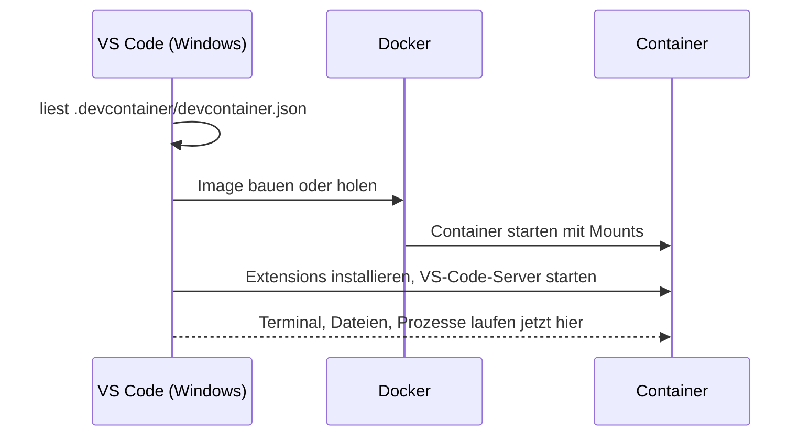

:::tldr
Eine Datei `.devcontainer/devcontainer.json` im Projekt sagt VS Code, **welches Image**, **welche Ordner**, **welcher Benutzer** und **welche Extensions** gelten. Ein Klick auf «Reopen in Container», und Editor-Oberfläche bleibt unter Windows, aber Terminal, Dateien und Prozesse – auch Claude Code – laufen **im Container**. Der Container sieht genau das, was die Datei hineinreicht: idealerweise das Projekt, eine Git-Identität, ein Volume für den Login und den SSH-**Agenten**, nie die Schlüssel selbst.
:::

## Die Brücke zwischen VS Code und Docker

`devcontainer.json` folgt der offenen [Dev-Container-Spezifikation](https://containers.dev/). Die VS-Code-Extension **Dev Containers** liest sie und erledigt, was du sonst mit langen `docker build`- und `docker run`-Befehlen tippen müsstest. Dieselbe Datei versteht auch die **devcontainer-CLI** (`devcontainer up`) – du bist also nicht an VS Code gebunden.



:::bildlich Fernbedienung statt Kabelsalat
Ohne Devcontainer steckst du jedes Mal von Hand Kabel um: welches Image, welche Ordner, welcher Benutzer. Die `devcontainer.json` ist die **programmierte Fernbedienung**: ein Knopf, und alles ist richtig verbunden – für dich und für jedes Teammitglied gleich.
:::

## Eine Vorlage Zeile für Zeile

```jsonc
{
  "name": "mein-projekt",
  "image": "docker-dev-base:latest",          // gemeinsames, vorgebautes Basis-Image
  "initializeCommand": "touch \"$HOME/.gitconfig\"",  // läuft auf dem HOST vor dem Start
  "workspaceMount": "source=${localWorkspaceFolder},target=/workspace/project,type=bind",
  "workspaceFolder": "/workspace/project",
  "mounts": [
    "source=${localEnv:HOME}/.gitconfig,target=/home/vscode/.gitconfig,type=bind,readonly",
    "source=claude-code-config-${localWorkspaceFolderBasename},target=/home/vscode/.claude,type=volume"
  ],
  "remoteUser": "vscode",
  "customizations": { "vscode": { "extensions": ["anthropic.claude-code"] } },
  "postCreateCommand": "claude --version && uv sync"
}
```

| Eintrag | Wirkung |
|---|---|
| `image` | nimmt ein fertiges Image – schneller Start. Alternativ `build` mit eigenem Dockerfile |
| `initializeCommand` | läuft **auf dem Host**, bevor der Container startet. Ideal, um fehlende Mount-Quellen anzulegen |
| `workspaceMount` / `workspaceFolder` | der Projektordner als [[Bind Mount]] – die «Haustür» für den Code |
| `.gitconfig` **readonly** | Name und E-Mail für Commits, keine Secrets, nicht veränderbar |
| Volume `claude-code-config-…` | Login und Einstellungen von Claude Code **überleben «Rebuild Container»** |
| `remoteUser: vscode` | kein root im Container |
| `extensions` | werden **im Container** installiert, nicht nur unter Windows |
| `postCreateCommand` | läuft einmal nach dem Erstellen, z. B. Versionscheck und `uv sync` |

## Was sieht der Container?

| Im Container | Kommt von | Zugriff |
|---|---|---|
| `/workspace/project` | der **geöffnete Projektordner** | lesen und schreiben, sofort auf dem Host |
| `/home/vscode/.gitconfig` | deine `~/.gitconfig` | nur lesen |
| `/home/vscode/.claude` | Docker-Volume pro Projekt | lesen und schreiben |
| SSH-Agent | Agent-Forwarding | nur der Agent, nie die Schlüssel |

**Nicht sichtbar:** alle anderen Projekte, dein Home-Verzeichnis, `~/.ssh`, `/mnt/c` und dein persönliches `~/.claude` aus WSL.

:::gem Ein Container pro Projekt kostet fast nichts
Man könnte einen grossen Container für alle Projekte laufen lassen. Dann sieht aber jedes Projekt – und jeder Agent darin – alle anderen, und die Isolation ist weg. Weil alle Projekt-Container dasselbe Basis-Image teilen, starten sie in Sekunden und brauchen kaum zusätzlichen Speicher. Isolation pro Projekt ist also praktisch gratis.
:::

:::falle Der falsche Ordner geöffnet
VS Code sucht `.devcontainer/devcontainer.json` **im geöffneten Ordner**. Wer `~/projekte` statt `~/projekte/app` öffnet, bekommt kein «Reopen in Container» angeboten. Ebenso: Ein Symlink im Projekt, der nach ausserhalb zeigt, ist im Container tot – das Ziel ist dort nicht eingehängt.
:::

## Zugangsdaten: was hinein darf

Anthropic rät in der Devcontainer-Dokumentation ausdrücklich davon ab, Host-Secrets wie `~/.ssh` oder Cloud-Zugangsdateien in den Container zu mounten. Stattdessen:

- **SSH-Agent-Forwarding:** VS Code reicht einen in WSL laufenden `ssh-agent` automatisch durch. Im Container kann `git push` per SSH signieren, der **private Schlüssel bleibt in WSL**. Prüfen mit `ssh-add -l` im Container.
- **Git-Identität** als read-only Mount (`.gitconfig`, enthält keine Secrets).
- Für HTTPS: **repo-gebundene, kurzlebige Tokens** (z. B. GitHub Fine-grained PAT) statt eines globalen Passworts.
- `.env` nur dort, wo sie gebraucht wird, und immer in `.gitignore`.

:::bildlich Den Schlüsselbund behalten, den Türöffner leihen
Agent-Forwarding ist, als würdest du nicht deinen Schlüsselbund in den Pavillon geben, sondern eine **Gegensprechanlage**: Der Arbeiter kann fragen «Mach mir bitte die Tür zu GitHub auf», und du öffnest. Den Schlüssel selbst bekommt er nie in die Hand.
:::

## Ports und OAuth

Manche Dienste (z. B. MCP-Server) melden sich per OAuth an: Der Browser läuft auf Windows, der Rückruf geht an `http://localhost:<port>` – und dort wartet der Empfänger **im Container**. Damit der Rückruf ankommt, muss genau dieser Port weitergeleitet werden:

```json
"forwardPorts": [41417],
"portsAttributes": { "41417": { "label": "OAuth-Callback" } }
```

Ohne VS Code heisst das Gegenstück `-p 41417:41417` bzw. `ports:` in Compose. OAuth (Anmeldung bei Diensten) und SSH (nur für Git) haben übrigens nichts miteinander zu tun.

## Aktualisieren und Python im Container

- **Wie Claude Code aktualisiert wird, hängt vom Einbau ab** (Stand 27.11.2026): Über das offizielle Dev-Container-Feature `ghcr.io/anthropics/devcontainer-features/claude-code` wird die neueste Version installiert, und sie aktualisiert sich im Container standardmässig selbst. Hast du Claude Code dagegen selbst per `npm install -g` ins **eigene Image** gebaut, bekommst du neue Versionen verlässlich nur über einen **Rebuild des Images** und danach «Dev Containers: Rebuild Container». Der Login überlebt in beiden Fällen dank Volume.
- Python-Pakete gehören **nicht ins Image**, sondern in die `pyproject.toml` und `uv.lock` des Projekts. Im Container stellt `uv sync` die Umgebung her. Liegt die virtuelle Umgebung ausserhalb des Projektordners (z. B. `/home/vscode/.venv`), kollidiert sie nicht mit einer `.venv` vom Host – ist nach einem Rebuild aber weg und wird per `uv sync` (am besten im `postCreateCommand`) neu aufgebaut.

:::falle Login nach «Rebuild Container» weg
Ursache ist fast immer ein fehlendes oder umbenanntes Volume. Wenn der Volume-Name den **Projektordnernamen** enthält, führt das Umbenennen des Ordners zu einem neuen, leeren Volume. Umgekehrt teilen sich zwei gleich benannte Ordner einen Login.
:::

:::berater Im Kundengespräch
«Mit einer Datei im Repository bekommt jede Entwicklerin auf Knopfdruck exakt dieselbe Umgebung – inklusive Claude Code, aber ohne Zugriff auf ihre SSH-Schlüssel oder andere Projekte.» Typischer Einwand: «Das bremst doch.» – Der erste Start dauert einen Moment, danach starten Container in Sekunden. Der Gewinn: Onboarding in Minuten statt Tagen, und kein «bei mir läuft's».
:::

:::spickzettel
- `.devcontainer/devcontainer.json` im **geöffneten** Projektordner → «Reopen in Container»
- Projekt als Bind Mount, `.gitconfig` **readonly**, Login als **Volume**, `remoteUser` ohne root
- **Nie** `~/.ssh` mounten → **SSH-Agent-Forwarding**, prüfen mit `ssh-add -l`
- `initializeCommand` = Host, vor dem Start · `postCreateCommand` = Container, nach dem Erstellen
- OAuth-Rückruf braucht **`forwardPorts`** bzw. `-p`
- Neue Claude-Version im Image → **Image neu bauen**, dann **Rebuild Container**
- Python: `pyproject.toml` + `uv.lock` im Projekt, `uv sync` im Container
:::

:::selbstcheck 3
