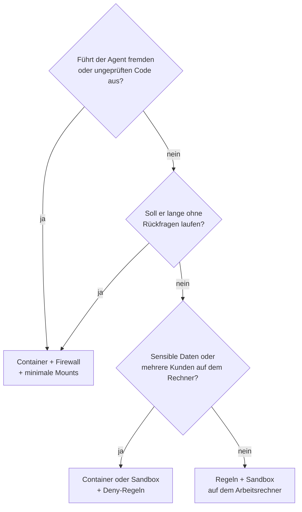

:::tldr
**Isolation entsteht nicht dadurch, wo du stehst, sondern dadurch, was du nicht erreichen kannst.** `cd` ändert nur den Standort, ein Container ändert die Erreichbarkeit. Härten heisst: **so wenig mounten wie möglich**, Lesendes **`:ro`**, **kein Netz**, wenn der Job keines braucht, **kein root** und **nie `docker.sock`**. Und ehrlich bleiben: Der Container schützt den Rest deines Rechners, **nicht** das eingehängte Projekt, und ohne Firewall **nicht vor Datenabfluss**.
:::

## Die Isolationsleiter

| Stufe | Bild | Technisch | Schützt gegen |
|---|---|---|---|
| 0 – Freie Hand | Generalschlüssel | Programm läuft als du | nichts |
| 1 – `cd` | Arbeiter steht in Zimmer 12, Generalschlüssel in der Tasche | Arbeitsverzeichnis gesetzt | **nichts** – nur Ordnung |
| 2 – Eigener Benutzer | Schlüssel nur für Zimmer 12 | separates Linux-Konto mit Dateirechten | Versehen |
| 3 – Container | Pavillon auf dem Hof, ein Fenster zu Zimmer 12 | `docker run -v ./projekt:/app` | Versehen **und** neugierigen Code |
| 4 – Container + Egress-Firewall | Pavillon ohne Telefon, ausser zu drei Nummern | Default-Deny-Regeln im Container | zusätzlich **Datenabfluss** |

:::falle Stufe 1 fühlt sich sicher an und ist es nicht
«Ich bin mit `cd` in den Projektordner, jetzt kann Claude nichts anderes anfassen.» Falsch. Claude Code **schreibt** standardmässig zwar nur im Startordner, kann aber nach einer Rückfrage auch **ausserhalb lesen** – etwa `~/.ssh`. Eine Rückfrage ist eine Nachfrage, keine Mauer, und bei fremdem Code kommt [[Prompt Injection]] dazu. Wer Lesen wirklich ausschliessen muss, braucht Deny-Regeln, die Sandbox oder einen Container (siehe [Schichten kombinieren](#/l/ai-security/sandbox-vs-permissions)).
:::

## Fünf Handgriffe zum Härten

```bash
docker run --rm -it \
  -v ~/projekte/ki-videos:/app \
  -v ~/projekte/daten:/daten:ro \
  -w /app \
  --network none \
  --user 1000:1000 \
  node:22 sh
```

1. **Nur mounten, was nötig ist.** `-v ~/projekte/x:/app` statt `-v ~:/app`. Wer sein ganzes Home mountet, hat den Container umsonst gebaut – das Fenster geht dann in jedes Zimmer.
2. **`:ro` für alles, was nur gelesen wird:** Referenzdaten, Vorlagen, fremde Repos. Der Agent kann lesen, aber nie überschreiben.
3. **`--network none`,** wenn der Job kein Internet braucht (Konvertieren, Rendern, Analysieren). Kein Telefonanschluss, kein Abfluss.
4. **Kein root:** `USER` im Dockerfile oder `--user`. Standardmässig ist der Prozess im Container root.
5. **`.dockerignore` als Geheimnisschutz:** Was nicht in den Build-Kontext kommt (`.env`, `.git`), kann auch nicht versehentlich ins Image wandern.

:::falle Kommentare hinter dem Backslash
Schreib keinen `# Kommentar` hinter einen Zeilenumbruch-`\`. Der Backslash heisst «die Zeile geht weiter». Steht danach noch etwas, ist die Fortsetzung kaputt, und die Shell meldet kryptische Fehler.
:::

:::gem Ein Secret im Image bleibt im Image
`COPY .env .` und in der nächsten Zeile `RUN rm .env` – die Datei ist trotzdem für immer in der früheren Schicht und reist mit jedem `docker push` mit. Secrets gehören zur **Laufzeit** in den Container (`--env-file`, Secrets-Mechanismus), nie zur **Bauzeit** ins Image.
:::

## Die eine Zeile, die du nie schreibst

```bash
-v /var/run/docker.sock:/var/run/docker.sock   # NIE
```

Sie steht in unzähligen Blog-Beispielen. Wer den Docker-Socket hineinreicht, gibt dem Prozess im Container die Steuerung über **Docker selbst**. Er kann einen neuen Container starten, der dein ganzes Dateisystem mountet und als root läuft. Das ist kein Bug, sondern die logische Folge dieser Zeile – und der Standardweg aus einem Container heraus.

:::bildlich Das Diensttelefon der Spedition
Der Arbeiter im Pavillon bekommt das Telefon der Firma, die alle Pavillons aufstellt. Er bestellt sich damit einen neuen Pavillon – einen mit Generalschlüssel für die ganze Schule.
:::

## Wogegen ein Container nicht schützt

- **Was du hineinreichst, ist drin.** Der Bind Mount auf dein Projekt ist echt. Der Agent kann dort jede Datei ändern oder löschen. Sicherheitsnetz: **Git** mit häufigen Commits.
- **Netzwerk ist standardmässig offen.** Container-Isolation ist **Datei**-Isolation, kein Schutz vor Datenabfluss. Ohne `--network none` oder Firewall kann alles im Container ins Internet senden.
- **Der Kern ist geteilt.** Container sind keine VMs. Unter Windows liegt zwar die WSL-2-VM dazwischen, was hilft – gegen gezielt bösartigen Code bleibt ein Container eine Schicht von mehreren.
- **Alles im Container Erreichbare ist exponiert** – inklusive der Zugangsdaten von Claude Code im Container. Anthropic hält in der Devcontainer-Doku fest, dass ein Devcontainer mit `--dangerously-skip-permissions` nicht verhindert, dass ein bösartiges Projekt alles im Container Erreichbare abzieht, auch diese Zugangsdaten (Stand 27.11.2026).

:::merke
Container sind exzellent gegen Versehen und gut gegen Neugier. Gegen einen entschlossenen Angreifer sind sie eine Schicht von mehreren.
:::

## KI-Agenten im Container

### Wann der Container Pflicht ist

- Der Agent soll **fremden oder ungeprüften Code** ausführen: ein unbekanntes Repo, `npm install` mit Hunderten Paketen samt Install-Skripten.
- Der Agent soll **lange unbeaufsichtigt** laufen und dafür ohne Rückfragen arbeiten.
- **Mehrere Projekte oder Kunden** müssen strikt getrennt bleiben.

### `--dangerously-skip-permissions`

Ohne Rückfragen zu arbeiten ist **nur** innerhalb eines Containers vertretbar – dort ersetzt die Wand die Nachfrage. Laut Anthropic-Doku (Stand 27.11.2026):

- Die CLI **verweigert** das Flag, wenn sie als **root** läuft. `remoteUser` muss also ein normales Konto sein.
- Ohne Rückfragen fällt die Möglichkeit weg, Werkzeugaufrufe vorher zu prüfen. Claude kann weiterhin **jede Datei im eingehängten Projekt** ändern und alles erreichen, was die Netzregeln des Containers erlauben.
- Darum: **mit einer Egress-Firewall kombinieren** und nur mit **vertrauenswürdigen Repos** arbeiten.
- Wer weniger Rückfragen ohne ganz abgeschaltete Prüfung will, kann den **Auto-Modus** prüfen. Wer das Flag im Team ganz verbieten will, sperrt es über [[Managed Settings]].

:::gem Die Referenz-Firewall von Anthropic
Anthropics Referenz-Devcontainer enthält ein Skript `init-firewall.sh`, das allen ausgehenden Verkehr blockiert ausser zu den Domains, die Claude Code und die Entwicklungswerkzeuge brauchen. Weil eine Firewall im Container zusätzliche Rechte braucht, setzt die Referenz die Capabilities `NET_ADMIN` und `NET_RAW` über `runArgs`. Das ist Stufe 4 der Leiter – ohne eigene Netzwerk-Infrastruktur.
:::

:::falle Sandbox im Container – nicht einfach beides
Die Bash-Sandbox von Claude Code (bubblewrap) braucht Benutzer-Namespaces, die Docker in der Standardkonfiguration oft blockiert. Ob sie im Container ohne Zusatzrechte läuft, muss man testen. In der Praxis ersetzt die Container-Isolation die Sandbox; wer beides will, testet und dokumentiert es.
:::



:::berater Im Kundengespräch
Der Anfänger fragt «Ist das sicher?», der Profi fragt **«Wogegen?»**. Für den Kunden heisst das: «Für den Alltag reichen Regeln und Sandbox. Sobald ein Agent fremden Code ausführt oder stundenlang allein arbeitet, gehört er in einen Container mit Firewall, der nur den Projektordner sieht. Und das Projekt selbst schützen wir mit Git und Reviews, denn den Ordner, den wir hineinreichen, kann der Agent verändern.» Typischer Einwand: «Container sind doch sicher, dann brauchen wir kein Review.» – Nein. Der Container schützt den Rechner, nicht den Code im Projekt.
:::

:::spickzettel
- **Isolation = Unerreichbarkeit**, nicht Standort. `cd` ist keine Grenze.
- Leiter: frei → `cd` → eigener Benutzer → **Container** → **Container + Firewall**
- Härten: **minimale Mounts**, **`:ro`**, **`--network none`**, **kein root**, **`.dockerignore`**
- **Nie** `docker.sock` mounten · Secrets nie ins Image
- Container schützt **nicht**: das eingehängte Projekt, Datenabfluss ohne Firewall, Zugangsdaten im Container
- `--dangerously-skip-permissions`: nur im Container, nicht als root, mit Firewall, nur vertrauenswürdige Repos
- Pflicht bei: fremdem Code, langen unbeaufsichtigten Läufen, Kundentrennung
:::

:::selbstcheck 3
