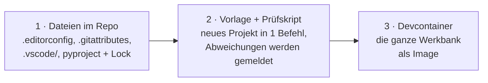

:::tldr
Ein Team-Standard ist erreicht, wenn ein **frischer Klon** auf einem fremden Rechner mit **zwei Befehlen** läuft (`uv sync --locked`, `uv run pytest`) und alle denselben Formatierer, dieselben Zeilenenden und dieselben Werkzeuge haben. Dafür gehören **Workspace-Einstellungen**, **empfohlene Erweiterungen**, **Tasks**, **`.editorconfig`**, **`.gitattributes`** und bei Bedarf ein **Devcontainer** ins Repo. Persönliches – Farbschema, Tastenkürzel, Schriftgrösse – bleibt in den **User-Settings**.
:::

## Drei Stufen der Standardisierung



| Stufe | Standardisiert | Aufwand | Gut für |
|---|---|---|---|
| 1 Dateien im Repo | Formatierung, Zeilenenden, Abhängigkeiten, Editor-Verhalten | gering | jedes Projekt |
| 2 Vorlage + Prüfskript | Projektstruktur, Checklisten, frühe Fehlererkennung | mittel | Teams mit vielen ähnlichen Projekten |
| 3 Devcontainer | Betriebssystem, Werkzeuge, Versionen, Isolation | höher, einmalig | heterogene Rechner, KI-Agenten, Onboarding |

:::bildlich Gemeinsame Werkstatt statt eigener Werkzeugkiste
Stufe 1 ist das **Schild an der Werkbank**: «Hier wird metrisch gemessen, Schrauben links.» Stufe 2 ist die **Checkliste beim Eintreten**, die meldet, wenn etwas fehlt. Stufe 3 ist eine **komplett eingerichtete Werkstatt**, die man per Knopfdruck an jedem Ort aufstellen kann – mit genau denselben Maschinen.
:::

## User- oder Workspace-Einstellung?

| | User-Settings | Workspace-Settings |
|---|---|---|
| Ort | ausserhalb des Projekts (`Strg+,` → «Open Settings (JSON)») | `.vscode/settings.json` im Projekt |
| Gilt für | alle deine Projekte | nur dieses Projekt, für alle |
| Ins Git? | nein | **ja**, wenn es das Team betrifft |
| Beispiele | Farbschema, Schriftgrösse, Tastenkürzel, Auto Save | Formatierer, Zeilenende, Interpreter-Pfad, Testframework |

Workspace-Einstellungen überschreiben die User-Einstellungen für dieses Projekt.

### Was in `.vscode/` gehört

```jsonc
// .vscode/settings.json
{
  "files.eol": "\n",
  "files.insertFinalNewline": true,
  "files.trimTrailingWhitespace": true,
  "editor.formatOnSave": true,
  "python.defaultInterpreterPath": "${workspaceFolder}/.venv/bin/python",
  "python.testing.pytestEnabled": true,
  "[python]": { "editor.defaultFormatter": "charliermarsh.ruff" }
}
```

```jsonc
// .vscode/extensions.json – VS Code schlägt diese beim Öffnen vor
{ "recommendations": ["ms-python.python", "charliermarsh.ruff", "ms-vscode-remote.remote-containers"] }
```

- **`tasks.json`** macht wiederkehrende Befehle (Tests, Linter, Build) über «Run Task» für alle gleich startbar.
- **`launch.json`** legt Debug-Konfigurationen fest (`F5`), damit niemand sie neu erfinden muss.

:::falle Persönliches im Team-Repo
Wer seine ganze `settings.json` mitcommittet, zwingt allen sein Farbschema, seine Schriftgrösse oder lokale Pfade (`/home/anna/…`) auf – und erzeugt Konflikte bei jedem, der etwas anpasst. In `.vscode/settings.json` gehört nur, was **für das Projekt** gelten muss. Pfade immer relativ über `${workspaceFolder}`.
:::

## Editor-unabhängig: `.editorconfig` und `.gitattributes`

Nicht jeder nutzt VS Code – und KI-Agenten nutzen gar keinen Editor. Zwei kleine Dateien wirken trotzdem für alle:

```ini
# .editorconfig – von den meisten Editoren gelesen
root = true
[*]
end_of_line = lf
insert_final_newline = true
charset = utf-8
indent_style = space
indent_size = 4
[*.{yml,yaml,json,md}]
indent_size = 2
```

`.gitattributes` mit `* text=auto eol=lf` sorgt dafür, dass **im Repo** immer LF steht, egal wer von wo committet (Lektion [Git unter WSL einrichten](#/l/git-github/einrichten-wsl)).

:::gem Die eine Wahrheit für Formatierung
Lokal formatiert VS Code beim Speichern, in CI prüft ein Linter, und ein Agent formatiert gar nicht – wenn die drei verschiedene Versionen oder Regeln nutzen, ist CI dauernd rot. Lösung: **ein** Werkzeug mit **einer** Konfiguration (z. B. Ruff in der `pyproject.toml`), lokal über pre-commit und in CI mit **demselben Befehl** aufgerufen.
:::

## Vorlage und Prüfskript

Ein Team, das regelmässig neue Projekte startet, legt eine **Projektvorlage** an: ein Skript, das Ordnerstruktur, `pyproject.toml`, `.gitignore`, `.gitattributes`, `.editorconfig`, `.env.example` und `.vscode/` in einem Schritt erzeugt. Ein **Prüfskript** meldet Abweichungen in bestehenden Projekten: Projekt unter `/mnt/c`, `.env` im Git, fehlende `.env.example`, kein Lock, `credential.helper store`.

:::praxis Definition of Done für eine reproduzierbare Umgebung
- Frischer Klon + `uv sync --locked` + `uv run pytest` läuft auf einem zweiten Rechner oder im Container.
- Keine Secrets im Git (`git ls-files` ohne `.env`), `.env.example` vollständig.
- Projekt liegt im Linux-Dateisystem, nicht unter `/mnt/c`.
- Prüfskript ohne Fehler.
:::

## Stufe 3: der Devcontainer

Ein Devcontainer standardisiert nicht nur Einstellungen, sondern die **ganze Werkbank** – Betriebssystem, Werkzeuge, Versionen, VS-Code-Erweiterungen. Bewährt hat sich **ein gemeinsames Basis-Image** für alle Projekte plus eine kleine `devcontainer.json` pro Projekt. Nebeneffekt: Jeder Agent, der im Container arbeitet, sieht nur dieses Projekt (Lektion [Devcontainer](#/l/container/devcontainer)).

:::gem Profiles und Settings Sync für die persönliche Seite
Was persönlich bleibt, muss nicht auf jedem Rechner neu eingerichtet werden: **Settings Sync** (über den GitHub- oder Microsoft-Login) überträgt User-Einstellungen, Erweiterungen und Tastenkürzel. **Profiles** trennen Kontexte, z. B. ein schlankes «Python»-Profil und ein «Schulung»-Profil mit grosser Schrift – umschaltbar über das Zahnrad unten links.
:::

:::berater Im Kundengespräch
Die Kosten fehlender Standards sieht man selten direkt: Onboarding dauert Tage statt Stunden, CI ist «manchmal rot», und Fehler lassen sich nicht reproduzieren. Ein Vorschlag in drei Etappen überzeugt meist: **diese Woche** Stufe 1 in allen aktiven Repos, **diesen Monat** eine Vorlage für neue Projekte, **dieses Quartal** ein Devcontainer für Teams mit KI-Agenten. Typischer Einwand: «Unsere Leute wollen ihre eigene Umgebung.» – Dürfen sie, in den User-Settings. Standardisiert wird nur, was das Ergebnis beeinflusst.
:::

:::spickzettel
- Ziel: **frischer Klon + 2 Befehle = läuft**, überall gleich
- Stufen: **Dateien im Repo → Vorlage + Prüfskript → Devcontainer**
- Workspace (`.vscode/settings.json`, `extensions.json`, `tasks.json`, `launch.json`) ins Git; **User-Settings persönlich**
- Pfade mit `${workspaceFolder}`, keine persönlichen Pfade
- **`.editorconfig`** + **`.gitattributes`** wirken für alle Editoren und Agenten
- Ein Formatierer, eine Konfiguration, lokal und CI **derselbe Befehl**
- Devcontainer: gemeinsames Basis-Image, kleine `devcontainer.json` pro Projekt
- Persönliches mit **Settings Sync** und **Profiles**
:::

:::selbstcheck 3
