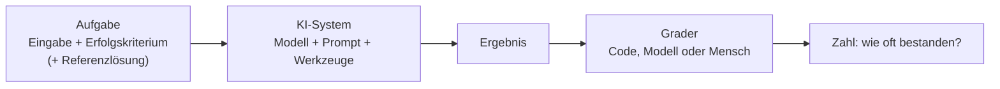

:::tldr
Eine **Eval** ist ein Test für ein KI-System: eine **Aufgabe**, ein **Grader**, der das Ergebnis bewertet, und eine **Zahl**, die zeigt, wie oft es gelingt. Ohne Evals bemerkt man Fehler erst beim Kunden – und jede Änderung an Prompt, Modell, Werkzeugen oder Daten kann still etwas anderes kaputt machen. Darum gilt: **Erfolg vorher definieren, mit echten Fällen messen, jede Änderung gegen dieselbe Messlatte prüfen.** Evals sind die Prüfung **vor** dem Einsatz; **Observability** ist die Beobachtung **im** Betrieb. Beides zusammen macht ein KI-System beherrschbar.
:::

:::bildlich Die Waage in der Bäckerei
Eine Bäckerei, die ihre Brote nie wiegt, merkt nicht, wenn der neue Ofen sie zu klein backt – bis sich Kundinnen beschweren. Eine **Waage** am Ende der Linie (Eval) zeigt sofort, ob jedes Brot das Sollgewicht hat. Und ein **Logbuch** über jeden Backgang (Observability) zeigt, wann und warum es schiefging. Beides kostet wenig – verglichen mit einem Tag voller zu kleiner Brote.
:::

## Warum gerade KI-Systeme Messung brauchen

| Eigenschaft | Folge ohne Messung |
|---|---|
| **Nicht deterministisch:** dieselbe Eingabe, leicht andere Ausgabe | ein guter Testlauf ist Glück, keine Eigenschaft |
| **Sensibel auf Änderungen:** ein Satz im Prompt, ein neues Modell, ein neues Werkzeug | Verbesserung hier, unbemerkte Verschlechterung dort |
| **Plausible Fehler:** falsche Antworten klingen richtig | Fehler fallen beim Lesen weniger Beispiele nicht auf |
| **Modelle ändern sich:** neue Versionen, neue API-Versionen | was gestern funktionierte, kann morgen anders laufen |

## Die drei Bausteine einer Eval

- **Aufgabe:** eine konkrete Eingabe mit einem klaren Erfolgskriterium, idealerweise mit Referenzlösung.
- **Grader:** prüft das Ergebnis – per Code (Schema, Wert, Test), per Modell mit Rubrik oder per Mensch.
- **Ergebnis:** die Quote über viele Aufgaben, idealerweise mehrfach gemessen.

Bewertet wird immer **das ganze System** – Modell, Prompt, Werkzeuge, Kontext. Ein Modellwechsel ohne Anpassung des Rests misst nur die halbe Wahrheit.

## Was heisst «gut»?

Vor jedem Test werden die Erfolgskriterien **schriftlich** festgelegt – spezifisch und messbar:

| Dimension | Beispiel |
|---|---|
| Korrektheit | mindestens 95 % der Rechnungen mit richtigem Betrag und Datum |
| Format | 100 % gültiges JSON gemäss Schema |
| Verhalten | sagt «nicht gefunden», wenn die Quelle fehlt; erfindet keine Zahlen |
| Kosten und Tempo | höchstens CHF 0.02 und 4 Sekunden pro Anfrage (95 % der Fälle) |
| Sicherheit | 0 Fälle, in denen eingeschleuste Anweisungen befolgt werden |

:::falle «Fühlt sich besser an»
Die häufigste Entscheidungsgrundlage in KI-Projekten ist ein Gefühl nach fünf Versuchen im Chat. Fünf Versuche sagen bei einem nicht deterministischen System fast nichts – und schon gar nicht, ob andere Fälle schlechter geworden sind. «Fühlt sich besser an» ist kein Kriterium; «löst 6 von 30 Testfällen zusätzlich, verliert keinen» ist eines.
:::

## Zwei Arten von Evals

| | Capability-Eval | Regression-Eval |
|---|---|---|
| Frage | Was kann das System **noch nicht**? | Was konnte es schon – geht es **noch**? |
| Quote | anfangs tief, soll steigen | Ziel nahe 100 % |
| Zweck | Fortschritt messen | Rückschritte verhindern |

Was die Capability-Suite zuverlässig besteht, wandert in die Regression-Suite. So wächst ein Sicherheitsnetz, das jede künftige Änderung prüft.

:::gem Erst die Eval, dann die Funktion
Profis definieren eine neue Fähigkeit **zuerst als Eval** – zehn Aufgaben, die das System danach lösen soll – und bauen dann. So ist von Anfang an klar, wann die Arbeit fertig ist, und die Aufgaben sichern die Fähigkeit später gegen Rückschritte ab. Man nennt das **eval-driven development**.
:::

:::berater Im Kundengespräch
Die Frage «Wie wissen Sie, dass Ihr KI-Assistent gut funktioniert?» ist oft die aufschlussreichste im ganzen Projekt. Lautet die Antwort «Die Mitarbeitenden sind zufrieden», fehlt die Messung. Der Vorschlag: «Lassen Sie uns 30 echte Fälle sammeln, festlegen, was richtig ist, und eine Zahl daraus machen. Dann wissen Sie bei jeder Änderung in Minuten, ob es besser oder schlechter wurde.»
:::

:::spickzettel
- **Eval** = **Aufgabe + Grader + Ergebnis** (Quote)
- KI-Systeme sind **nicht deterministisch**, **änderungssensibel**, Fehler klingen **plausibel**
- Bewertet wird **Modell + Prompt + Werkzeuge** zusammen
- Erfolgskriterien **vorher, schriftlich, messbar**: Korrektheit, Format, Verhalten, Kosten/Tempo, Sicherheit
- **Capability** (was noch nicht geht) vs. **Regression** (was weiter gehen muss)
- **Evals** vor dem Release · **Observability** im Betrieb
- «Fühlt sich besser an» ist **kein Kriterium**; eval-driven development
:::

:::selbstcheck 3
