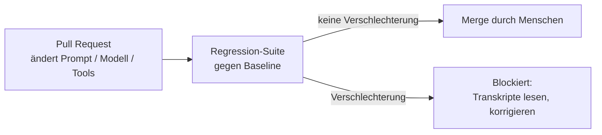

:::tldr
«Die KI soll gut funktionieren» ist kein Abnahmekriterium. Abnahmefähig wird Qualität erst, wenn vier Dinge schriftlich festgelegt sind: **Kriterien mit Schwellen** (z. B. «≥ 92 % richtige Beträge, 100 % gültiges Format, 0 befolgte eingeschleuste Anweisungen»), ein **Messverfahren** (welches Testset, welche Grader, wie viele Läufe, wie mit Unsicherheit umgegangen wird), die **Hoheit über das Testset** (wer liefert Fälle, wer darf sie ändern) und das **Vorgehen bei Änderungen** – jede Änderung an Prompt, Modell oder Werkzeugen läuft durch ein **Regression-Gate**, ein Modellwechsel durch eine erneute Abnahme.
:::

:::bildlich Die Bauabnahme
Bei einem Haus wird nicht abgenommen, ob es «schön geworden» ist, sondern nach **Plänen und Normen**: Masse, Dichtheit, Elektrik – jeweils mit einem **Prüfverfahren** und einer **Toleranz**. Später wird jeder Umbau wieder geprüft. Eine KI-Abnahme funktioniert genauso: Kriterien, Prüfverfahren, Toleranz – und eine erneute Prüfung bei jedem «Umbau».
:::

## Die vier Elemente einer Qualitätsvereinbarung

| Element | Inhalt | Beispiel |
|---|---|---|
| **1. Kriterien und Schwellen** | pro Dimension ein messbarer Wert | Korrektheit ≥ 92 %, Format 100 %, Sicherheit 0 Verstösse, Kosten ≤ CHF 0.03 und Latenz ≤ 5 s (95 % der Fälle) |
| **2. Messverfahren** | Testset, Grader, Anzahl Läufe, Auswertung | 200 Fälle, Code-Grader für Beträge, geeichter Judge für Ton, k = 3, Schwelle gilt für pass^3 |
| **3. Testset-Hoheit** | wer liefert, pflegt und darf ändern | Kunde liefert echte, anonymisierte Fälle; ein Teil bleibt beim Kunden als **Hold-out** |
| **4. Änderungen** | was bei Änderungen geschieht | Regression-Gate bei jedem Pull Request; erneute Abnahme bei Modell- oder API-Wechsel |

## Schwellen ehrlich setzen

- **Nicht 100 % versprechen** – ausser bei deterministisch prüfbarem Format. Ein Sprachmodell irrt irgendwann; die Frage ist, wie oft und was dann passiert.
- **Genug Fälle:** Bei 30 Fällen und einer Quote um 92 % beträgt die Unsicherheit rund ± 10 Prozentpunkte; das 95-%-Vertrauensintervall reicht bei 28 von 30 richtigen Antworten von etwa 79 % bis 98 % – eine Schwelle von 92 % lässt sich damit nicht seriös prüfen. Für Abnahmen eher **100–200 Fälle** oder die Schwelle auf die **Untergrenze des Vertrauensintervalls** beziehen.
- **pass^k statt pass@k**, wo Verlässlichkeit zählt: Bei Kundenkontakt muss es **jedes Mal** stimmen.
- **Pro Kategorie** Mindestwerte, damit ein guter Durchschnitt keine Lücke verdeckt.
- **Was bei Fehlern passiert**, gehört dazu: Prüfschritt durch Menschen, Rückfall, Eskalation.

:::falle Das Testset gehört dem Lieferanten
Wenn nur der Lieferant das Testset kennt und pflegt, kann er – auch unbeabsichtigt – auf genau diese Fälle optimieren: perfekte Zahlen bei der Abnahme, enttäuschende im Betrieb. Besser: Der **Kunde liefert** die Fälle aus seinem Alltag, ein **Hold-out-Teil** bleibt beim Kunden und wird erst bei der Abnahme eingesetzt, und Änderungen am Testset werden **gemeinsam** beschlossen und versioniert.
:::

## Regression-Gates

| Wann | Was läuft | Ziel |
|---|---|---|
| **Jeder Pull Request**, der Prompt, Modell, Werkzeuge oder Retrieval ändert | schnelle, deterministische Regression-Suite gegen die gespeicherte **Baseline** | nichts Bestehendes kaputt machen |
| **Nachts oder vor Release** | volle Suite inkl. Judges, Kosten- und Latenzbudget, Red-Team-Fälle | Gesamtbild |
| **Modell- oder API-Wechsel** | volle Suite alt gegen neu, **gepaart**, plus Kostenvergleich | erneute Abnahme |
| **Nach Go-live** | Online-Evals auf einer Stichprobe, Fehlerquote, Alarme | Qualität im Betrieb halten |

:::gem Modellwechsel sind Umbauten
Anbieter veröffentlichen neue Modelle und API-Versionen in kurzen Abständen – oft mit geänderten Standardwerten, Preisen oder Verhalten. Ein Vertrag, der eine **erneute Abnahme bei Modellwechsel** vorsieht, schützt beide Seiten: Der Kunde bekommt keine stille Verschlechterung, der Lieferant hat ein klares Verfahren, um von besseren oder günstigeren Modellen zu profitieren.
:::

## Vertragsform in der Schweiz

Ob ein KI-Projekt als **Werkvertrag** (OR Art. 363 ff.: ein bestimmter **Erfolg** wird geschuldet, mit Prüfung und Abnahme) oder als **Auftrag** (OR Art. 394 ff.: sorgfältiges **Tätigwerden**, kein garantierter Erfolg) gestaltet wird, hat grosse Folgen für Abnahme und Gewährleistung. Messbare Qualitätskriterien passen gut zu einer **Abnahme**, müssen aber die Eigenheiten von KI berücksichtigen (Streuung, Modellwechsel, Datenabhängigkeit). Die rechtliche Gestaltung gehört in die Hände einer **Fachperson** – die Aufgabe des Beraters ist, die **messbaren Kriterien und das Verfahren** zu liefern.

:::berater Im Kundengespräch
Ein bewährter Ablauf für die Qualitätsvereinbarung: (1) **Workshop** mit den Fachleuten: Erfolgskriterien und Grenzfälle festlegen. (2) **Testset** aus 100–200 echten, anonymisierten Fällen, Hold-out beim Kunden. (3) **Pilotmessung** mit dem heutigen Stand – oft zeigt schon das, wo realistische Schwellen liegen. (4) **Schwellen** festlegen, inklusive Kosten und Latenz. (5) **Regression-Gate** und **Abnahme bei Modellwechsel** vereinbaren. Typischer Einwand: «Das ist zu aufwendig für ein KI-Projekt.» – Es ist der einzige Weg, «funktioniert gut» überprüfbar zu machen, und es schützt den Kunden wie den Lieferanten vor Streit.
:::

:::spickzettel
- Vier Elemente: **Kriterien mit Schwellen** · **Messverfahren** · **Testset-Hoheit** · **Vorgehen bei Änderungen**
- Schwellen: **nicht 100 %** (ausser Format), **genug Fälle** (100–200) oder **Untergrenze des Intervalls**, **pass^k**, **pro Kategorie**
- **Kunde liefert Fälle**, **Hold-out** beim Kunden, Änderungen gemeinsam und versioniert
- **Regression-Gate** bei jedem PR (deterministisch, gegen Baseline); volle Suite nachts/vor Release
- **Erneute Abnahme bei Modell-/API-Wechsel**, gepaart alt gegen neu
- Nach Go-live: **Online-Evals**, Fehlerquote, Alarme
- **Werkvertrag** (OR 363 ff., Erfolg) vs. **Auftrag** (OR 394 ff., Sorgfalt) – rechtlich durch Fachperson prüfen
:::

:::selbstcheck 3
