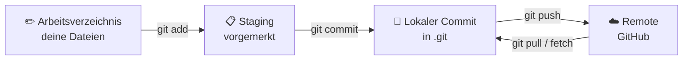

:::tldr
**Git** ist ein Fotoapparat für deinen Projektordner: Jeder **Commit** ist ein Foto, zu dem du jederzeit zurückkannst. **GitHub** ist das Fotoalbum im Internet, das du mit anderen teilst. Eine Änderung durchläuft **vier Stationen**: Arbeitsverzeichnis → Staging → lokaler Commit → Remote. Erst mit `git push` verlässt sie deinen Rechner. Und was einmal committet und gepusht wurde, bleibt in der Historie – auch ein versehentlich eingechecktes Passwort.
:::

## Git und GitHub – zwei verschiedene Dinge

| | Git | GitHub |
|---|---|---|
| Was | Programm auf deinem Rechner | Webdienst (Microsoft) |
| Speichert | Historie im versteckten Ordner `.git` neben deinem Code | Kopie des Repos im Internet |
| Funktioniert offline | ja | nein |
| Zusätzlich | – | Pull Requests, Reviews, Issues, Actions (CI), Rechte |

Git funktioniert ganz ohne GitHub. GitHub ist der Treffpunkt, an dem mehrere Menschen – und KI-Agenten – am selben Code arbeiten.

:::bildlich Fotoapparat und Fotoalbum
Git ist ein **Fotoapparat**, der neben deinem Projektordner steht. Mit `git add` wählst du aus, was aufs nächste Foto soll, mit `git commit` drückst du ab. Die Fotos liegen in einer Schachtel (`.git`) neben dem Ordner. Mit `git push` klebst du sie ins **gemeinsame Album** auf GitHub; mit `git pull` holst du dir die Fotos der anderen. Und wenn etwas kaputtgeht, legst du einfach ein altes Foto hin – der Ordner sieht wieder genau so aus.
:::

## Die vier Stationen



| Station | Was dort liegt | Befehl dorthin | Ansehen |
|---|---|---|---|
| 1 Arbeitsverzeichnis | deine Dateien, wie du sie gerade bearbeitest | (speichern im Editor) | `git status`, `git diff` |
| 2 Staging Area | Änderungen, die ins nächste Foto sollen | `git add <datei>` | `git diff --staged` |
| 3 Lokales Repository | Commits mit Nachricht, Autor, Zeit | `git commit -m "…"` | `git log --oneline` |
| 4 Remote (GitHub) | geteilte Commits | `git push` | im Browser |

:::gem Warum es das Staging überhaupt gibt
Staging erlaubt **saubere Commits aus einem unordentlichen Arbeitstag**. Du hast einen Bug behoben und nebenbei eine Formatierung geändert? `git add bugfix.py` → Commit «Fix login timeout», dann `git add style.css` → zweiter Commit. Jedes Foto erzählt eine Sache – und lässt sich später einzeln zurücknehmen.
:::

:::falle Committet heisst nicht gesichert
Ein Commit liegt nur **auf deinem Rechner**, bis du `git push` ausführst. Geht der Laptop kaputt, sind ungepushte Commits weg. Ebenso umgekehrt: Was ein Kollege gepusht hat, siehst du erst nach `git pull`.
:::

## Die Befehle für jeden Tag

```bash
git status              # Was hat sich geändert? (der wichtigste Befehl)
git diff                # Welche Zeilen genau? (noch nicht vorgemerkt)
git add <datei>         # vormerken; git add . = alles im Ordner
git commit -m "Fix login timeout"   # Foto machen
git push                # zu GitHub hochladen
git pull                # von GitHub holen und einarbeiten
git fetch               # nur nachschauen, was es Neues gibt, nichts einarbeiten
git log --oneline       # kompakte Historie
git switch -c fix/login # neuen Zweig anlegen und wechseln
```

`git pull` ist eigentlich zwei Schritte: `git fetch` (holen) plus `git merge` (einarbeiten). Wer erst schauen will, was kommt, macht `fetch` allein.

### Gute Commit-Nachrichten

- **Eine Zeile, Befehlsform**, kurz (≤ 72 Zeichen): «Add retry to API client», nicht «Änderungen» oder «misc».
- Optional nach einer Leerzeile: **warum**, nicht was – das Was zeigt der Diff.
- Lieber drei kleine, thematische Commits als einer mit allem.

## Branches in einem Satz

Ein **Branch** ist eine eigene Fotoreihe, die von einem bestimmten Foto abzweigt. Du kannst darin experimentieren, ohne den Hauptzweig `main` zu stören. Ist die Arbeit fertig, wird sie über einen **Pull Request** zurück in `main` geführt (Lektion [Branch, Pull Request, Review](#/l/git-github/branch-pr-review)).

## Was nie in Git gehört

Eine Datei `.gitignore` im Projekt listet, was Git gar nicht erst beachten soll:

```gitignore
.env
.venv/
node_modules/
__pycache__/
*.log
```

:::falle Ein committetes Secret ist für immer geleakt
Wer ein Token in den Code schreibt, committet und pusht, kann es danach nicht mehr «einfach löschen». Der nächste Commit entfernt die Datei nur aus dem aktuellen Stand – **in der Historie bleibt sie lesbar**, für alle mit Zugriff aufs Repo. Der einzig wirksame Schritt: das Token **sofort beim Anbieter sperren und neu ausstellen**. Secrets gehören in eine `.env`, die in `.gitignore` steht.
:::

:::gem `.gitignore` wirkt nicht rückwirkend
Eine Datei, die Git schon verfolgt, bleibt verfolgt, auch wenn du sie nachträglich in `.gitignore` einträgst. Erst `git rm --cached <datei>` nimmt sie aus der Verfolgung (die Datei auf der Platte bleibt).
:::

## Häufige Meldungen

| Meldung | Bedeutung | Was tun |
|---|---|---|
| `fatal: not a git repository` | du bist im falschen Ordner oder `git init` fehlt | `pwd`, in den Projektordner wechseln |
| `rejected … (fetch first)` | auf GitHub gibt es neuere Commits | `git pull --rebase`, dann `git push` |
| `nothing to commit, working tree clean` | alles ist bereits fotografiert | nichts – alles in Ordnung |
| `Changes not staged for commit` | geändert, aber nicht vorgemerkt | `git add`, dann committen |

:::berater Im Kundengespräch
«Git ist die Versicherung für Ihren Code: Jeder Stand ist fotografiert, jede Änderung hat einen Namen und einen Grund, und alles lässt sich zurückdrehen.» Gerade mit KI-Agenten wird das zentral: Wenn ein Agent Dateien ändert, zeigt Git **genau**, was er gemacht hat, und ein Fehlgriff ist ein Befehl weit weg. Typischer Einwand: «Wir haben doch ein Backup.» – Ein Backup zeigt nicht, **wer was warum** geändert hat, und lässt sich nicht Zeile für Zeile prüfen.
:::

:::spickzettel
- Git = Fotoapparat (lokal, `.git`), GitHub = gemeinsames Album (online)
- Vier Stationen: **Arbeitsverzeichnis → `add` → Staging → `commit` → lokal → `push` → GitHub**
- Commit ≠ gesichert: erst `push` verlässt den Rechner
- `git status` zuerst, `git diff` für Details, `git log --oneline` für die Historie
- `pull` = `fetch` + `merge`
- Commit-Nachricht: kurz, Befehlsform, eine Sache
- Secrets in `.env` + `.gitignore`; committet = **sofort sperren**, nicht nur löschen
- `.gitignore` wirkt nicht rückwirkend → `git rm --cached`
:::

:::selbstcheck 3
