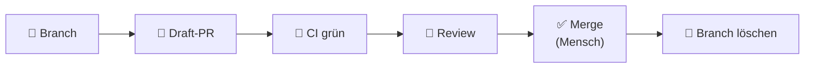

:::tldr
**`main` ist immer lauffähig.** Jede Änderung läuft über einen kurzen Branch und einen **Pull Request (PR)**: zuerst als **Draft**, dann CI grün, eigener Diff gelesen, Review, Merge – meist per **Squash**, ein Commit pro PR. **Maschinen prüfen, Menschen entscheiden.** Agenten öffnen nur Draft-PRs und mergen nie. Wer PRs aufeinander stapelt, merged von unten nach oben, sonst schlägt die **Squash-Falle** zu.
:::

## Der Ablauf in acht Befehlen

```bash
git switch main && git pull                 # aktuell starten
git switch -c fix/login-timeout             # ein Thema pro Branch
# … arbeiten, klein committen …
git push                                    # mit push.autoSetupRemote kein -u nötig
gh pr create --draft --fill                 # Draft-PR, Beschreibung ergänzen
gh pr checks --watch                        # CI abwarten
gh pr ready                                 # wenn grün und selbst geprüft
gh pr merge --squash --delete-branch        # nach Review – Agenten: nie
git switch main && git pull && git fetch --prune   # aufräumen
```



:::bildlich Der Änderungsantrag im Bauamt
`main` ist der **genehmigte Bauplan**. Niemand radiert direkt darin. Wer etwas ändern will, zeichnet auf einer **Kopie** (Branch) und reicht einen **Änderungsantrag** ein (PR). Der Prüfautomat rechnet die Statik nach (CI), eine Fachperson schaut drüber (Review), und erst die zuständige Person stempelt (Merge). «Draft» heisst: Der Antrag liegt schon auf dem Tisch, ist aber ausdrücklich noch nicht zur Genehmigung eingereicht.
:::

### Branch-Namen

`<typ>/<kurz-beschreibung>` in Kleinbuchstaben mit Bindestrichen: `feat/retry-client`, `fix/login-timeout`, `docs/readme-setup`. Agenten-Branches mit Präfix und Datum (`weekly/inhalte-2026-11-27`), damit man sie sofort erkennt.

## Gute Pull Requests

- **Klein:** eine Absicht pro PR. Richtwert: weniger als 400 geänderte Zeilen.
- **Beschreibung mit vier Teilen:** Warum, Was, Wie getestet, Risiken und Rückweg. `Closes #12` schliesst beim Merge das passende Issue.
- **Draft, bis CI grün ist** und du deinen eigenen Diff gelesen hast (`gh pr diff`).
- **Keine Nebenbei-Änderungen** wie das Umformatieren ganzer Dateien – sie verstecken die eigentliche Änderung.

## Review: Menschen und Claude

Eine kurze Checkliste für jeden Review: Löst der PR, was er verspricht – und nur das? Sind Randfälle und Fehlerpfade bedacht? Gibt es Tests für neue Logik? Keine Secrets, keine Debug-Reste? Neue Abhängigkeiten nötig und gepflegt?

Claude kann dabei helfen, von leicht bis gründlich (Stand 27.11.2026): `/code-review` lokal vor dem Push, ein eigener Review-Subagent, die GitHub Action `anthropics/claude-code-action` in der eigenen CI oder der verwaltete Dienst **Code Review** für Team- und Enterprise-Pläne. Dieser kommentiert, blockiert aber nie einen Merge und genehmigt nichts.

:::merke
KI-Review ersetzt die menschliche Entscheidung nicht. Funde prüfen, beantworten oder beheben – mergen tut ein Mensch.
:::

## Die drei Merge-Methoden

| | Squash and merge | Rebase and merge | Merge-Commit |
|---|---|---|---|
| Auf `main` | **ein neuer Commit** pro PR | alle Commits, neu erzeugt | alle Commits plus ein Merge-Commit |
| Historie | linear, ein Eintrag pro PR | linear, feingranular | verzweigt, vollständig |
| Rückgängig | ein `git revert` | mehrere Commits | `git revert -m 1 <merge>` |
| Gut für | Solo, kleine PRs, unordentliche Zwischencommits | bewusst geschnittene Commits | lange Feature- und Release-Branches |

:::falle Die Squash-Falle bei gestapelten PRs
PR A (`feat/a` → `main`), PR B baut auf A auf (`feat/b` → `feat/a`). A wird per **Squash** in `main` gemergt – das erzeugt einen **neuen** Commit. B enthält weiter die alten A-Commits. Git sieht dieselben Änderungen zweimal, und B zeigt plötzlich Konflikte. **Richtig:** unterster PR zuerst nach `main`, dann B auf `main` umstellen und rebasen (`git rebase --onto origin/main <letzter-A-commit> feat/b`), dann B mergen. Nie einen PR in einen anderen Feature-Branch mergen.
:::

:::gem Native Stacked PRs mit `gh stack`
Seit Oktober 2026 kennt GitHub gestapelte PRs nativ (Erweiterung `github/gh-stack`, Stand 27.11.2026). GitHub verwaltet dann Basis und Rebase selbst, stellt bei gelöschter Basis den Stapel automatisch um und behält Approvals bei einem Rebase ohne Änderungen. Befehle ändern sich noch – vor Gebrauch `gh stack --help`.
:::

## Branch aktuell halten und Konflikte lösen

`main` ist weitergelaufen, und dein PR zeigt «out of date» oder Konflikte:

| Weg | Befehl | Wann |
|---|---|---|
| **Rebase** | `git fetch && git rebase origin/main`, dann `git push --force-with-lease` | eigener Branch, an dem sonst niemand arbeitet |
| Merge von main | `git fetch && git merge origin/main`, dann `git push` | Branch wird von mehreren genutzt |
| Knopf «Update branch» | im PR | kleine Fälle ohne Konflikt |

**Konflikt lösen:**

1. `git status` zeigt die betroffenen Dateien.
2. In jeder Datei die Blöcke `<<<<<<<`, `=======`, `>>>>>>>` **bewusst** zusammenführen – nicht blind «meins» oder «deins».
3. Generierte Dateien (Lock-Dateien) nicht von Hand mischen, sondern neu erzeugen (z. B. `uv lock`).
4. `git add <datei>`, dann `git rebase --continue` bzw. `git commit`.
5. **Tests laufen lassen, bevor** du pushst. Abbrechen geht immer: `git rebase --abort` bzw. `git merge --abort`.

:::gem `--force-with-lease` statt `--force`
Nach einem Rebase muss der eigene Branch neu gepusht werden. `--force-with-lease` bricht ab, wenn inzwischen jemand anderes auf den Branch gepusht hat – `--force` überschreibt dessen Arbeit stillschweigend. Auf `main` gilt: nie, egal mit welchem Flag.
:::

## Parallele Claude-Sessions: Worktrees

Zwei Claude-Code-Sessions im selben Ordner überschreiben sich gegenseitig. Ein **Worktree** ist ein zweites Arbeitsverzeichnis desselben Repos auf einem anderen Branch – ohne zweites Klonen.

```bash
git worktree add ../projekt-feat-x -b feat/x    # neuer Ordner, neuer Branch
cd ../projekt-feat-x && claude                   # eigene Session
git worktree list
git worktree remove ../projekt-feat-x            # nach dem Merge
```

Claude Code kann das auch selbst (`claude --worktree`). Dateien, die nicht in Git sind (z. B. `.env`), müssen in neue Worktrees eigens mitgegeben werden.

:::berater Im Kundengespräch
«Bei uns geht nichts direkt in den Hauptstand. Jede Änderung – ob von einem Menschen oder einem KI-Agenten – kommt als Antrag mit Begründung, wird automatisch getestet und von einer Person freigegeben.» Typischer Einwand: «Das verlangsamt uns.» – Kleine PRs sind in Minuten geprüft. Was wirklich bremst, sind grosse Änderungen ohne Review, die später niemand mehr versteht oder zurücknehmen kann.
:::

:::spickzettel
- `main` immer lauffähig · **ein Thema pro Branch** · `<typ>/<beschreibung>`
- Ablauf: Branch → **Draft-PR** → CI grün → eigener Diff → Review → Merge (Mensch) → Branch löschen
- PR klein (< 400 Zeilen), Beschreibung: Warum · Was · Wie getestet · Rückweg
- **Squash** = ein Commit pro PR; gestapelte PRs **von unten** mergen, sonst Squash-Falle
- Konflikte bewusst lösen, Lock-Dateien neu erzeugen, **vor dem Push testen**
- `--force-with-lease`, nie auf `main`
- Parallele Claude-Sessions → **`git worktree`**
- Agenten: nur Draft-PRs, **nie mergen**
:::

:::selbstcheck 3
