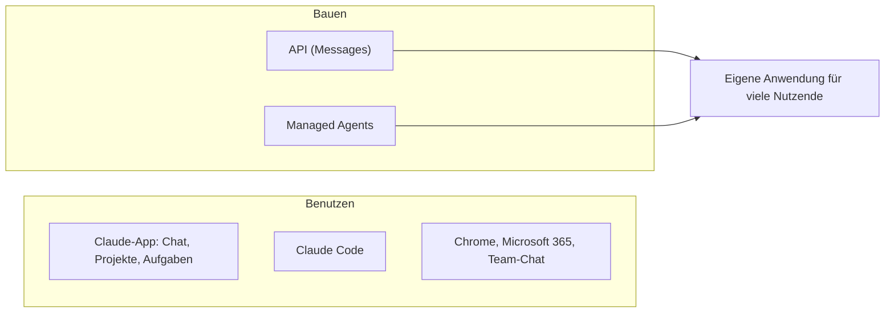

:::tldr
Anthropic bietet nicht «ein» Claude, sondern eine Familie von Produkten. Die wichtigste Unterscheidung: **Produkte, die Menschen benutzen** – die **Claude-App** mit Chat, Projekten und längeren Aufgaben, **Claude Code** für die Entwicklung und Integrationen in **Browser und Office** – und **Bausteine, mit denen man eigene Lösungen baut**: die **API** und [[Managed Agents]]. Für Unternehmen zählt zudem der **Plan**: **Team** und **Enterprise** bringen zentrale Verwaltung, Single Sign-on und standardmässig **kein Training mit den eigenen Inhalten**. Stand 28.11.2026 – die Produktnamen und Funktionen ändern sich schnell.
:::

:::bildlich Werkzeug oder Werkstatt
Die Claude-App und Claude Code sind wie **Werkzeuge**, die Mitarbeitende direkt in die Hand nehmen. Die API und Managed Agents sind eine **Werkstatt**, in der die eigene IT ein neues Werkzeug baut – etwa einen Kundenservice-Assistenten oder einen nächtlichen Prüfprozess – das danach viele andere benutzen.
:::

## Die Landschaft im Überblick

| Produkt | Für wen | Typischer Einsatz |
|---|---|---|
| **Claude-App: Chat** | alle Mitarbeitenden | Texte entwerfen, zusammenfassen, recherchieren, Daten auswerten |
| **Projekte** | Teams | gemeinsame Wissensbasis und Anweisungen pro Thema, z. B. «Offerten» oder «Personalreglement» |
| **Aufgaben übergeben** (bisher «Cowork») | Fachleute ohne Programmierkenntnisse | mehrstufige Arbeit mit Dateien und angebundenen Apps, z. B. Berichte aus mehreren Quellen erstellen |
| **Claude Code** | Entwicklerinnen und Entwickler | Code lesen, schreiben, testen, Pull Requests vorbereiten |
| **Claude in Chrome, Claude for Microsoft 365 / Outlook** | Wissensarbeit im Browser und in Office | Webformulare bearbeiten, in Excel, Word, PowerPoint und Outlook arbeiten |
| **API (Messages)** | IT, Produktteams | Claude in eigene Software einbauen: Chatbot, Klassifikation, Extraktion |
| **Managed Agents** | IT, Produktteams | fertiger Agenten-Rahmen in verwalteter Infrastruktur für lange, asynchrone Aufgaben |

## Managed Agents in einem Satz

Managed Agents ist ein **vorgefertigter, konfigurierbarer Agenten-Rahmen** (Harness), der in einer von Anthropic verwalteten Umgebung läuft – Werkzeuge, Sandbox, Sitzungen und Zeitpläne sind schon da. Er eignet sich für **lange, asynchrone Aufgaben**, etwa einen Prüfprozess, der jede Nacht läuft. Abgerechnet werden die Tokens plus **USD 0.08 pro aktive Sitzungsstunde**; das Produkt ist im **Beta-Status** (Stand 28.11.2026). Wer die volle Kontrolle über den Ablauf braucht, baut stattdessen mit der Messages API selbst (Thema [Agenten](#/t/agents)).

## Pläne – was für Unternehmen zählt

| | Free / Pro / Max | Team / Enterprise |
|---|---|---|
| Gedacht für | Einzelpersonen | Organisationen |
| Verwaltung | eigenes Konto | **zentrale Verwaltung**, **Single Sign-on**, Ausgabenkontrolle |
| Training mit Inhalten | Einstellung des Kontos (Opt-out) | **standardmässig nein** |
| Firmenweite Skills, Connectors | nein | ja, durch Admins steuerbar |

:::falle Privatkonto für Firmendaten
Der häufigste Fehler bei der Einführung ist nicht das falsche Produkt, sondern der **falsche Kontotyp**: Mitarbeitende nutzen ein privates Free- oder Pro-Konto für Kundendaten, weil es schneller geht. Damit fehlen Verwaltung, Vertrag und die geprüften Datenschutzeinstellungen. Für geschäftliche Daten gehört der Einsatz auf ein **Team- oder Enterprise-Konto** mit geklärter Datenfrage (Lektion [Datenfrage Schweiz](#/l/ai-security/datenfrage-schweiz)).
:::

:::gem Benutzen vor Bauen
Viele Firmen starten mit einem API-Projekt, obwohl die Claude-App mit einem gut gepflegten **Projekt** und einigen **Skills** denselben Nutzen in Tagen statt Monaten bringt. Die Faustregel: Zuerst prüfen, ob ein vorhandenes Produkt die Aufgabe löst. Gebaut wird erst, wenn **viele Personen** eine **gleichbleibende** Lösung brauchen, die in **eigene Systeme** eingebettet ist.
:::

:::berater Im Kundengespräch
Auf die Frage «Welches Claude sollen wir kaufen?» helfen drei Gegenfragen: **Wer nutzt es** – alle Mitarbeitenden, ein Fachteam oder Entwicklerinnen? **Wo passiert die Arbeit** – im Chat, in Office, im Code oder in einem eigenen System? **Wie heikel sind die Daten?** Daraus ergibt sich fast immer: Team- oder Enterprise-Plan für die Breite, Claude Code für die Entwicklung, und API oder Managed Agents erst für die Prozesse, die automatisch und für viele laufen sollen.
:::

:::spickzettel
- **Benutzen**: Claude-App (Chat, **Projekte**, Aufgaben übergeben), **Claude Code**, Chrome, Microsoft 365
- **Bauen**: **API** (volle Kontrolle), **Managed Agents** (fertiger Harness, lange asynchrone Aufgaben, Beta)
- Managed Agents: Tokens + **USD 0.08 pro Sitzungsstunde** (Stand 28.11.2026)
- Unternehmen: **Team/Enterprise** – zentrale Verwaltung, SSO, **kein Training standardmässig**
- **Kein Privatkonto für Firmendaten**
- Faustregel: **Benutzen vor Bauen**
- Produktnamen und Funktionen **ändern sich schnell** – vor jeder Empfehlung prüfen
:::

:::selbstcheck 3
