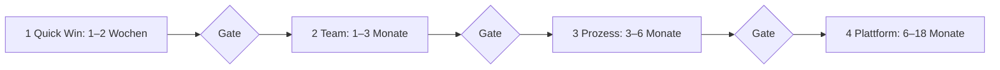

:::tldr
Eine KI-Einführung gelingt selten als Grossprojekt, aber fast immer **in Stufen**: **(1) Quick Win** mit wenigen Power-Usern in ein bis zwei Wochen, **(2) Team** mit Firmenkonto, Projekten, Skills und Schulung, **(3) Prozess** mit API oder Managed Agents, eingebettet in die eigenen Systeme, und **(4) Plattform** mit eigenen Agenten und firmenweiter Governance. Zwischen den Stufen steht jeweils ein **Gate** mit klaren Kriterien. Und auf jeder Stufe wird festgelegt, **wie stark der Mensch beteiligt** bleibt ([[Human-in-the-Loop]]) – abhängig davon, was ein Fehler kostet.
:::

:::bildlich Schwimmen lernen
Niemand springt am ersten Tag vom Zehnmeterbrett. Man beginnt im Nichtschwimmerbecken (Quick Win), schwimmt dann mit der Gruppe Längen (Team), trainiert für einen Wettkampf (Prozess) und leitet irgendwann selbst einen Schwimmclub (Plattform). Wer Stufen überspringt, geht unter – oder hat danach Angst vor dem Wasser.
:::

## Die vier Stufen

| Stufe | Werkzeuge | Wer | Ergebnis |
|---|---|---|---|
| **1 Quick Win** | Chat, Projekte, Office-Integration | 3–10 Power-User | ein Use Case mit gemessenem Nutzen, erste Erfahrungen |
| **2 Team** | Team- oder Enterprise-Plan, Projekte, **Skills**, Connectors | Abteilung, 20–50 Personen | Datenklassen-Regel, Schulung, Champions, mehrere Use Cases |
| **3 Prozess** | **API** oder **Managed Agents**, Anbindung an Systeme | IT, Fachbereich, Compliance | ein Prozess läuft teilautomatisch mit Freigabe und Protokoll |
| **4 Plattform** | eigene Agenten, interne Connectors, zentrale Bausteine | ganze Organisation | wiederverwendbare Bausteine, zentrale Governance, laufende Weiterentwicklung |

## Gates – wann es weitergeht

Bevor die nächste Stufe beginnt, werden die Kriterien geprüft:

- **Nutzung:** Wird das Werkzeug regelmässig genutzt (z. B. mehr als die Hälfte der Teilnehmenden wöchentlich)?
- **Nutzen:** Ist der Nutzen **gemessen**, nicht nur gefühlt – gegen die Basislinie?
- **Qualität:** Erfüllt das Ergebnis die Kriterien im **Testset** oder in Stichproben (Thema [Evals](#/t/evals))?
- **Daten und Recht:** Sind Datenklassen, Vertrag und Freigaben geklärt?
- **Verantwortung:** Gibt es eine Person im Fachbereich, die den Use Case trägt?

Fällt ein Gate negativ aus, ist das **kein Scheitern**, sondern eine Entscheidung: nachbessern, anderen Use Case wählen oder bewusst auf der Stufe bleiben.

## Human-in-the-Loop nach Risiko

| Stufe der Beteiligung | Wie es aussieht | Passt, wenn |
|---|---|---|
| **Mensch arbeitet, KI hilft** | Mitarbeitende formulieren mit Claude, entscheiden alles selbst | Einstieg, heikle Inhalte |
| **Mensch prüft jeden Entwurf** | KI erstellt, Mensch gibt frei | Kundenbriefe, Berichte, Offerten |
| **Mensch prüft Stichproben und Ausnahmen** | KI erledigt Routine, unsichere Fälle gehen an Menschen | hohes Volumen, Fehler gut erkennbar und günstig |
| **Automatisch mit Überwachung** | KI entscheidet, Kennzahlen und Alarme überwachen | sehr tiefe Fehlerkosten, klare Prüfregeln |

Die Wahl folgt zwei Fragen: **Was kostet ein Fehler?** und **Wie leicht wird er bemerkt?** Bei Entscheidungen über Personen mit erheblichen Folgen bleibt ein Mensch beteiligt – auch rechtlich (Lektion [Governance und Regulierung](#/l/ki-beratung/governance-und-regulierung)).

:::falle Der Review, der zur Unterschrift verkommt
«Ein Mensch prüft» klingt sicher – aber wenn eine Person 200 Entwürfe pro Tag freigeben soll, klickt sie nach einer Woche nur noch auf «OK». Echte Prüfung braucht **Zeit, Kriterien und Stichproben mit Rückmeldung**. Plane die Prüfzeit im Business Case ein, und miss regelmässig, wie viele Fehler die Prüfung tatsächlich findet.
:::

## Der Pilot

Ein Pilot hat einen klaren Rahmen:

1. **Dauer** (z. B. sechs Wochen) und **Teilnehmende** (Power-User und Skeptiker).
2. **Use Case** mit Steckbrief und **Basislinie** (Zeit pro Fall heute).
3. **Messgrössen** und Zielwerte (Nutzung, Zeit, Qualität, Zufriedenheit).
4. **Abbruchkriterium** – wann wird gestoppt?
5. **Abschluss** mit Entscheid am Gate und Bericht an die Geschäftsleitung.

:::gem Skeptiker in den Pilot
Wer nur Begeisterte im Pilot hat, misst zu gute Werte und überhört die Einwände, die beim Rollout kommen. Ein bis zwei **konstruktive Skeptiker** im Pilot finden die echten Schwachstellen – und werden, wenn sie überzeugt sind, zu den glaubwürdigsten Fürsprechern.
:::

:::berater Im Kundengespräch
Ein bewährter Satz für die Geschäftsleitung: «Wir starten nächsten Monat mit fünf Personen und einem Use Case, messen sechs Wochen, und Sie entscheiden dann am Gate, ob wir auf die ganze Abteilung gehen.» Das senkt die Hürde, macht den Nutzen sichtbar und verhindert, dass Stufe 3 beginnt, bevor die Datenfrage und die Verantwortung geklärt sind.
:::

:::spickzettel
- Vier Stufen: **Quick Win → Team → Prozess → Plattform**
- Werkzeuge: Chat/Projekte → **Firmenkonto, Skills, Connectors** → **API/Managed Agents** → eigene Agenten
- **Gates**: Nutzung, **gemessener Nutzen**, Qualität, Daten und Recht geklärt, Verantwortliche Person
- Human-in-the-Loop nach **Fehlerkosten** und **Erkennbarkeit**: hilft → prüft jeden → prüft Stichproben → automatisch mit Überwachung
- **Prüfzeit einplanen**, sonst wird Review zur Unterschrift
- Pilot: **Dauer, Teilnehmende (auch Skeptiker), Basislinie, Messgrössen, Abbruchkriterium**
:::

:::selbstcheck 3
