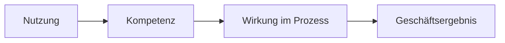

:::tldr
Die meisten KI-Einführungen scheitern nicht an der Technik, sondern daran, dass **zu wenige Menschen das Werkzeug regelmässig nutzen** – und genau davon hängt der Business Case ab. Den Change führt man mit einem **Sponsor** in der Geschäftsleitung, einem [[Champion|Champions-Netzwerk]] in den Teams, **Schulung am eigenen Arbeitsalltag** statt Produktdemos, **offener Kommunikation über Ängste** und klaren Regeln. Gemessen wird auf vier Ebenen: **Nutzung → Kompetenz → Wirkung im Prozess → Geschäftsergebnis**.
:::

:::bildlich Das Fitness-Abo
Ein Fitness-Abo macht niemanden fit – das Training schon. Viele kaufen im Januar ein Jahresabo und gehen ab Februar nicht mehr. Was hilft, sind ein Trainingspartner (Champion), ein Plan, der zum eigenen Alltag passt (Schulung an echten Aufgaben), und sichtbare Fortschritte (Messung). Bei KI-Lizenzen ist es genauso.
:::

## Warum Menschen KI nicht nutzen

| Grund | Was dahinter steckt | Gegenmittel |
|---|---|---|
| **«Ich weiss nicht, wofür»** | kein konkreter Anwendungsfall im eigenen Alltag | Schulung mit **eigenen Aufgaben**, Beispielbibliothek pro Rolle |
| **«Ich habe Angst um meinen Job»** | Unklarheit, was mit gewonnener Zeit passiert | **offen sagen**, wohin die Zeit fliesst; Geschäftsleitung bezieht Stellung |
| **«Ich habe Angst vor Fehlern»** | Sorge, für falsche Ergebnisse verantwortlich zu sein | klare **Prüfregeln**, Fehler als Lernstoff, Grenzen der KI ehrlich zeigen |
| **«Ich weiss nicht, was erlaubt ist»** | unklare Datenregeln | **Datenklassen-Tabelle** auf einer Seite, Ansprechperson |
| **«Ich habe keine Zeit»** | Einarbeitung kostet zuerst Zeit | **Lernzeit reservieren**, kleine Startaufgaben |

## Die Hebel

- **Sponsor:** Ein Mitglied der Geschäftsleitung nutzt das Werkzeug sichtbar selbst und spricht über Ziele und Grenzen.
- **Champions:** Pro Team ein bis zwei Power-User mit **reservierter Zeit** (z. B. zwei Stunden pro Woche), die Kolleginnen helfen, Beispiele sammeln und Probleme zurückmelden.
- **Schulung am Alltag:** Statt «so funktioniert der Chat» lieber «so schreibst du deine nächste Offerte in der halben Zeit». Kurze Formate, wiederholt, mit eigenen Dokumenten.
- **Bibliothek:** Bewährte Prompts, **Projekte** und **Skills** pro Rolle zentral bereitstellen (Lektion [Skill-Bibliothek](#/l/skills-plugins/skill-bibliothek)).
- **Sprechstunde und Kanal:** Ein fester Termin pro Woche und ein Chat-Kanal für Fragen.
- **Geschichten teilen:** Konkrete Erfolge aus dem eigenen Haus überzeugen mehr als jede Herstellerpräsentation.

:::falle Schulung als Pflichtveranstaltung
Eine zweistündige Präsentation für alle, danach Lizenzen verteilen – und nach drei Monaten nutzt ein Fünftel das Werkzeug. Einmalige Schulungen verpuffen. Wirksam sind **kurze, wiederholte Formate an echten Aufgaben** und **Champions vor Ort**. Übrigens: Wer KI-Systeme im Anwendungsbereich des EU AI Act betreibt, muss ohnehin Massnahmen zur [[KI-Kompetenz]] der Mitarbeitenden treffen (Art. 4).
:::

## Erfolg messen – vier Ebenen

| Ebene | Frage | Messgrössen |
|---|---|---|
| **1 Nutzung** | Wird es genutzt? | aktive Nutzende pro Woche, Anteil an Lizenzen, Häufigkeit |
| **2 Kompetenz** | Wird es gut genutzt? | Schulungsquote, Selbsteinschätzung, Qualität der Ergebnisse in Stichproben |
| **3 Wirkung im Prozess** | Verändert es die Arbeit? | Zeit pro Fall, Durchlaufzeit, Fehlerquote – **gegen die Basislinie** |
| **4 Geschäftsergebnis** | Lohnt es sich? | Nutzen in CHF minus Kosten, Zufriedenheit von Mitarbeitenden und Kundschaft |

Die Ebenen bauen aufeinander auf: Ohne Nutzung keine Wirkung, ohne Wirkung kein Geschäftsergebnis. Darum zeigt ein **monatliches Dashboard** vor allem Ebene 1 und 2, der **Quartalsbericht** an die Geschäftsleitung Ebene 3 und 4.

## Wenn die Nutzung stagniert

1. **Nach Teams aufschlüsseln** – wo wird genutzt, wo nicht?
2. **Nachfragen statt vermuten:** kurze Gespräche mit Nicht-Nutzenden.
3. **Gezielt handeln:** fehlender Anwendungsfall → Beispiel aus dem Team; Unsicherheit → Regel klären; Zeitmangel → Lernzeit freigeben.
4. **Lizenzen umverteilen**, wenn einzelne Personen sie auch nach Unterstützung nicht brauchen.

:::gem Die Champions messen mit
Champions erfahren als Erste, was nicht funktioniert – lange bevor es in den Zahlen sichtbar wird. Ein kurzer **monatlicher Champion-Austausch** mit drei Fragen («Was klappt? Was nervt? Was fehlt?») ist oft das beste Frühwarnsystem und liefert die Geschichten für die interne Kommunikation.
:::

:::berater Im Kundengespräch
Wenn ein Kunde nach sechs Monaten sagt «KI bringt bei uns nichts», lohnt sich ein Blick auf die vier Ebenen: Meist liegt das Problem auf **Ebene 1** – nur wenige nutzen es. Dann geht es nicht um ein besseres Modell, sondern um Champions, Anwendungsfälle und klare Regeln. Und eine ehrliche Frage an die Geschäftsleitung: **«Haben Sie gesagt, was mit der gewonnenen Zeit passiert?»** Ohne Antwort darauf bremst die Angst jede Einführung.
:::

:::spickzettel
- Scheitern meist an **Nutzung**, nicht an Technik
- Gründe: **kein Anwendungsfall, Jobangst, Fehlerangst, unklare Regeln, keine Zeit**
- Hebel: **Sponsor**, **Champions mit reservierter Zeit**, **Schulung am Alltag**, Bibliothek, Sprechstunde, **eigene Erfolgsgeschichten**
- **Offen sagen, wohin die gewonnene Zeit fliesst**
- EU AI Act Art. 4: Massnahmen zur **KI-Kompetenz**
- Vier Ebenen: **Nutzung → Kompetenz → Wirkung → Geschäftsergebnis**; Basislinie
- Rhythmus: **monatliches Dashboard**, **Quartalsbericht**; bei Stagnation aufschlüsseln, nachfragen, handeln
:::

:::selbstcheck 3
