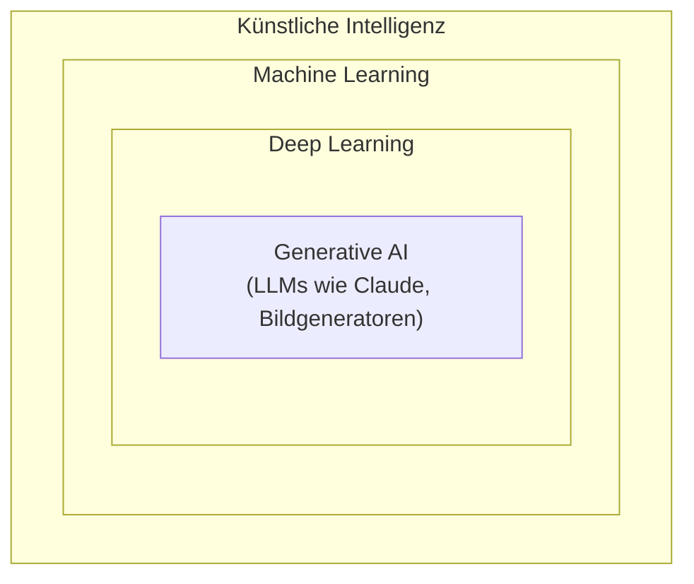

:::tldr
**KI**, **Machine Learning**, **Deep Learning** und **Generative AI** sind keine Synonyme, sondern **ineinander verschachtelt** wie russische Puppen: Jede Ebene ist ein Spezialfall der äusseren. Ein **Sprachmodell (LLM)** wie Claude liegt ganz innen – es ist Generative AI für Text. Dazu kommt die wichtigste Unterscheidung im Alltag: **Training** (das Modell lernt, einmal und teuer) und **Inferenz** (das Modell antwortet, bei jeder Anfrage). Wer diese Begriffe sauber trennt, stellt im Kundengespräch sofort die richtigen Rückfragen.
:::

## Vier Kreise

| Ebene | Was es ist | Beispiel |
|---|---|---|
| **Künstliche Intelligenz (KI)** | Oberbegriff: Systeme, die Aufgaben lösen, für die man sonst Intelligenz bräuchte – auch mit festen Regeln | Schachcomputer, Routenplaner, regelbasierter Chatbot |
| **Machine Learning (ML)** | Teil der KI, der **aus Daten lernt**, statt fest programmiert zu sein | Spamfilter, Kreditscoring, Absatzprognose |
| **Deep Learning (DL)** | Teil des ML mit **mehrschichtigen neuronalen Netzen** für sehr komplexe Muster | Bilderkennung, Spracherkennung |
| **Generative AI** | Deep-Learning-Modelle, die **neue Inhalte erzeugen**, meist auf der Transformer-Architektur | Claude, Bild- und Videogeneratoren |

Ein **Large Language Model (LLM)** ist ein generatives Modell für Sprache. Es wurde darauf trainiert, zu einem Text das **wahrscheinlich nächste Stück** (Token) vorherzusagen – und aus dieser einfachen Aufgabe entstehen bei genügend Daten und Grösse erstaunliche Fähigkeiten.

:::bildlich Das Fahrzeug
**KI** ist wie «Fahrzeug» – vom Velo bis zum Flugzeug. **Machine Learning** ist «motorisiertes Fahrzeug». **Deep Learning** ist «Auto». **Generative AI** ist «Elektroauto». Jedes Elektroauto ist ein Fahrzeug, aber wer «Fahrzeug» sagt, kann auch ein Velo meinen. Genauso ist jedes LLM KI – aber nicht jede KI ist ein LLM.
:::

## Lernen aus Daten: drei Arten

| Art | Daten | Beispiel |
|---|---|---|
| **Überwacht** (supervised) | Beispiele **mit** richtiger Antwort (Label) | Rechnungen, je mit Kategorie → neue Rechnungen kategorisieren |
| **Unüberwacht** (unsupervised) | Daten **ohne** Label; das Modell sucht Struktur | Kundinnen in Gruppen mit ähnlichem Verhalten einteilen |
| **Selbstüberwacht** (self-supervised) | Das Label steckt in den Daten selbst | «Sag das nächste Wort voraus» – so lernen LLMs aus riesigen Textmengen |

## Training und Inferenz

| | Training | Inferenz |
|---|---|---|
| Was passiert | das Modell passt seine Parameter an Beispieldaten an | das fertige Modell beantwortet eine neue Anfrage |
| Wie oft | einmal bzw. periodisch | bei **jeder** Anfrage |
| Kosten | sehr hoch, beim Modellanbieter | pro Anfrage, bei dir (Tokens) |
| Was du beeinflusst | kaum (ausser bei eigenem Fine-Tuning) | alles, was im Prompt und Kontext steht |

:::gem Was du im Alltag steuerst, ist die Inferenz
Wenn Claude in deinem Projekt etwas «nicht weiss», hilft kein Training – du kannst das Modell nicht nachträglich «etwas lernen lassen», indem du mit ihm chattest. Was du steuerst, ist der **Kontext zur Inferenzzeit**: Anweisungen, Dokumente, Beispiele, Werkzeuge. Genau darum geht es in fast allen anderen Themen dieser Wissensdatenbank.
:::

:::falle «Wir setzen KI ein»
Diese Aussage ist ohne Rückfrage wertlos. Ein Profi fragt sofort: Ist es ein **regelbasiertes System**, ein **klassisches ML-Modell** (z. B. eine Regression oder ein Entscheidungsbaum), ein **tiefes neuronales Netz** oder ein **generatives Sprachmodell**? Die Antwort entscheidet über Kosten, Erklärbarkeit, Datenbedarf und typische Fehler – ein Kreditscoring-Modell versagt ganz anders als ein Chatbot.
:::

:::berater Im Kundengespräch
Viele Probleme brauchen **kein** LLM. Eine Absatzprognose aus Tabellendaten löst ein klassisches ML-Modell oft besser, billiger und erklärbarer. Ein LLM glänzt, wo **Sprache** im Spiel ist: Texte verstehen, zusammenfassen, formulieren, Informationen aus Dokumenten herausziehen, Werkzeuge bedienen. Die erste Beraterfrage lautet deshalb: «Ist das ein Sprach- oder ein Zahlenproblem?»
:::

:::spickzettel
- **KI ⊃ Machine Learning ⊃ Deep Learning ⊃ Generative AI** – verschachtelt, nicht synonym
- KI: auch **regelbasiert** · ML: **lernt aus Daten** · DL: **neuronale Netze** · GenAI: **erzeugt Inhalte**
- **LLM** = Generative AI für Sprache, trainiert auf «nächstes Token vorhersagen»
- Lernarten: **überwacht** (mit Label), **unüberwacht** (Struktur finden), **selbstüberwacht** (Label aus den Daten)
- **Training** einmal und teuer beim Anbieter · **Inferenz** bei jeder Anfrage, steuerbar über den Kontext
- «Wir setzen KI ein» → nachfragen: **Regeln, klassisches ML, Deep Learning oder LLM?**
- Zahlenproblem → oft klassisches ML; Sprachproblem → LLM
:::

:::selbstcheck 3
