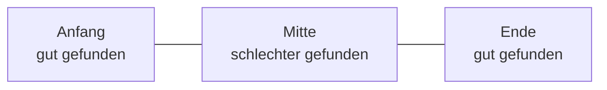

:::tldr
Sprachmodelle haben drei typische Schwächen, die jeder Berater erklären können muss. **Halluzination:** Das Modell sagt das **Plausible**, nicht zwingend das **Wahre** – und zwar im gleichen selbstbewussten Ton. **Wissensstichtag:** Was nach dem Ende der Trainingsdaten passiert ist, kennt das Modell nicht. **Lost in the Middle:** In langen Kontexten werden Informationen in der **Mitte** schlechter gefunden als am Anfang und am Ende. Alle drei folgen direkt aus der Funktionsweise – und für alle drei gibt es wirksame Gegenmittel.
:::

## Halluzination: plausibel statt wahr

Ein Sprachmodell sagt das **wahrscheinlich nächste Token** voraus. Bei gut belegtem Wissen ist das Wahrscheinliche meist auch das Richtige. Wo das Modell **wenig oder widersprüchliche** Daten gesehen hat, erzeugt es trotzdem eine flüssige, plausible Fortsetzung – nur eben ohne Deckung.

Typische Formen:

- **Erfundene Quellen:** Bücher, Urteile oder Studien mit glaubwürdigem Titel, die es nicht gibt.
- **Erfundene Details:** falsche Paragrafen, Zahlen, Daten, Versionsnummern.
- **Falsche Rechnungen:** Rechnen und Zählen sind keine Stärke eines Modells, das Text vorhersagt.

:::bildlich Der eloquente Praktikant
Stell dir einen sehr belesenen Praktikanten vor, der **nie «weiss ich nicht»** sagt. Fragst du nach dem Urteil zur Mietzinsherabsetzung von 2019, liefert er Aktenzeichen und Begründung – in perfektem Juristendeutsch. Manchmal stimmt es. Manchmal hat er es aus Versatzstücken zusammengesetzt, die sich richtig **anhören**. Der Ton verrät den Unterschied nicht.
:::

**Gegenmittel:**

| Massnahme | Wirkung |
|---|---|
| **Quellen mitgeben** (Dokumente, Suchergebnisse) und «nur aus diesen Quellen» verlangen | Antwort stützt sich auf Belege statt auf Erinnerung |
| **Zitate oder Fundstellen** verlangen | Behauptungen werden überprüfbar |
| **«Nicht gefunden» erlauben** | das Modell muss nicht raten |
| **Werkzeuge** für Fakten und Rechnungen (Suche, Rechner, Datenbank) | Zahlen kommen aus Code, nicht aus Wahrscheinlichkeit |
| **Prüfen**, bevor es nach aussen geht | letzter Filter, besonders bei Recht, Medizin, Finanzen |

## Wissensstichtag

Ein Modell kennt die Welt nur bis zum Ende seiner Trainingsdaten. Anthropic unterscheidet dabei zwei Daten:

- **Training data cutoff:** bis wann Daten ins Training eingeflossen sind.
- **Reliable knowledge cutoff:** bis wann das Wissen des Modells am umfassendsten und verlässlichsten ist.

Bei Claude Opus 5.5 liegt beides im **Juni 2026** (Stand 27.11.2026). Was danach geschah – neue Gesetze, Preise, Produktversionen, Personalwechsel –, kennt das Modell nicht. Und oft weiss es nicht einmal, **welches Datum heute** ist, wenn man es ihm nicht sagt.

:::falle Veraltetes Wissen klingt nicht veraltet
Das Modell sagt nicht «Stand Juni 2026», sondern erzählt den damaligen Stand als Gegenwart. Fragst du nach dem aktuellen MWST-Satz, der aktuellsten Version einer Software oder einer Person in einem Amt, bekommst du eine **selbstsichere, möglicherweise überholte** Antwort. Gegenmittel: das **heutige Datum** und die **aktuellen Fakten** mitgeben, **Websuche** aktivieren oder eigene Daten per RAG einbinden.
:::

## Lost in the Middle

Auch wenn alles ins Kontextfenster passt, wird nicht alles gleich gut genutzt. Informationen am **Anfang** und am **Ende** eines langen Kontexts werden zuverlässiger gefunden als solche in der **Mitte**. Je voller das Fenster, desto stärker der Effekt; Anthropic spricht allgemein von **Context Rot** – die Treffsicherheit sinkt mit der Füllmenge.

**Gegenmittel:**

- **Weniger hineinlegen:** nur relevante Abschnitte statt ganzer Ordner.
- **Lange Dokumente oben, Frage unten:** Anthropic empfiehlt, lange Dokumente vor die Frage zu stellen; die Frage am Ende verbessert die Antworten.
- **Kritische Anweisungen ans Ende** (bei sehr langen Prompts zusätzlich an den Anfang).
- **Gezielt abrufen** statt alles mitschicken (RAG, Suche).

:::gem Ein Muster hinter allen drei Fehlern
Alle drei Fehler haben dieselbe Wurzel: Das Modell optimiert **Plausibilität im Kontext**, nicht Wahrheit in der Welt. Darum ist die wirksamste Gegenmassnahme fast immer dieselbe: **Die richtige Information zur richtigen Zeit in den Kontext legen** – und das Modell auffordern, sich daran zu halten. Das ist der Kern von Context Engineering.
:::

:::berater Im Kundengespräch
Die Aussage «Die KI lügt manchmal» schürt Misstrauen, ohne zu helfen. Besser: «Ein Sprachmodell formuliert das Plausibelste. Wenn wir ihm die richtigen Quellen geben und Belege verlangen, ist das Plausibelste meist das Richtige. Wo Fehler teuer sind, prüft ein Mensch oder ein Programm.» So wird aus einer Angst ein Gestaltungsauftrag – und die Frage «Wo braucht es eine Prüfung?» lässt sich pro Anwendungsfall beantworten.
:::

:::spickzettel
- **Halluzination** = plausibel statt wahr, im selben selbstsicheren Ton
- Typisch: erfundene **Quellen**, **Paragrafen**, **Zahlen**; Rechnen ist eine Schwäche
- Gegen Halluzination: **Quellen mitgeben**, **Zitate verlangen**, **«nicht gefunden» erlauben**, **Werkzeuge** für Fakten/Zahlen, **prüfen**
- **Wissensstichtag**: Training data cutoff vs. **Reliable knowledge cutoff**; Opus 5.5: **Juni 2026**
- Veraltetes klingt nicht veraltet → **Datum und aktuelle Fakten mitgeben**, Websuche, RAG
- **Lost in the Middle / Context Rot**: Mitte schlechter, volles Fenster schlechter
- Dagegen: **weniger hineinlegen**, Dokumente oben, **Frage und kritische Anweisungen ans Ende**
:::

:::selbstcheck 3
