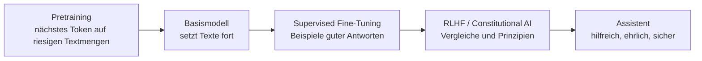

:::tldr
Ein Sprachmodell entsteht in Stufen. Im **Pretraining** liest es riesige Textmengen und lernt, das nächste Token vorherzusagen – heraus kommt ein **Basismodell**, das Texte fortsetzt, aber noch kein Assistent ist. Im **Fine-Tuning** lernt es an Beispielen, Anweisungen zu befolgen und hilfreich zu antworten. Mit **RLHF** (Menschen bewerten Antworten) oder bei Anthropic zusätzlich mit **Constitutional AI** (das Modell bewertet Antworten anhand schriftlicher Prinzipien) wird das Verhalten weiter geschärft: hilfreich, ehrlich, sicher. Merksatz: **Pretraining bringt Wissen und Sprache, Post-Training bringt Verhalten.**
:::

:::bildlich Von der Bibliothek zum Berufsleben
**Pretraining** ist, als würde jemand jahrelang eine riesige Bibliothek lesen: Danach kennt er Sprache, Fakten und Stile – aber er weiss nicht, wie man Kunden berät. **Fine-Tuning** ist die Berufsausbildung mit Musterlösungen: «Auf diese Frage antwortet man so.» **RLHF und Constitutional AI** sind die Jahre mit einer guten Vorgesetzten: Sie vergleicht zwei Antworten, sagt «diese ist besser», und mit der Zeit entsteht ein Gespür für gute Arbeit – nach Regeln, die man auch aufschreiben kann.
:::

## Die Phasen im Überblick

| Phase | Was passiert | Ergebnis |
|---|---|---|
| **Pretraining** | selbstüberwacht: aus riesigen Textmengen das nächste Token vorhersagen; die Parameter werden per Gradient Descent schrittweise angepasst | **Basismodell** mit Sprach- und Weltwissen bis zum Stichtag |
| **Supervised Fine-Tuning (SFT)** | Training mit Beispielen «Anweisung → gute Antwort» | Modell befolgt Anweisungen, antwortet im Assistentenstil |
| **RLHF** | Menschen vergleichen Antwortpaare; daraus entsteht ein **Präferenzmodell**, mit dem das Modell per Reinforcement Learning weiter trainiert wird | Antworten, die Menschen bevorzugen |
| **Constitutional AI** | ein Teil der Bewertung erfolgt durch ein Modell anhand **schriftlicher Prinzipien** | skalierbares, nachvollziehbares Training auf Hilfsbereitschaft und Sicherheit |

Eine verbreitete Variante zu RLHF ist **DPO** (Direct Preference Optimization), die direkt aus Präferenzpaaren lernt, ohne separates Präferenzmodell.

## Constitutional AI bei Claude

Anthropic hat **Constitutional AI** im Dezember 2022 vorgestellt. Das Verfahren hat zwei Phasen:

1. **Selbstkritik und Überarbeitung:** Das Modell schreibt eine Antwort, kritisiert sie anhand eines Prinzips aus der «Verfassung» und überarbeitet sie. Mit den überarbeiteten Antworten wird es weiter trainiert.
2. **Reinforcement Learning from AI Feedback (RLAIF):** Ein Modell vergleicht Antwortpaare anhand der Prinzipien; daraus entsteht ein Präferenzmodell, das als Belohnungssignal dient.

Der Vorteil: Statt jeden Grenzfall von Menschen bewerten zu lassen, stehen die Werte **schriftlich** fest – und lassen sich lesen, diskutieren und anpassen. Anthropic hat Claudes Verfassung veröffentlicht und am **21.01.2026** eine neue Fassung publiziert.

:::gem Darum erklärt Claude seine Grenzen
Weil das Verhalten an formulierten Prinzipien geschärft wurde, kann Claude bei einer Ablehnung oft begründen, **warum** – statt nur «kann ich nicht» zu sagen. Für die Beratung ist das nützlich: Die Verfassung ist ein öffentliches Dokument, auf das man bei Fragen zu Werten und Grenzen des Modells verweisen kann.
:::

:::falle Fine-Tuning für Fakten
Ein verbreitetes Missverständnis: «Wir trainieren das Modell auf unsere Dokumente, dann kennt es unsere Produkte.» Post-Training verändert vor allem **Verhalten** – Stil, Format, Ton, Grenzen. Für **Wissen**, das sich ändert (Preise, Produkte, Vorschriften), ist Fine-Tuning der falsche Weg: Es ist teuer, veraltet mit jeder Änderung und führt trotzdem zu Halluzinationen. Aktuelles Wissen gehört zur **Inferenzzeit** in den Kontext – per Prompt oder RAG (Lektion [Prompting, RAG oder Fine-Tuning](#/l/ki-grundlagen/prompting-rag-finetuning)).
:::

## Was du beeinflussen kannst

| Phase | Wer macht es | Dein Einfluss |
|---|---|---|
| Pretraining | Modellanbieter, Monate, sehr hohe Kosten | keiner – Wahl des Modells |
| SFT, RLHF, Constitutional AI | Modellanbieter | keiner – Wahl des Modells |
| Eigenes Fine-Tuning | du, sofern der Anbieter es für das Modell anbietet | Stil, Format, Spezialaufgaben |
| Kontext zur Inferenzzeit | du, bei jeder Anfrage | Anweisungen, Dokumente, Beispiele, Werkzeuge |

:::berater Im Kundengespräch
Wenn ein Kunde fragt «Lernt Claude aus unseren Gesprächen?», unterscheidest du zwei Dinge: **Während** der Nutzung lernt das Modell nichts dazu – jede Anfrage startet mit demselben Modell, nur der Kontext ist anders. **Ob** Gespräche für **künftiges** Training verwendet werden, ist eine Frage der Vertrags- und Kontoeinstellungen, nicht der Technik. Für Firmen gehört diese Frage in die Datenschutzprüfung (Lektion [Datenfrage Schweiz](#/l/ai-security/datenfrage-schweiz)).
:::

:::spickzettel
- **Pretraining**: nächstes Token auf riesigen Textmengen → **Basismodell** (Wissen + Sprache)
- **Supervised Fine-Tuning**: Beispiele guter Antworten → befolgt Anweisungen
- **RLHF**: Menschen vergleichen Antworten → Präferenzmodell → Reinforcement Learning; Variante **DPO**
- **Constitutional AI** (Anthropic, 12.2022): **Selbstkritik + Überarbeitung**, dann **RLAIF** anhand schriftlicher Prinzipien
- Claudes **Verfassung** öffentlich, neue Fassung **21.01.2026**
- **Post-Training = Verhalten**, nicht aktuelles Faktenwissen
- Während der Nutzung **lernt das Modell nicht dazu**; Training mit Kundendaten = Vertrags-/Kontofrage
:::

:::selbstcheck 3
