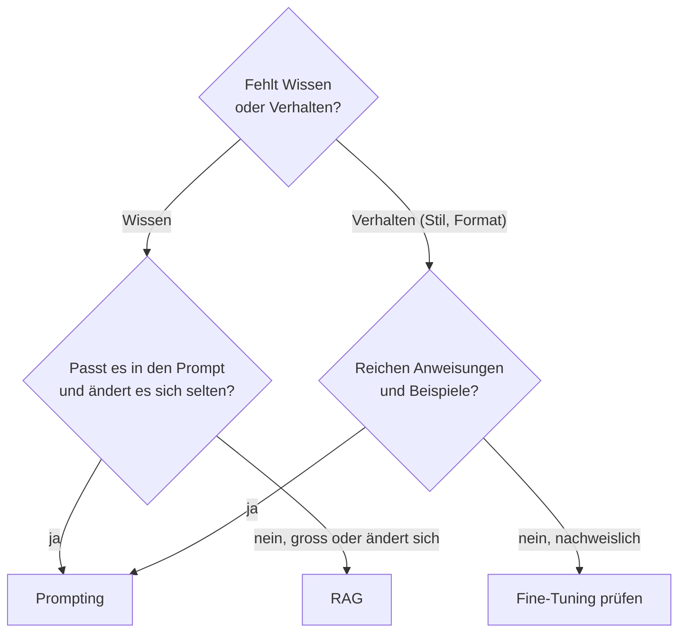

:::tldr
Wenn ein Modell «unsere Sache» nicht gut kann, gibt es drei Wege. **Prompting:** Anweisungen, Wissen und Beispiele direkt in die Anfrage – schnell, ohne Training. **RAG** (Retrieval-Augmented Generation): passende Abschnitte aus einer eigenen Wissensbasis **zur Laufzeit suchen** und mitgeben – aktuell und mit Quellen. **Fine-Tuning:** das Modell mit eigenen Beispielen **nachtrainieren** – für Stil, Format und Spezialverhalten, aber teuer und ungeeignet für sich ändernde Fakten. Die entscheidende Frage: **Fehlt dem Modell Wissen oder Verhalten?** Wissen → Prompting oder RAG. Verhalten → zuerst Prompting mit Beispielen, Fine-Tuning nur, wenn das nachweislich nicht reicht.
:::

:::bildlich Die neue Mitarbeiterin
Eine sehr fähige neue Mitarbeiterin soll Kundenanfragen beantworten. **Prompting** heisst: Du gibst ihr bei jeder Anfrage eine klare Anweisung und die nötigen Unterlagen mit. **RAG** heisst: Sie hat Zugriff auf ein gut sortiertes Archiv und holt sich bei jeder Anfrage die passenden Seiten. **Fine-Tuning** heisst: Du schickst sie für Monate in eine Spezialausbildung – danach schreibt sie im Firmenstil, aber die Preisliste von damals hat sie trotzdem im Kopf, auch wenn sie längst geändert hat.
:::

## Die drei Wege im Vergleich

| | Prompting | RAG | Fine-Tuning |
|---|---|---|---|
| **Was** | Anweisungen, Wissen, Beispiele im Prompt | Wissensbasis durchsuchen, passende Stellen mitgeben | Modell mit eigenen Beispielen nachtrainieren |
| **Gut für** | die meisten Aufgaben, kleinere Wissensmengen, Format über Beispiele | grosse oder sich ändernde Wissensbestände, Antworten mit Quellen | fester Stil, Spezialformat, sehr hohe Volumen einer engen Aufgabe |
| **Aktualität** | so aktuell wie der Prompt | so aktuell wie die Wissensbasis | Stand des Trainings – veraltet |
| **Aufwand** | gering | mittel: Aufbereitung, Suche, Pflege | hoch: Datensatz, Training, Evaluation, Wiederholung |
| **Kosten pro Aufruf** | steigen mit der Kontextmenge | nur relevante Abschnitte | Prompt kürzer, aber Trainings- und oft höhere Nutzungskosten |
| **Quellenangaben** | möglich, wenn Quellen im Prompt | **natürlich** möglich | nicht möglich |
| **Verfügbarkeit** | überall | überall | nicht für jedes Modell angeboten |

## Die Entscheidungsfragen

1. **Wissen oder Verhalten?** «Kennt unsere Produkte nicht» ist Wissen. «Schreibt nicht in unserem Ton» ist Verhalten.
2. **Wie gross ist das Wissen und wie oft ändert es sich?** Zehn Seiten Richtlinien, die sich jährlich ändern → in den Prompt. 20 000 Dokumente, die sich täglich ändern → RAG.
3. **Braucht es Quellen?** Wo Antworten belegbar sein müssen (Recht, Compliance, Support), ist RAG fast immer die Antwort.
4. **Reichen Beispiele?** Bevor jemand Fine-Tuning vorschlägt: Wurde mit zwei, drei guten Beispielen im Prompt **gemessen**, ob es reicht?

:::falle Fine-Tuning als erster Schritt
«Wir fine-tunen ein Modell auf unsere Daten» klingt nach Profi-Lösung und ist oft der teuerste Umweg. Typische Folgen: Das Modell kennt den Stand vom Trainingstag, halluziniert trotzdem, liefert keine Quellen, und bei jedem neuen Basismodell beginnt die Arbeit von vorn. Fine-Tuning lohnt sich erst, wenn **Prompting mit Beispielen gemessen nicht reicht**, die Aufgabe **eng und stabil** ist und das **Volumen** hoch genug ist, dass sich der Aufwand auszahlt.
:::

## Kombinationen sind normal

In der Praxis werden die Wege kombiniert:

- **Prompting + RAG** ist der Normalfall: feste Anweisungen und Beispiele im Prompt, dazu die zur Frage passenden Dokumentstellen.
- **RAG + Fine-Tuning** kann sinnvoll sein, wenn ein Modell ein sehr spezielles Ausgabeformat zuverlässig treffen muss und zugleich aktuelles Wissen braucht.
- **Grosse Kontextfenster** verschieben die Grenze: Mit 1 Million Tokens passt mehr direkt in den Prompt als früher. Das ersetzt RAG aber nicht, wenn die Wissensbasis grösser ist, sich laufend ändert oder Kosten pro Aufruf eine Rolle spielen.

:::gem Messen entscheidet, nicht Meinung
Ob Prompting reicht oder RAG nötig ist, beantwortet ein **kleines Testset** mit 20–50 echten Fragen und bekannten richtigen Antworten (Lektion [Prompts testen](#/l/prompting/prompts-testen)). Erst Prompting messen, dann RAG messen, dann – nur bei klarer Lücke – Fine-Tuning erwägen. Ohne diese Zahlen ist jede Empfehlung eine Vermutung.
:::

:::berater Im Kundengespräch
Ein Kunde sagt: «Wir wollen ein eigenes KI-Modell mit unserem Firmenwissen.» Gemeint ist fast immer: «Die KI soll unsere Dokumente kennen und mit Quellen antworten.» Das ist **RAG**, kein eigenes Modell. Die Rückfrage «Geht es um **Wissen**, das sich ändert, oder um ein **Verhalten**, das gleich bleibt?» klärt das in zwei Minuten – und spart oft Monate und sechsstellige Beträge in CHF.
:::

:::spickzettel
- **Prompting**: Anweisungen + Wissen + Beispiele im Prompt → schnell, die meisten Fälle
- **RAG**: zur Laufzeit relevante Stellen suchen und mitgeben → **aktuell, mit Quellen**, für grosse/sich ändernde Wissensbasen
- **Fine-Tuning**: nachtrainieren → **Stil/Format/Spezialverhalten**, teuer, **veraltet**, keine Quellen
- Leitfrage: **Wissen oder Verhalten?**
- Reihenfolge: **Prompting → RAG → (Fine-Tuning nur bei gemessener Lücke)**
- Kombination **Prompting + RAG** ist der Normalfall
- Grosses Kontextfenster ersetzt RAG nicht bei grossen, sich ändernden Beständen
- Entscheiden mit **Testset**, nicht mit Bauchgefühl
:::

:::selbstcheck 3
