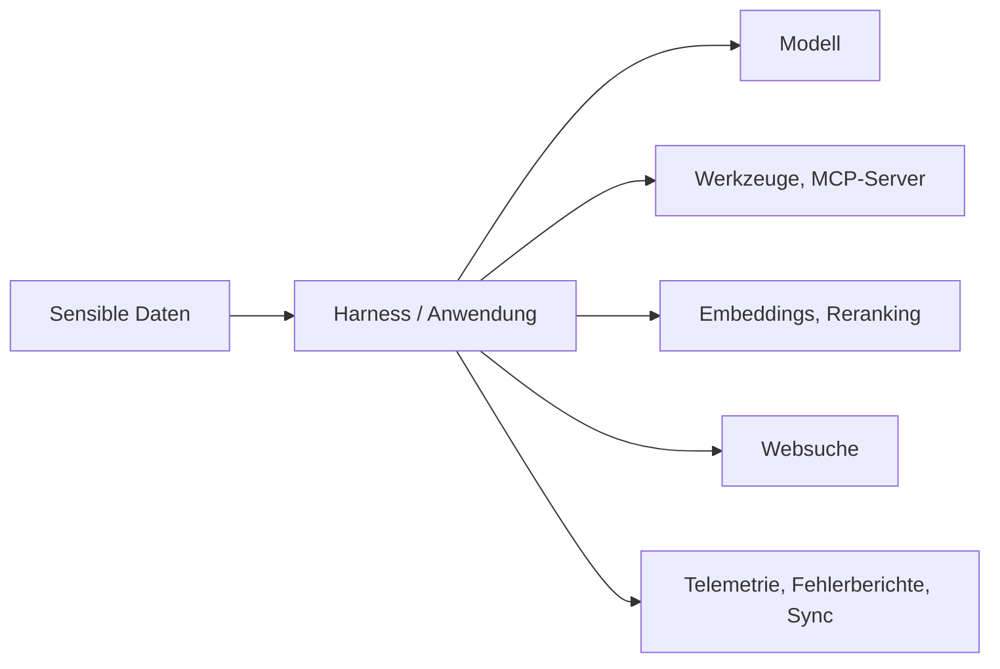

:::tldr
Die Frage «lokal oder Cloud?» wird mit vier Kriterien entschieden: **Daten** (wie sensibel, welche Pflichten), **Qualität** (reicht ein lokales Modell für **diese** Aufgabe – gemessen, nicht geschätzt), **Gesamtkosten** (Hardware, Strom, Betrieb und Personal gegen Tokenkosten) und **Betrieb** (wer pflegt, sichert und überwacht). Die wichtigste Einsicht dabei: **Ein lokales Modell allein macht nichts privat.** Erst wenn auch der [[Harness]] und alle **Nebenwege** lokal bleiben – Werkzeuge, Embeddings, Websuche, Telemetrie, Synchronisation –, verlassen die Daten das Gerät wirklich nicht. Oft ist die beste Antwort eine **Mischung**: Sensibles lokal, Anspruchsvolles in der Cloud.
:::

:::bildlich Der Tresorraum mit Fenster
Ein Tresorraum (lokales Modell) nützt nichts, wenn daneben ein offenes **Fenster** ist (Cloud-Harness, Cloud-Embeddings, Telemetrie) oder wenn ein **Kurier** regelmässig Kopien abholt (Synchronisation). Wer Diskretion verspricht, prüft alle Ausgänge – nicht nur die Tresortür.
:::

## Wann ist es wirklich lokal?

Für jede dieser Verbindungen muss klar sein, **wohin** sie geht:

| Weg | Typische Falle |
|---|---|
| **Modell** | ein Modell mit `cloud` im Namen läuft bei Ollama, nicht lokal |
| **Harness** | ein Cloud-Harness oder eine Desktop-App, die Inhalte an einen Cloud-Dienst schickt, obwohl das Modell lokal läuft |
| **Werkzeuge / MCP** | ein MCP-Server, der selbst ein Cloud-Modell oder einen Cloud-Dienst anspricht |
| **Embeddings, Reranking** | Chat lokal, aber die Dokumente werden bei einem Cloud-Dienst eingebettet |
| **Websuche** | Suchanfragen enthalten Teile des sensiblen Kontexts |
| **Telemetrie, Fehlerberichte** | Werkzeuge melden Nutzungs- oder Fehlerdaten an den Hersteller |
| **Synchronisation** | Notizen oder Projektordner werden in eine Cloud gespiegelt |

:::falle «Ich nutze ein lokales Modell, also ist alles privat»
Ein typisches Beispiel: Jemand nutzt ein lokales Llama über Ollama, lässt aber eine Desktop-App mit Cloud-Modell per MCP auf denselben Notizordner zugreifen. Die Notizen bleiben dann **nicht** privat – sie gehen über den anderen Weg nach aussen. Ebenso bei Claude Code gegen ein lokales Modell: Das Modell rechnet lokal, aber Einstellungen für Telemetrie, Fehlerberichte und Werkzeuge wie Websuche müssen geprüft und bei Bedarf abgeschaltet werden. **Echte Privatsphäre = lokales Modell plus lokaler Harness plus geprüfte Nebenwege.**
:::

## Die vier Kriterien

| Kriterium | Fragen | Spricht für lokal | Spricht für Cloud |
|---|---|---|---|
| **Daten** | Welche Datenklasse? Berufsgeheimnis? Vertragliche Pflichten? | besonders schützenswerte Daten, Geheimhaltung, Abschottung | öffentliche oder interne Daten, Anbieter mit Vertrag und Datenstandort |
| **Qualität** | Reicht ein lokales Modell im **Testset**? | einfache, klar umrissene Aufgaben | Agenten, Coding, langer Kontext, schwierige Urteile |
| **Kosten** | Gesamtkosten über 2–3 Jahre? | sehr hohe, gleichmässige Mengen | geringe oder schwankende Mengen |
| **Betrieb** | Wer pflegt, sichert, überwacht? | eigene IT mit GPU-Know-how | keine eigene Infrastruktur |

## Gesamtkosten ehrlich rechnen

| Lokal | Cloud |
|---|---|
| Hardware (abgeschrieben über 2–3 Jahre) | Tokenkosten pro Monat |
| Strom und Kühlung | ggf. Aufpreis für Datenstandort |
| Einrichtung, Updates, Absicherung, Überwachung | Integration und Überwachung (fällt bei beiden an) |
| Personalzeit, Ausfallrisiko | Abhängigkeit vom Anbieter |

Bei **geringen Mengen** ist die Cloud fast immer günstiger: Die Tokenkosten vieler KMU-Anwendungen liegen im Bereich von Franken bis wenigen hundert Franken pro Monat (Thema [Modelle und Kosten](#/t/modelle-kosten)). Lokal rechnet sich vor allem bei **hohen, gleichmässigen Mengen** einfacher Aufgaben – oder wenn die Daten die Maschine schlicht nicht verlassen **dürfen**.

## Mischformen

- **Routing nach Datenklasse:** Ein kleiner lokaler Schritt erkennt sensible Inhalte; diese bleiben lokal, der Rest darf in die Cloud.
- **Pseudonymisieren vor dem Cloud-Aufruf:** Namen und Kennungen lokal ersetzen, Ergebnis lokal zurückübersetzen.
- **Lokal für Masse, Cloud für Qualität:** Klassifikation und Extraktion lokal, schwierige Entwürfe und Urteile in der Cloud.
- **Cloud mit Vertrag:** Wo die Datenfrage geklärt ist (Vertrag zur Auftragsbearbeitung, Datenstandort, kein Training mit Kundendaten), ist ein seriöser Cloud-Anbieter oft **sicherer** als ein schlecht betriebener eigener Server (Lektion [Datenfrage Schweiz](#/l/ai-security/datenfrage-schweiz)).

:::gem Die Entscheidung mit einem Testset treffen
Die Qualitätsfrage lässt sich in einem Tag klären: dasselbe Testset mit 30–50 echten Fällen gegen das lokale Modell **und** ein Cloud-Modell laufen lassen, gepaart vergleichen, Kosten und Antwortzeit danebenlegen. Erst mit diesen Zahlen wird «lokal oder Cloud» von einer Glaubensfrage zu einer Entscheidung.
:::

:::berater Im Kundengespräch
Eine bewährte Entscheidungsvorlage auf einer Seite: (1) **Anwendungsfall und Datenklasse**, (2) **Testergebnis** lokal gegen Cloud, (3) **Gesamtkosten** über drei Jahre in CHF, (4) **Betriebsaufwand** und Verantwortliche, (5) **Datenwege** – welche Verbindungen verlassen das Haus, und was ist dagegen vorgekehrt. Typischer Einwand: «Cloud ist bei uns verboten.» – Dann ist die Frage nicht ob, sondern **wie gut** lokal reicht; das Testset zeigt, welche Aufgaben realistisch sind und wo Menschen weiter prüfen müssen.
:::

:::spickzettel
- Kriterien: **Daten · Qualität (Testset) · Gesamtkosten · Betrieb**
- **Nur lokales Modell + lokaler Harness + geprüfte Nebenwege = wirklich privat**
- Nebenwege: **Cloud-Modelle in Ollama**, Cloud-Harness, **MCP mit Cloud**, **Embeddings/Reranking**, Websuche, **Telemetrie**, **Sync**
- Lokal stark: **einfache Aufgaben**, **hohe Mengen**, **strenge Geheimhaltung**, offline
- Cloud stark: **Agenten, Coding, langer Kontext**, geringe Mengen, keine eigene IT
- Gesamtkosten über **2–3 Jahre** inkl. Personal; bei kleinen Mengen ist Cloud meist günstiger
- Mischformen: **Routing nach Datenklasse**, **Pseudonymisierung**, lokal für Masse
- Entscheidung mit **Testset** und **Entscheidungsvorlage**
:::

:::selbstcheck 3
