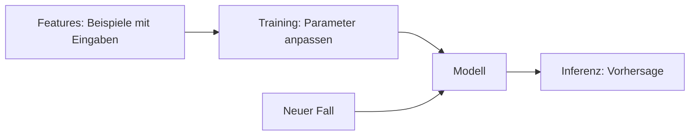

:::tldr
Klassische Software folgt **Regeln, die ein Mensch schreibt** («wenn A, dann B»). [[Machine Learning]] dreht das um: Man zeigt einem System viele **Beispiele**, und es leitet die Regel selbst ab. Jedes ML-System hat drei Schritte: **Features** (die Eingaben), **Training** (das Modell passt seine Parameter an) und **Inferenz** (es sagt neue Fälle voraus). Wie gelernt wird, hängt von den Daten ab: [[Supervised Learning|Supervised]] mit bekannten Antworten, [[Unsupervised Learning|Unsupervised]] ohne Antworten, [[Self-Supervised Learning|Self-Supervised]] mit Antworten, die schon in den Daten stecken, und [[Reinforcement Learning]] durch Ausprobieren und Belohnung. Sprachmodelle wie Claude nutzen gleich mehrere davon.
:::

:::bildlich Drei Arten zu lernen
**Supervised** ist Vokabeln lernen mit Lösungsheft: Zu jeder Aufgabe gibt es die richtige Antwort. **Unsupervised** ist ein Haufen Fotos, den man ohne Anleitung in Stapel sortiert – man erkennt Gruppen, ohne dass jemand sagt, wie sie heissen. **Reinforcement Learning** ist Velofahren lernen: Niemand gibt die richtige Bewegung vor, aber Umfallen und Vorwärtskommen zeigen, was funktioniert.
:::

## Die drei Grundschritte

- **Features** sind die Eingaben: bei einer Tabelle die Spalten (z. B. Kundenalter, Anzahl Bestellungen, letzte Zahlung), bei Text die Tokens.
- **Training** passt die Parameter des Modells so lange an, bis seine Vorhersagen möglichst nah an den bekannten Ergebnissen liegen.
- **Inferenz** ist der Einsatz: Das fertige Modell bekommt einen neuen Fall und liefert eine Vorhersage.

Training passiert einmal oder periodisch, Inferenz bei jeder Anfrage – die beiden Phasen haben ganz unterschiedliche Kosten und Fehlerquellen.

## Die Lernparadigmen

| Paradigma | Daten | Aufgaben | Beispiel |
|---|---|---|---|
| **Supervised** (überwacht) | Beispiele **mit** bekannter Antwort (Label) | **Regression** (Zahl), **Klassifikation** (Kategorie) | Hypothekarausfall ja/nein, Umsatz nächsten Monat |
| **Unsupervised** (unüberwacht) | Daten **ohne** Label | **Clustering**, Dimensionsreduktion, Anomalien | Kundensegmente, auffällige Buchungen |
| **Semi-Supervised** | wenige Labels, viele ohne | wie Supervised, wenn Labeln teuer ist | Röntgenbilder, von Fachpersonen einzeln bestätigt |
| **Self-Supervised** | Label steckt **in den Daten** | Vortraining grosser Modelle | nächstes Wort eines Satzes vorhersagen |
| **Reinforcement Learning** | kein fester Datensatz, sondern **Belohnung** | Strategien in einer Umgebung | Spiele, Robotik, Feinabstimmung von Sprachmodellen |

:::gem Claude ist Machine Learning
Sprachmodelle sind kein Bruch mit klassischem ML, sondern seine Fortsetzung in grossem Massstab. Das **Vortraining** ([[Pretraining]]) ist **Self-Supervised**: Aus riesigen Textmengen lernt das Modell, das nächste Token vorherzusagen – das «richtige» Token steht ja im Text. Danach folgt **Supervised Fine-Tuning** mit Beispielen guter Antworten und **Reinforcement Learning** (z. B. [[RLHF]], Lernen aus menschlichem Feedback) für hilfreiche und sichere Antworten. Wer die Paradigmen versteht, versteht auch, warum Sprachmodelle plausible statt garantiert wahre Antworten liefern (Lektion [Wie Modelle entstehen](#/l/ki-grundlagen/wie-modelle-entstehen)).
:::

## Die wichtigsten Werkzeuge

| Algorithmus | Paradigma | Wofür |
|---|---|---|
| Lineare / logistische Regression | Supervised | **Basislinie** für fast jedes Projekt, gut erklärbar |
| Entscheidungsbaum | Supervised | nachvollziehbare Entscheidungen |
| Random Forest, **Gradient Boosting** (XGBoost, LightGBM) | Supervised | **Standard für Tabellendaten** |
| k-Means | Unsupervised | Segmente bilden |
| PCA | Unsupervised | viele Merkmale auf wenige verdichten |
| Neuronale Netze, Deep Learning | alle | Bilder, Audio, Text, sehr grosse Datenmengen |

:::falle «Wir brauchen Deep Learning»
Bei **Tabellendaten** – Zahlen und Kategorien in Spalten, wie sie in den meisten Firmen vorliegen – gewinnen fast immer **Baum-Ensembles** wie Gradient Boosting, nicht neuronale Netze. Deep Learning glänzt bei Bildern, Sprache und Text. Die Faustregel: **mit dem einfachsten Modell beginnen**, das die Aufgabe lösen könnte, und es als Basislinie für alles Weitere nutzen.
:::

:::berater Im Kundengespräch
«Wir setzen KI ein» ist oft eine leere Aussage. Zwei Rückfragen schaffen Klarheit: **Was soll vorhergesagt oder erzeugt werden?** (Zahl, Kategorie, Gruppe, Text) und **Gibt es Beispiele mit bekannter Antwort?** Die Antworten zeigen, ob es um Supervised oder Unsupervised Learning geht, ob ein Sprachmodell nötig ist – oder ob eine einfache Regel reicht (Lektion [Regel, ML oder GenAI?](#/l/machine-learning/regel-ml-oder-genai)).
:::

:::spickzettel
- ML: **Regel aus Beispielen** statt von Hand programmiert
- Drei Schritte: **Features → Training → Inferenz**
- **Supervised**: mit Label – **Regression** (Zahl), **Klassifikation** (Kategorie)
- **Unsupervised**: ohne Label – **Clustering**, Dimensionsreduktion, Anomalien
- **Semi-Supervised**: wenige Labels, viele ohne
- **Self-Supervised**: Label in den Daten – **Vortraining von Sprachmodellen**
- **Reinforcement Learning**: Aktion, **Belohnung**, Strategie – z. B. **RLHF**
- Tabellen: **Gradient Boosting**; Bild/Text: Deep Learning; **einfachstes Modell zuerst**
:::

:::selbstcheck 3
