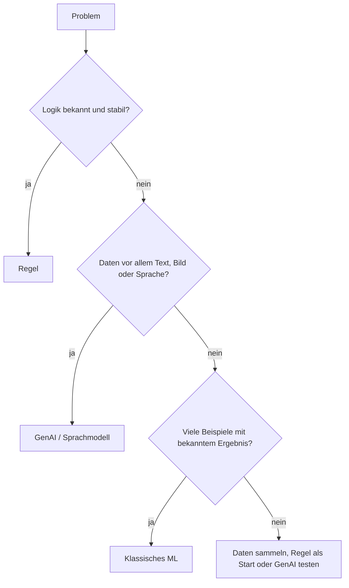

:::tldr
Nicht jedes Problem braucht KI – und nicht jede KI ist ein Sprachmodell. Eine **feste Regel** genügt, wenn die Logik bekannt, stabil und vollständig beschreibbar ist. **Klassisches Machine Learning** passt, wenn **strukturierte Daten mit bekannten Ergebnissen** vorliegen und eine **Zahl oder Kategorie** vorhergesagt werden soll. **Generative KI** (Sprachmodelle) ist stark bei **unstrukturiertem Text, Bild und Sprache** und bei Aufgaben, für die es kaum Trainingsbeispiele gibt. Oft ist die beste Lösung eine **Kombination** – und immer der Vergleich mit der einfachsten Variante als **Basislinie**.
:::

:::bildlich Werkzeugkiste statt Lieblingswerkzeug
Wer nur einen Hammer hat, sieht überall Nägel. Eine **Regel** ist der Schraubenzieher: einfach, präzise, für genau eine Schraube. **Klassisches ML** ist die Bohrmaschine: kraftvoll für viele gleichartige Löcher. Ein **Sprachmodell** ist das Multitool: kann erstaunlich viel, aber für eine einzelne Schraube ist es teurer, schwerer zu kontrollieren und nicht immer präziser.
:::

## Das Entscheidungsraster

| Kriterium | Regel | Klassisches ML | GenAI |
|---|---|---|---|
| **Datenart** | beliebig, Logik explizit | **Tabellen**, Zahlen, Kategorien | **Text, Bild, Sprache** |
| **Beispiele mit Ergebnis** | nicht nötig | **viele nötig** (oft Tausende) | wenige oder keine |
| **Erklärbarkeit** | vollständig | mittel bis gut (je nach Modell) | gering, Begründungen nicht verlässlich |
| **Kosten pro Fall** | praktisch null | sehr tief | höher (Tokens) |
| **Verhalten** | deterministisch | stabil bei gleichen Daten | kann bei gleichen Eingaben variieren |
| **Änderung der Logik** | Code anpassen | neu trainieren | Prompt anpassen |

## Beispiele aus der Praxis

| Aufgabe | Empfehlung | Warum |
|---|---|---|
| Rabatt ab Bestellwert CHF 500, IBAN prüfen, Zahlungsfristen | **Regel** | Logik bekannt, muss exakt und nachvollziehbar sein |
| Kündigungsrisiko von Abonnenten, Absatzprognose pro Filiale, Betrugsscore | **Klassisches ML** | viele historische Fälle mit Ergebnis, Tabellendaten, hohes Volumen |
| Eingehende Kunden-E-Mails einordnen und Antwortentwürfe schreiben | **GenAI** | Freitext, viele Varianten, kaum gelabelte Beispiele |
| Daten aus Verträgen und Rechnungen herausziehen | **GenAI** (mit Prüfregeln) | unstrukturierte Dokumente; Regeln prüfen das Ergebnis |
| Kreditentscheid bei einer Bank | **ML plus Regeln plus Mensch** | erklärbar, regulatorisch heikel, Fairness prüfen |

:::falle «Machen wir alles mit einem Sprachmodell»
Ein Sprachmodell kann eine Kündigungswahrscheinlichkeit «schätzen», aber ein auf den eigenen Daten trainiertes Gradient-Boosting-Modell ist dafür meist **genauer, schneller, günstiger und stabiler**. Umgekehrt ist ein klassisches Modell für das Verstehen frei formulierter Kundenbriefe ungeeignet. Der häufigste Beratungsfehler ist nicht die falsche Technik im Detail, sondern das **Lieblingswerkzeug** für jedes Problem.
:::

## Kombinationen, die sich bewähren

- **Regel als Leitplanke:** Harte Grenzen (Betragslimiten, Pflichtfelder, gesetzliche Vorgaben) prüft eine Regel vor oder nach dem Modell.
- **GenAI erzeugt Merkmale, ML entscheidet:** Ein Sprachmodell zieht aus Freitext strukturierte Merkmale (Thema, Dringlichkeit, Stimmung), ein klassisches Modell rechnet damit weiter.
- **Klassisches Modell zuerst, Sprachmodell für Sonderfälle:** Der Grossteil wird günstig und schnell entschieden, nur unklare Fälle gehen an das Sprachmodell oder einen Menschen.
- **Mensch in der Schleife:** Bei folgenreichen Entscheidungen bereitet das System vor, ein Mensch entscheidet.

## Was neben der Technik entscheidet

- **Fairness:** Eine gute Gesamtgenauigkeit kann schlechte Ergebnisse für einzelne Gruppen verdecken. Bei Kreditvergabe, Personalauswahl oder Versicherung werden Fehlerraten **pro Untergruppe** ausgewertet.
- **Recht:** Personendaten unterstehen dem revDSG. Beruht eine Entscheidung **ausschliesslich auf automatisierter Bearbeitung** und hat sie für die betroffene Person eine Rechtsfolge oder beeinträchtigt sie erheblich, muss die Person informiert werden und kann auf Antrag ihren Standpunkt darlegen und eine Überprüfung durch einen Menschen verlangen (Art. 21 DSG, Stand 27.11.2026). Im Zweifel Datenschutzverantwortliche beiziehen (Lektion [Datenfrage Schweiz](#/l/ai-security/datenfrage-schweiz)).
- **Betrieb ([[MLOps]]):** Daten, Code und Modell versionieren, Qualität und Eingabedaten überwachen, Drift erkennen und nachtrainieren. Ein Modell im Notebook schafft noch keinen Wert.
- **Datenaufwand:** Der grösste Teil eines ML-Projekts steckt meist in Daten und Merkmalen, nicht im Training.

:::gem Die Basislinie entscheidet mit
Bevor in ein Modell investiert wird, wird die **einfachste Lösung gemessen**: die bestehende Regel, «Wert vom Vorjahr», oder ein einfaches Modell wie eine logistische Regression. Bringt das aufwendige Modell nur wenige Prozentpunkte mehr, rechtfertigt das selten Betrieb, Erklärungsaufwand und Risiko. Bei Sprachmodellen gilt dasselbe mit einem [Testset](#/l/evals/testset-und-grader).
:::

:::berater Im Kundengespräch
Fünf Fragen führen fast immer zur richtigen Lösung: (1) **Was genau soll herauskommen** – Zahl, Kategorie, Text, Entscheidung? (2) **Welche Daten gibt es** – Tabellen oder Freitext, mit oder ohne bekannte Ergebnisse? (3) **Was kostet ein Fehler**, und muss jede Entscheidung erklärbar sein? (4) **Wie viele Fälle** pro Tag, und wie schnell muss die Antwort kommen? (5) **Wer betreibt es** und merkt, wenn es schlechter wird? Ein gutes Ergebnis kann auch sein: «Das lösen wir mit drei Regeln und sparen uns das KI-Projekt.»
:::

:::spickzettel
- **Regel**: Logik bekannt, stabil, exakt, erklärbar – praktisch gratis
- **Klassisches ML**: **Tabellen mit vielen Beispielen samt Ergebnis**, Zahl oder Kategorie, hohes Volumen
- **GenAI**: **Text, Bild, Sprache**, wenige Beispiele, flexible Aufgaben
- **Kombinieren**: Regel als Leitplanke, GenAI → Merkmale → ML, Sonderfälle an Sprachmodell oder Mensch
- **Basislinie** immer messen
- **Fairness pro Untergruppe**; revDSG, **Art. 21 DSG** bei automatisierten Einzelentscheidungen
- **MLOps**: versionieren, überwachen, **Drift**, nachtrainieren
- Fünf Fragen: **Ergebnis, Daten, Fehlerkosten, Volumen, Betrieb**
:::

:::selbstcheck 3
