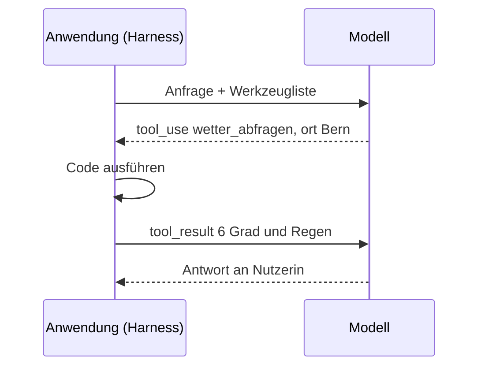

:::tldr
Ein Sprachmodell kann von sich aus **nichts ausführen** – keine Datei lesen, keine Mail senden, keine Datenbank abfragen. Bei **Tool Use** bekommt es eine Liste von Werkzeugen (Name, Beschreibung, Eingabeschema) und antwortet, wenn es eines braucht, mit einer **strukturierten Bitte** um einen Aufruf. Die Anwendung drumherum – der [[Harness]] – führt den Aufruf aus und gibt das Ergebnis zurück. Das **Model Context Protocol (MCP)** standardisiert, wie solche Werkzeuge angeboten werden: Ein MCP-Server stellt Tools bereit, und jede MCP-fähige Anwendung (Claude Code, die Claude-App, andere Agenten) kann sie nutzen.
:::

:::bildlich Der Chef am Telefon
Stell dir einen Chef vor, der nur telefonieren kann. Er weiss, welche Abteilungen es gibt und was sie können (Werkzeugliste). Braucht er eine Zahl, ruft er die Buchhaltung an: «Bitte Umsatz Q3, Filiale Bern.» Die **Buchhaltung** macht die Arbeit und meldet das Ergebnis zurück. Der Chef führt nie selbst etwas aus – er **bittet**, andere **handeln**. MCP ist dabei die **einheitliche Telefonanlage**: Jede Abteilung, die daran angeschlossen ist, kann von jedem Chef angerufen werden, egal von welcher Firma er kommt.
:::

## Wie ein Werkzeugaufruf abläuft

1. Die Anwendung schickt die Anfrage **mit der Werkzeugliste** ans Modell.
2. Braucht das Modell ein Werkzeug, endet seine Antwort mit `stop_reason: "tool_use"` und einem `tool_use`-Block (Name + Eingaben).
3. Die Anwendung **führt den Aufruf aus** und schickt das Ergebnis als `tool_result` zurück.
4. Das wiederholt sich, bis das Modell fertig antwortet. Genau diese Schleife ist der [[Agentic Loop]].

:::gem Das Modell sieht nur die Beschreibung
Claude erhält **nie den Code** eines Werkzeugs – nur Name, Beschreibung und Eingabeschema, und danach das Ergebnis. Ob ein Werkzeug richtig gewählt und korrekt aufgerufen wird, hängt deshalb fast ganz an der **Beschreibung**. Ein brillantes Werkzeug mit schlechter Beschreibung wird falsch oder gar nicht genutzt (Lektion [Tools entwerfen](#/l/mcp-tools/tools-entwerfen)).
:::

## Zwei Arten von Werkzeugen

| | Client-Tools | Server-Tools |
|---|---|---|
| Wo läuft der Code | in **deiner** Anwendung | bei **Anthropic** |
| Beispiele | eigene Funktionen, Datei bearbeiten, Bash, MCP-Werkzeuge in Claude Code | Websuche, Web-Abruf |
| Wer baut die Schleife | du bzw. dein Harness | die API erledigt es |

## MCP: ein Stecker für alle

Vor MCP musste jede KI-Anwendung jede Anbindung selbst bauen: Claude-für-GitHub, ChatGPT-für-GitHub, Agent-X-für-GitHub. MCP ist ein **offener Standard**, den Anthropic im November 2024 veröffentlicht hat. Damit baut ein Anbieter **einen** MCP-Server, und alle MCP-fähigen Anwendungen können ihn nutzen – wie ein USB-C-Anschluss.

| Rolle | Was | Beispiel |
|---|---|---|
| **Host / Client** | die KI-Anwendung, die Werkzeuge nutzt | Claude Code, Claude-App, eigener Agent |
| **Server** | stellt Fähigkeiten bereit | GitHub-, Notion-, Datenbank-Server |

Ein MCP-Server kann drei Dinge anbieten:

- **Tools** – Aktionen, die das Modell aufrufen kann («Issue anlegen», «Tabelle abfragen»).
- **Resources** – Daten, die man in den Kontext holen kann (Dateien, Datensätze).
- **Prompts** – vorbereitete Vorlagen, die als Befehl auftauchen.

**Transport:** Ein **lokaler** Server läuft als Prozess auf deinem Rechner und spricht über `stdio`. Ein **entfernter** Server läuft im Netz und wird über **HTTP** angesprochen; der ältere SSE-Transport gilt als veraltet (Stand 27.11.2026).

## Tool, MCP-Server, Connector – wie hängt das zusammen?

- Ein **Tool** ist eine einzelne Fähigkeit («`github_create_issue`»).
- Ein **MCP-Server** bündelt mehrere Tools eines Dienstes.
- Ein **[[Connector]]** in der Claude-App ist technisch ein MCP-Server, den du per Klick verbindest, meist mit Anmeldung per OAuth.
- In Claude Code bindest du MCP-Server selbst ein (Lektion [MCP einbinden](#/l/mcp-tools/mcp-einbinden)).

:::falle «Das Modell hat die Mail gesendet»
Präzise gesagt hat das Modell **um den Versand gebeten**, und die Anwendung hat ihn ausgeführt. Das ist mehr als Wortklauberei: **Jede Sicherheitsgrenze liegt im Harness**, nicht im Modell. Ob eine Aktion erlaubt ist, entscheiden Berechtigungsregeln, Freigaben und der Code des Werkzeugs – nicht die Bitte im Prompt «sende keine Mails». Und ein lokaler MCP-Server läuft mit **deinen Rechten**: Was er kann, kannst du.
:::

:::berater Im Kundengespräch
Die Frage «Kann Claude auf unser ERP zugreifen?» beantwortest du mit: «Claude kann um Zugriffe **bitten**. Ob und welche erlaubt sind, legen wir fest – über die Werkzeuge, die wir anbieten, und deren Rechte.» Das verschiebt das Gespräch von «Vertrauen wir der KI?» zu «Welche Aktionen bieten wir an, mit welchen Rechten, und wer gibt was frei?» – eine Frage, die IT und Datenschutz beantworten können.
:::

:::spickzettel
- Modell **führt nichts aus** – es **bittet** per `tool_use`, der **Harness** führt aus und antwortet mit `tool_result`
- Schleife läuft, solange `stop_reason` = `tool_use`
- Modell sieht **nur Name, Beschreibung, Schema** und das Ergebnis – nie den Code
- **Client-Tools** (deine Anwendung) vs. **Server-Tools** (Anthropic, z. B. Websuche)
- **MCP** = offener Standard (11.2024), «USB-C für KI»: **Client/Host** ↔ **Server**
- Server bieten **Tools, Resources, Prompts**; Transport **stdio** (lokal) oder **HTTP** (entfernt), SSE veraltet
- **Connector** in der App = MCP-Server per Klick
- Sicherheitsgrenzen liegen im **Harness**; lokale Server laufen mit **deinen Rechten**
:::

:::selbstcheck 3
