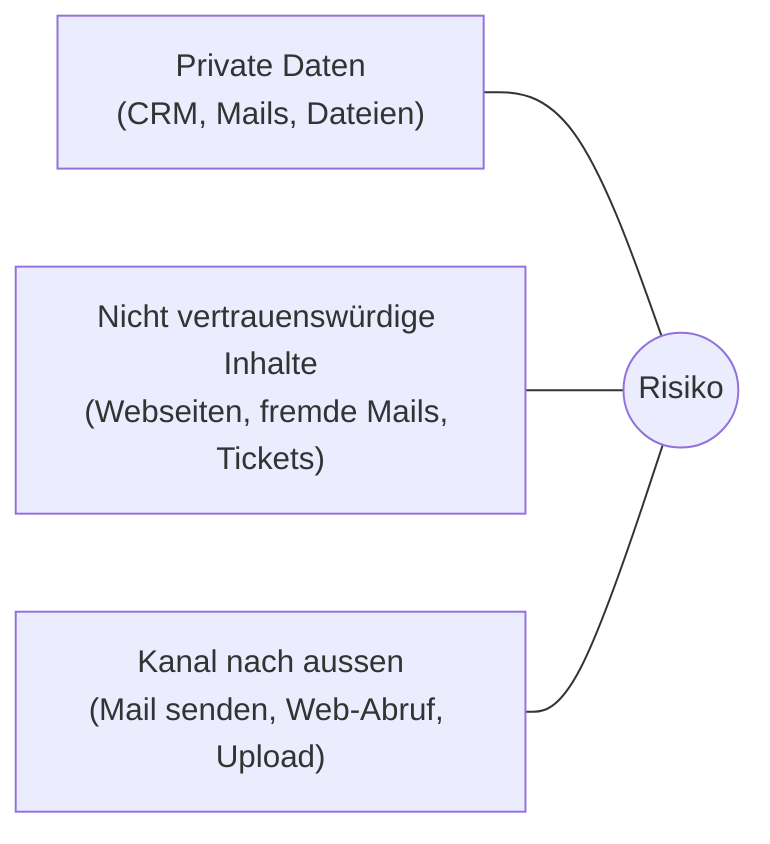

:::tldr
Ein MCP-Server ist nicht «ein Plugin», sondern ein **Zugang**: Er gibt einem Modell, das durch fremde Texte manipulierbar ist, Hände in einem System. Die Bewertung folgt deshalb fünf Fragen: **Welche Daten** sind erreichbar? **Was kann** das Werkzeug bewirken (lesen, schreiben, senden)? **Wo läuft** es (lokal mit deinen Rechten oder beim Anbieter)? **Woher** kommt es? **Mit welcher Identität** und welchen Rechten greift es zu? Besonders kritisch ist die Kombination aus **privaten Daten**, **nicht vertrauenswürdigen Inhalten** und einem **Kanal nach aussen**. Durchgesetzt wird die Entscheidung technisch – mit Berechtigungsregeln und zentralen MCP-Vorgaben, nicht mit Bitten im Prompt.
:::

:::bildlich Der Badge für den externen Techniker
Ein externer Techniker bekommt keinen Generalschlüssel. Man überlegt: Welche **Räume** braucht er (Daten)? Darf er nur **schauen** oder auch **umbauen** (Wirkung)? Arbeitet er **im Haus** oder nimmt er Geräte **mit** (Ort)? Kennt man seine **Firma** (Herkunft)? Bekommt er einen **eigenen Badge** mit genau diesen Räumen oder deinen persönlichen (Identität)? Und man lässt ihn nicht allein im Archiv, wenn er gleichzeitig Post von Unbekannten öffnet und ein offenes Fenster hat.
:::

## Die fünf Bewertungsfragen

| Frage | Optionen | Was es bedeutet |
|---|---|---|
| **1. Daten** | öffentlich · intern · vertraulich · Personendaten · besonders schützenswert / Berufsgeheimnis | Je höher, desto strenger alles Weitere – und desto wichtiger die Datenfrage (revDSG) |
| **2. Wirkung** | lesen · schreiben · löschen · Geld bewegen · nach aussen senden | Schreiben und Senden brauchen Freigabe oder engste Grenzen |
| **3. Ort** | lokaler Prozess · entfernter Server des Anbieters · eigener Server | Lokal: läuft mit **deinen Rechten** ausserhalb der Sandbox. Entfernt: Daten gehen an einen **Dritten** |
| **4. Herkunft** | eigener Code · offizieller Server des Anbieters · Community | Community-Server sind fremder Code: prüfen, Version fixieren oder selbst bauen |
| **5. Identität** | persönliches Konto · Service-Konto mit minimalen Rechten | Ein Agent mit deinem Admin-Konto kann alles, was du kannst |

## Die gefährliche Kombination

Hat ein Agent **alle drei** gleichzeitig, reicht eine präparierte Mail oder Webseite, um ihn per [[Prompt Injection]] dazu zu bringen, private Daten nach aussen zu schicken. Der Sicherheitshinweis in der Claude-Code-Doku sagt es knapp: Server, die externe Inhalte abrufen, setzen dich dem Risiko von Prompt Injection aus. Die wirksamste Massnahme ist, **eines der drei zu entfernen** – etwa den Sendekanal nur mit menschlicher Freigabe zu erlauben oder Recherche (fremde Inhalte) und Datenzugriff (private Daten) in getrennte Agenten zu legen.

:::falle Eingebaute Server vergessen
Neben selbst eingebundenen Servern gibt es eingebaute, die Daten ausserhalb des Projekts zeigen können: der `ide`-Server (Auswahl, offene Dateien, Diagnosen aus VS Code), Browser- und Computer-Steuerung. Ist im Editor zufällig eine Datei mit Kundendaten offen, kann sie im Kontext landen. Für strenge Umgebungen gehören solche Server per `deniedMcpServers` gesperrt – das kostet etwas Komfort (z. B. die Diff-Ansicht in der IDE).
:::

## Durchsetzen statt hoffen

| Ebene | Mittel |
|---|---|
| **Pro Werkzeug** | Berechtigungsregeln: lesende Tools `allow`, schreibende `ask`, gefährliche `deny` (Lektion [Tools entwerfen](#/l/mcp-tools/tools-entwerfen)) |
| **Pro Server** | `allowedMcpServers` / `deniedMcpServers` als **Top-Level-Schlüssel** (nicht unter `sandbox`), verbindlich erst in **Managed Settings**; mit `allowManagedMcpServersOnly` nur noch zentral erlaubte |
| **Exklusiv** | `managed-mcp.json` in den Managed Settings: **nur** diese Server laden – auch Plugin-Server und claude.ai-Connectors werden unterdrückt; eine leere Liste schaltet MCP ganz ab |
| **Im Werkzeug selbst** | Authentifizierung, Autorisierung, Limits, Allowlists im Code; Service-Konto mit minimalen Rechten |
| **Nachvollziehbarkeit** | Aufrufe protokollieren (ohne Personendaten im Klartext, wo vermeidbar) |

:::gem Bewertung als Tabelle im Projekt
Eine Tabelle pro Kundenprojekt – System, Datenklasse, Wirkung, Ort, Herkunft, Identität, Entscheid (erlaubt / mit Freigabe / verboten), Begründung, Verantwortliche – macht die Entscheidung prüfbar und wiederholbar. Sie dient gleichzeitig als Nachweis gegenüber Datenschutz und Revision und als Grundlage für die Managed Settings.
:::

## Ein Beispiel

| System | Daten | Wirkung | Ort | Entscheid |
|---|---|---|---|---|
| Öffentliche Produktdoku | öffentlich | lesen | entfernt, offiziell | **erlaubt** |
| Ticketsystem (Kundenanfragen) | Personendaten, fremde Texte | lesen, kommentieren | entfernt, offiziell | lesen **erlaubt**, kommentieren **mit Freigabe**; kein gleichzeitiger Sendekanal |
| CRM | Personendaten | lesen, Adresse ändern | eigener Server | Service-Konto, lesen erlaubt, ändern mit Freigabe, löschen verboten |
| Buchhaltung | vertraulich, Geld | Zahlungen auslösen | eigener Server | **verboten** für Agenten; nur Entwürfe, Freigabe durch Menschen im System |
| Community-Server «Gmail all-in-one» | Personendaten, Senden | lesen, senden | lokal, unbekannte Herkunft | **verboten**; offiziellen Connector prüfen oder eigenes, eng geschnittenes Tool |

## Die Datenfrage nicht vergessen

Ein entfernter MCP-Server eines Anbieters ist datenschutzrechtlich ein **weiterer Empfänger**: Daten gehen an diesen Dienst, oft ins Ausland. Unter dem revDSG braucht es dafür eine Grundlage (z. B. Auftragsbearbeitung mit Vertrag) und bei Bekanntgabe ins Ausland eine Prüfung des Schutzniveaus. Bei Berufsgeheimnissen (Anwälte, Ärztinnen, Treuhand) gelten strengere Massstäbe. Die rechtliche Einordnung gehört in die Lektion [Datenfrage Schweiz](#/l/ai-security/datenfrage-schweiz); hier zählt: **Ohne geklärte Datenfrage kein Server mit Personendaten.**

:::berater Im Kundengespräch
Die Frage «Können wir alle unsere Systeme an Claude anbinden?» beantwortest du nicht mit Ja oder Nein, sondern mit dem Raster: «Lassen Sie uns für jedes System fünf Fragen beantworten – Daten, Wirkung, Ort, Herkunft, Identität. Daraus ergibt sich pro System: erlaubt, mit Freigabe oder verboten. Und das setzen wir technisch durch, nicht per Anweisung.» Typischer Einwand: «Unsere Mitarbeitenden würden das nie missbrauchen.» – Es geht nicht um die Mitarbeitenden, sondern um eine präparierte Mail, die der Agent liest.
:::

:::spickzettel
- MCP-Server = **Zugang** für ein manipulierbares Modell
- 5 Fragen: **Daten · Wirkung · Ort · Herkunft · Identität**
- Lokal: läuft mit **deinen Rechten** ausserhalb der Sandbox; entfernt: Daten an **Dritte**
- Gefährlich: **private Daten + fremde Inhalte + Kanal nach aussen** → eines davon entfernen
- Eingebaute Server (**`ide`**, Browser, Computer) mitdenken
- Durchsetzen: Regeln **pro Tool**, `allowedMcpServers`/`deniedMcpServers` (Top-Level, **Managed**), **`managed-mcp.json`** exklusiv
- Service-Konto mit **minimalen Rechten**, Protokollierung
- Personendaten: **revDSG** klären, bevor ein Server angebunden wird
:::

:::selbstcheck 3
