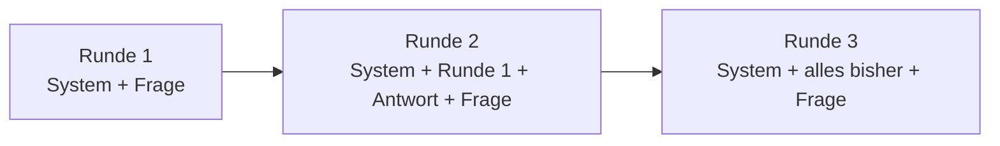

:::tldr
Bei der API bezahlst du **pro Token**, getrennt nach **Eingabe** (alles, was du schickst) und **Ausgabe** (alles, was das Modell erzeugt). Die Preise gelten **pro Million Tokens** in USD. Drei Dinge sollte jeder wissen: **Ausgabe ist bei Claude fünfmal so teuer wie Eingabe.** **Denk-Tokens zählen als Ausgabe** – auch wenn du sie nicht siehst. Und **die Eingabe wächst mit jeder Gesprächsrunde**, weil der ganze Verlauf bei jedem Aufruf neu mitgeschickt wird. Mit Tokenmenge, Preis und Wechselkurs rechnest du jeden Aufruf in CHF aus.
:::

:::bildlich Das Taxi mit zwei Zählern
Ein Modellaufruf ist wie ein Taxi mit **zwei Zählern**: Einer läuft für das Gepäck, das du einlädst (Eingabe), einer – fünfmal schneller – für die Strecke, die gefahren wird (Ausgabe). Und bei einem Gespräch steigst du nach jeder Etappe aus und wieder ein – mit **dem ganzen bisherigen Gepäck**, das jedes Mal neu gezählt wird.
:::

## Die Formel

```
Kosten = Eingabe-Tokens × Eingabepreis + Ausgabe-Tokens × Ausgabepreis
         (Preise pro Million Tokens, in USD)
```

**Preise in USD pro Million Tokens** (Stand 27.11.2026):

| Modell | Eingabe | Ausgabe | Bemerkung |
|---|---|---|---|
| Claude Opus 5.5 | 4.00 | 20.00 | grosses Modell |
| Claude Sonnet 5.5 | 2.00 | 10.00 | mittleres Modell, Arbeitspferd |
| Claude Haiku 5.5 | 0.10 | 0.50 | kleines Modell, gilt für Prompts **bis 100 000 Tokens** |
| Claude Haiku 5.5, langer Prompt | 0.50 | 2.50 | Prompts **über 100 000 Tokens** – alle Preise × 5 |

## Was alles zur Eingabe zählt

Die Eingabe ist nicht nur deine Frage. Bei **jedem** Aufruf werden mitgezählt:

- der **System-Prompt** (Rolle, Regeln, Beispiele),
- die **Werkzeugdefinitionen** (jedes Tool mit Beschreibung und Schema),
- **Dokumente** und Suchergebnisse,
- der **ganze bisherige Verlauf**, inklusive früherer Antworten und Werkzeugergebnisse,
- erst dann die neue Frage.



Deshalb wird ein langes Gespräch oder ein Agent mit vielen Schritten **mit jeder Runde teurer** – auch wenn die einzelnen Fragen kurz sind.

## Was alles zur Ausgabe zählt

- die sichtbare **Antwort**,
- **Werkzeugaufrufe**, die das Modell formuliert,
- **Denk-Tokens** (Thinking) – sie werden wie Ausgabe abgerechnet, auch wenn das Denken ausgeblendet oder nur zusammengefasst angezeigt wird.

:::falle Das unsichtbare Denken
Aktuelle Modelle denken adaptiv, bevor sie antworten; bei Opus 5.5 lässt sich das Denken nicht abschalten. Eine Antwort mit 300 sichtbaren Wörtern kann deshalb ein Mehrfaches an Ausgabe-Tokens kosten. Wer nur die sichtbare Antwort zählt, unterschätzt die Kosten. Die API meldet bei jeder Antwort die tatsächlichen Zahlen im Feld `usage` – dort nachsehen, nicht schätzen.
:::

## Rechenbeispiel in CHF

Ein Assistent beantwortet Fragen zu internen Richtlinien mit **Claude Sonnet 5.5**. Pro Anfrage gehen **20 000 Tokens** hinein (Richtlinien und Frage) und **1 000 Tokens** heraus.

| Posten | Rechnung | USD |
|---|---|---|
| Eingabe | 20 000 / 1 000 000 × 2.00 | 0.040 |
| Ausgabe | 1 000 / 1 000 000 × 10.00 | 0.010 |
| **Pro Anfrage** | | **0.050** |
| **10 000 Anfragen im Monat** | | **500** |

Bei einem Kurs von rund **0.84 CHF pro USD** (Mitte November 2026) sind das etwa **CHF 0.042 pro Anfrage** bzw. **CHF 420 im Monat**. Mit Prompt Caching für die immer gleichen Richtlinien sinkt der Betrag deutlich (Lektion [Caching und Batch](#/l/modelle-kosten/caching-und-batch)).

:::gem Nicht pro Aufruf rechnen, sondern pro brauchbares Ergebnis
Ein billiger Aufruf, der wiederholt, von Hand korrigiert oder falsch weitergegeben wird, ist am Ende teurer als ein etwas teurerer, der beim ersten Mal stimmt. Die richtige Kennzahl ist **Kosten pro akzeptiertes Ergebnis** – inklusive Wiederholungen, Nacharbeit und Fehlerfolgen.
:::

:::berater Im Kundengespräch
Viele Kunden überschätzen die API-Kosten massiv, weil sie an Software-Lizenzen denken. Ein Rechenbeispiel mit ihren eigenen Mengen holt das Gespräch auf den Boden: «Für 10 000 Anfragen im Monat reden wir von einigen hundert Franken, nicht von zehntausenden.» Ebenso wichtig ist der Hinweis auf die Treiber, die das schnell ändern können: lange Verläufe, viele Werkzeuge, hoher Denkaufwand und das grösste Modell für alles.
:::

:::spickzettel
- Kosten = **Eingabe × Eingabepreis + Ausgabe × Ausgabepreis**, Preise **pro Million Tokens** in USD
- Stand 27.11.2026: **Opus 5.5 4/20**, **Sonnet 5.5 2/10**, **Haiku 5.5 0.10/0.50** (bis 100 000 Tokens Prompt, darüber × 5)
- **Ausgabe 5× teurer** als Eingabe
- Eingabe = **System-Prompt + Tools + Dokumente + ganzer Verlauf + Frage** – bei jedem Aufruf
- Gespräche und Agenten werden **pro Runde teurer**
- **Denk-Tokens = Ausgabe**, auch wenn unsichtbar; tatsächliche Zahlen in **`usage`**
- In CHF umrechnen (Kurs Mitte Nov. 2026 ≈ **0.84**)
- Kennzahl: **Kosten pro akzeptiertes Ergebnis**
:::

:::selbstcheck 3
