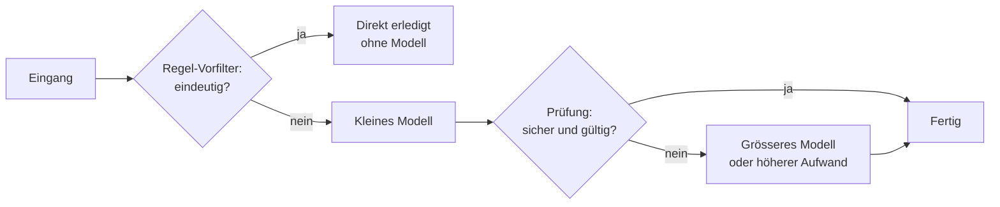

:::tldr
Eine Pipeline mit mehreren Schritten wird nicht als Ganzes einem Modell zugeordnet, sondern **pro Rolle**: Router, Extraktor, Autor, Kritiker, Richter. Jede Rolle bekommt **Modellstufe, Aufwand, `max_tokens` und Wiederholungen** – zentral in **einer** Konfigurationsdatei. Der **Aufwand** ist dabei der erste Regler, die **Modellstufe** der zweite. Unsichere Fälle laufen über eine **Kaskade** zum nächstgrösseren Modell, statt alles teuer zu rechnen. Und eine **harte Budgetgrenze** prüft **vor** jedem Aufruf, ob er noch ins Budget passt – sonst stoppt der Lauf sichtbar.
:::

:::bildlich Die Schichtplanung im Spital
Ein Spital setzt nicht für jeden Patienten die Chefärztin ein. Die **Triage** entscheidet schnell, wohin jemand gehört. Die meisten Fälle behandelt das **Team auf der Station**. Nur was unklar oder ernst ist, wird zur **Oberärztin** eskaliert. Und die Verwaltung hat ein **Budget pro Monat**, das vor teuren Eingriffen geprüft wird – nicht erst, wenn die Rechnung kommt.
:::

## Aufwand und Denken in Kürze

- **Denken** bestimmt, **ob** Claude vor der Antwort für sich überlegt. Bei aktuellen Modellen ist es **adaptiv**: Claude entscheidet selbst, wie viel. Bei Opus 5.5 lässt es sich nicht abschalten.
- **Aufwand** (Effort: `low`, `medium`, `high`, `xhigh`, `max`) bestimmt, **wie gründlich** Claude arbeitet – Denken, Prüfen, Werkzeugaufrufe. Er ist ein **Verhaltenssignal, kein festes Budget**.
- Denk-Tokens kosten wie **Ausgabe** – darum ist der Aufwand der erste Kostenregler.
- Die **Standardstufe** unterscheidet sich: In der API startet Opus 5.5 auf `medium`, Sonnet 5.5 auf `high`, Haiku 5.5 auf `medium` (Stand 27.11.2026). Eine Anfrage ohne Angabe ist also nicht überall gleich – **immer explizit setzen**.

## Rollen festlegen

| Rolle | Modell | Aufwand | max_tokens | Wiederholungen |
|---|---|---|---|---|
| Router (Absicht, Sprache) | klein | low | klein | 1 |
| Extraktor (Felder aus Dokument) | klein | medium | mittel | 2, mit Fehlerhinweis |
| Autor (Antwortentwurf) | mittel | medium | gross | 1 |
| Kritiker (prüft Entwurf) | mittel | **high** | mittel | 1 |
| Richter (Schlussentscheid bei Konflikt) | gross | high | mittel | 1 |

Grundsätze:

- **Global `medium`**, einzelne Rollen begründet höher oder tiefer – nie global erhöhen, um eine Rolle zu retten.
- **Wenige verschiedene Modelle** pro Pipeline: Jedes Modell zahlt seinen eigenen Cache-Schreibvorgang.
- **Aufwand innerhalb eines Gesprächs konstant** halten – ein Wechsel kann den Cache ungültig machen.
- Jede Einstellung mit **Begründung und Datum** in der Konfiguration kommentieren.

## Kaskade statt Grossmodell für alles

Die meisten Fälle sind einfach und werden billig erledigt; nur der Rest wird teurer. Voraussetzung ist eine **verlässliche Prüfung**, die unsichere Fälle erkennt – etwa ein Schema-Validator, eine Konfidenzangabe, die gegen echte Fälle geeicht ist, oder Regeln.

## Budgetgrenze

| Schritt | Umsetzung |
|---|---|
| **Vor** jedem Aufruf schätzen | Eingabe-Tokens zählen + `max_tokens` × Preise aus der Konfiguration |
| Vergleichen | laufende Summe + Schätzung > Budget? |
| Hart stoppen | Lauf mit klarer Fehlermeldung und Ereignis im Protokoll beenden – **kein stilles Weitermachen**, kein heimlicher Wechsel auf ein schlechteres Modell |
| Optional | Budget **pro Rolle**, damit eine Rolle nicht alles aufbraucht |
| Alarme | Cache-Trefferquote tief nach dem ersten Aufruf · Eingabe-Tokens wachsen in einer Schleife · Wiederholungsquote einer Rolle hoch · eine Rolle verbraucht weit mehr als ihren erwarteten Anteil |

:::falle Budget erst nach der Rechnung
Viele Projekte merken Kostenexplosionen erst auf der Monatsrechnung – typisch bei einem Agenten in einer **Endlosschleife**, der jede Runde den wachsenden Verlauf neu schickt. Eine Grenze, die erst **nach** dem überschreitenden Aufruf auslöst, ist zu spät. Darum: **vorher** schätzen, hart stoppen, und zusätzlich ein Ausgabenlimit im Konto des Anbieters setzen. Für unbeaufsichtigte Läufe in Claude Code gibt es dafür `--max-budget-usd` (Lektion [Unbeaufsichtigt absichern](#/l/automation/unbeaufsichtigt-absichern)).
:::

:::gem Eine Datei für alle Regler
Modell-IDs, Rollen, Aufwand, `max_tokens`, Wiederholungen, Cache-Lebensdauer, Budget und Preise gehören in **eine** Konfigurationsdatei – nicht verstreut über den Code. Dann ist jede Kostenänderung ein kleiner, prüfbarer Diff, und ein Modellwechsel ist eine Zeile plus ein neuer Vergleichslauf.
:::

:::berater Im Kundengespräch
Bei der Planung einer Pipeline stellst du pro Schritt drei Fragen: **Was kostet ein Fehler hier? Wie schwierig ist das Denken wirklich? Wie oft läuft es?** Ein Schritt, der zehntausendmal am Tag läuft und einfach ist, gehört aufs kleinste Modell. Ein Schritt, der einmal pro Fall über ein Ergebnis entscheidet, das an einen Kunden geht, darf teuer sein. Diese Logik ist für Management und Finanzabteilung nachvollziehbar – und lässt sich mit Messungen belegen.
:::

:::spickzettel
- Pro **Rolle**: Modellstufe · Aufwand · `max_tokens` · Wiederholungen – in **einer** Konfigurationsdatei
- **Aufwand zuerst**, Modell danach; Denk-Tokens = Ausgabekosten
- Aufwand ist **Verhaltenssignal**, kein Budget; Standard je Modell verschieden → **explizit setzen**
- Global **`medium`**, Ausnahmen begründet; **wenige Modelle** pro Pipeline; Aufwand im Gespräch **konstant**
- **Kaskade**: Regeln → kleines Modell → nur Unsicheres eskalieren
- **Budget vorher prüfen**, hart und sichtbar stoppen; Alarme für Cache, Kontextwachstum, Wiederholungen
- Zusätzlich **Ausgabenlimit im Konto**; in Claude Code `--max-budget-usd`
:::

:::selbstcheck 3
