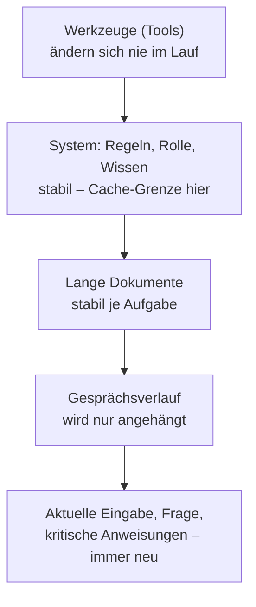

:::tldr
Das [[Kontextfenster]] ist der **Arbeitstisch** des Modells: begrenzt, bei jedem Aufruf bezahlt, und je voller, desto schlechter findet das Modell Details. Drei Regeln tragen weit: **Stabiles oben, Veränderliches unten** (spart dank [[Prompt Caching]] bis zu 90 % der Eingabekosten), **lange Dokumente vor die Frage, die Frage und kritische Anweisungen ans Ende**, und **nur hinlegen, was dieser Schritt braucht** – Referenzen statt Volltext, alte Werkzeug-Ergebnisse durch Platzhalter ersetzen, erst dann zusammenfassen.
:::

:::bildlich Der Arbeitstisch
Ein guter Sachbearbeiter legt nicht alle Akten der Firma auf den Tisch. Oben liegt, was er für **diesen** Fall braucht; das Handbuch steht griffbereit im Regal, und erledigte Fälle wandern mit einer kurzen Notiz ins Archiv. Liegt alles durcheinander auf dem Tisch, übersieht er das Wichtige – genau das passiert einem Modell mit überfülltem Kontext. Anthropic nennt den Effekt **Context Rot**.
:::

## Reihenfolge: was wohin gehört

| Position | Inhalt | Warum |
|---|---|---|
| **oben** | Werkzeuge, System-Prompt, feste Regeln, Beispiele | ändert sich nicht → wird zwischengespeichert |
| **Mitte** | lange Dokumente, bisheriger Verlauf | Material, auf das sich die Frage bezieht |
| **unten** | aktuelle Eingabe, Frage, die wichtigsten Formatregeln | wird am stärksten beachtet, ändert sich bei jedem Aufruf |

Anthropic empfiehlt, **lange Dokumente oben** und **die Frage ans Ende** zu stellen; in eigenen Tests verbesserte das die Antwortqualität bei vielen Dokumenten deutlich. Information **in der Mitte** langer Kontexte wird schlechter gefunden («Lost in the Middle»). Darum stehen kritische Anweisungen («Antworte nur mit JSON», «nur auf Deutsch») am Ende – bei sehr langen Prompts bei Bedarf zusätzlich auch oben.

## Prompt Caching: Stabiles zuerst spart Geld

Claude kann den **unveränderten Anfang** eines Prompts zwischenspeichern. Folgt eine Anfrage mit exakt demselben Anfang, wird er aus dem Cache gelesen statt neu verarbeitet (Stand 27.11.2026, Claude-Doku):

| | Preis relativ zum normalen Eingabepreis |
|---|---|
| Cache schreiben, Lebensdauer 5 Minuten (Standard) | 1,25× |
| Cache schreiben, Lebensdauer 1 Stunde | 2× |
| Cache lesen | 0,1× oder weniger (je nach Modell) |

Ein Präfix, das **einmal** innerhalb von fünf Minuten wiederverwendet wird, lohnt sich bereits (1,25 + 0,1 < 2). Jeder Treffer verlängert die Lebensdauer.

:::falle Ein Datum im System-Prompt zerstört den Cache
Der Cache greift nur, wenn **jedes Zeichen bis zur Cache-Grenze identisch** ist – in der Reihenfolge Werkzeuge → System → Nachrichten. Typische Cache-Killer: das heutige Datum oder eine Anfrage-ID im System-Prompt, Benutzernamen in den Regeln, abgerufene Suchtreffer **vor** den festen Anweisungen, JSON mit wechselnder Schlüsselreihenfolge, Werkzeuge, die je nach Anfrage ein- und ausgeblendet werden, und Gesprächsverläufe, die **vorne gekürzt** werden. Alles Veränderliche gehört **hinter** die letzte Cache-Grenze.
:::

:::gem Mit Zahlen prüfen, nicht hoffen
Die API meldet bei jeder Antwort `cache_creation_input_tokens` und `cache_read_input_tokens`. Erster Aufruf: Schreiben. Folgende Aufrufe: Lesen. Wächst der Schreibanteil bei jedem Aufruf weiter, ändert sich etwas im Präfix – dann zwei aufeinanderfolgende Anfragen vergleichen. Stehen beide Werte auf 0, ist das Präfix zu kurz für das Modell und wird gar nicht zwischengespeichert.
:::

## Weniger hinlegen: die Hebel in Reihenfolge

1. **Referenzen statt Inhalt:** Pfade, IDs oder gespeicherte Abfragen mitgeben; die Daten lädt ein Werkzeug erst, wenn sie gebraucht werden. Vorab nur, was **jeder** Aufruf braucht.
2. **Alte Werkzeug-Ergebnisse maskieren:** Ein 5000-Zeilen-Log von vor zehn Schritten wird durch einen Platzhalter ersetzt («Log geprüft, Fehler in Zeile 812, erneut abrufbar mit …»). Eigene Überlegungen und Nutzereingaben bleiben.
3. **Erst dann zusammenfassen:** Wird es trotzdem zu viel, ältere Runden zusammenfassen – ausgelöst durch eine Token-Schwelle, nicht nach Anzahl Runden. Inhalt der Zusammenfassung: Entscheide mit Begründung, offene Probleme, berührte Dateien und IDs, Vorgaben der Nutzerin, nächster Schritt.
4. **Grosse frische Daten verdichten:** lange JSON-Listen oder Logs im **hinteren** Teil kürzen – nie den stabilen Anfang umschreiben.

Eine von den Skill-Quellen zitierte Studie (JetBrains, Coding-Agenten) fand, dass schon das Maskieren die Kosten um mehr als die Hälfte senkte und oft gleich gut oder besser abschnitt als Zusammenfassen. Das sind Messungen auf anderen Modellen – auf den eigenen Daten nachprüfen.

:::falle Zusammenfassungen verlieren still Fakten
Eine Zusammenfassung wirkt vollständig, auch wenn die entscheidende Kündigungsfrist fehlt. Darum mit **fünf bis zehn Testfragen** prüfen, deren Antworten nur im weggekürzten Teil standen. Fällt eine durch, wird der Zusammenfassungs-Prompt verbessert. Und: Was dauerhaft gelten muss (Entscheide, Regeln), gehört in eine **Notizdatei**, die im stabilen Teil geladen wird – nicht nur ins Gespräch.
:::

## Gesprächsverlauf: nur anhängen

- **Verlauf nur hinten ergänzen**, nie vorne kürzen oder umsortieren – sonst ist der Cache dahin.
- Muss er schrumpfen: **selten und in einem Schritt** kompaktieren, danach wieder nur anhängen.
- Für lange Aufgaben eine **Notiz- oder To-do-Datei** ausserhalb des Fensters führen lassen und nach der Kompaktierung neu laden. Subagents arbeiten in einem eigenen, sauberen Fenster und geben nur ein kurzes Ergebnis zurück (Lektion [Kontext und Subagents](#/l/claude-code/kontext-und-subagents)).

:::berater Im Kundengespräch
«Unser Modell hat 1 Million Tokens Kontext, wir geben einfach alles mit» ist der teuerste Satz im KI-Projekt. Die Gegenrechnung: Jeder Token wird **bei jedem Aufruf** wieder bezahlt, und je voller das Fenster, desto schlechter die Treffsicherheit. Eine Umstellung auf «Stabiles oben, Veränderliches unten» plus Caching senkt die Eingabekosten bei wiederkehrenden Anfragen oft um ein Vielfaches – ohne dass sich an der Qualität etwas verschlechtert. Messbar an der Cache-Trefferquote.
:::

:::spickzettel
- Kontextfenster = **Arbeitstisch**: begrenzt, jedes Mal bezahlt, voll = schlechter (**Context Rot**)
- Reihenfolge: **Werkzeuge → System → Dokumente → Verlauf → Frage**
- **Lange Dokumente oben, Frage und kritische Anweisungen am Ende**; Mitte wird schlechter gefunden
- **Caching**: Schreiben 1,25× (5 Min.) / 2× (1 Std.), Lesen ≤ 0,1×; lohnt ab 1 Wiederverwendung
- Cache-Killer: **Datum/IDs im System-Prompt**, Suchtreffer vor Regeln, vorne kürzen
- Prüfen mit `cache_creation_input_tokens` / `cache_read_input_tokens`
- Hebel: **Referenzen statt Inhalt → maskieren → zusammenfassen → frische Daten verdichten**
- Zusammenfassung mit Testfragen prüfen; Dauerhaftes in **Notizdatei**
:::

:::selbstcheck 3
