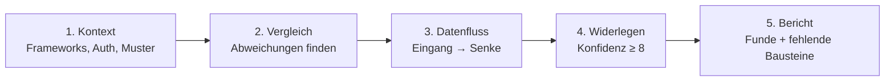

:::tldr
Ein gutes Security Review sucht nicht «irgendwas Verdächtiges», sondern folgt einer Methode: **Kontext verstehen** (Frameworks, Auth, übliche Muster), **Abweichungen** von diesen Mustern als heisse Stellen behandeln, für jeden Eingang den **Datenfluss bis zur Senke** verfolgen und jeden Fund **zu widerlegen** versuchen. Gemeldet wird nur, was einen **belegbaren Angriffspfad** hat – mit Datei und Zeile, Szenario und Korrektur, priorisiert nach **Ausnutzbarkeit und Wirkung**. Fehlende Härtung gehört in eine **getrennte Liste**. In Claude Code prüft `/security-review` die Änderungen eines Branches – hilfreich, aber **kein Ersatz** für Scanner und Tests.
:::

:::bildlich Der Gebäudeinspektor
Ein guter Inspektor läuft nicht wahllos durchs Haus. Er schaut sich zuerst die **Pläne** an (Kontext), sucht Stellen, die **vom Plan abweichen** (die heissesten), und verfolgt **jeden Zugang** bis zu den wertvollen Räumen. Er meldet «Hintertür im Keller lässt sich ohne Schlüssel öffnen» (Fund) getrennt von «Rauchmelder fehlt im Flur» (fehlende Härtung) – und schreibt dazu, welche Räume er **nicht** besichtigt hat.
:::

## Zwei Arten von Prüfung

| | Schwachstellen-Review | Grundcheck |
|---|---|---|
| Frage | Gibt es eine **ausnutzbare** Lücke? | Fehlt ein **Pflichtbaustein**? |
| Massstab | belegbarer Angriffspfad, hohe Konfidenz | Liste der Schutzbausteine |
| Ergebnis | «Fund» mit Angriffsszenario | «fehlt» mit Begründung |

Beides gehört in den Bericht – aber **getrennt**. Wer fehlendes Rate-Limiting als «Schwachstelle hoch» meldet, entwertet die echten Funde.

## Der Ablauf



1. **Kontext:** Welche Frameworks, welche Validierung, welcher Auth-Mechanismus, welches ORM? Läuft der Dienst im Internet, im LAN oder lokal?
2. **Vergleich:** Code gegen die üblichen Muster des Projekts. Roh-SQL in einem ORM-Projekt oder eine Route ohne die übliche Auth-Prüfung sind die **heissesten Stellen**.
3. **Datenfluss:** Für jeden Eingang den Weg bis zur Senke verfolgen. Nur ein **durchgehender Pfad ohne wirksamen Schutz** ist ein Fund.
4. **Widerlegen:** Jeden Kandidaten aktiv zu widerlegen versuchen. Konfidenz 1–10 vergeben, **unter 8 nicht melden**, höchstens als offene Frage.
5. **Bericht** – mit dem, was **nicht** geprüft wurde.

## Priorisieren

| Schweregrad | Bedeutung | Beispiele |
|---|---|---|
| **hoch** | direkt ausnutzbar | Code-Ausführung, Datenabfluss, Umgehung der Anmeldung, fremde Daten per ID |
| **mittel** | braucht besondere Bedingungen, Wirkung erheblich | Lücke nur für angemeldete Nutzer, XSS mit Interaktion |
| **tief** | Härtung, geringe Wirkung | im Review nicht als Fund, im Grundcheck als «fehlt» |

Für die Reihenfolge der Behebung zählen **Erreichbarkeit** (Internet? angemeldet?), **Wirkung** (Daten, Geld, Systemzugriff) und **Aufwand für den Angreifer**. Auch eine Lücke, die nur aus dem lokalen Netz erreichbar ist, kann «hoch» sein.

```markdown
### F1: Injection – `api/search.py:42` – hoch (Konfidenz 9/10)
- Beschreibung: Suchbegriff wird per f-String in SQL eingesetzt.
- Angriffsszenario: `' OR 1=1--` im Suchfeld liefert alle Kundendatensätze.
- Korrektur: parametrisierte Abfrage; Negativtest ergänzen.
```

## /security-review in Claude Code

- Prüft die **offenen Änderungen des aktuellen Branches** (den Diff), nur lesend.
- Schliesst bewusst einiges aus, damit der Bericht rauschfrei bleibt – u. a. Überlast/Denial of Service, fehlendes Rate-Limiting, fehlende Härtung und veraltete Bibliotheken. Für einen Grundcheck gehören diese dazu, als **eigene Liste**.
- Für ein ganzes Repository oder einen Grundcheck: eigener Befehl in `.claude/commands/` mit Pflichtbausteinen.
- Anthropic stellt die Methode auch als GitHub Action bereit (`anthropics/claude-code-security-review`).

:::falle Ein LLM-Review als einzige Prüfung
Ein Review durch ein Sprachmodell **übersieht** echte Lücken und meldet **falsche**. Unabhängige Tests haben beides gezeigt, und Sicherheitsforscher haben demonstriert, dass sich Schadcode vor einem KI-Review verstecken lässt. Laut Anthropic ist die Action **nicht gegen Prompt Injection gehärtet** – Kommentare im geprüften Code können den Reviewer beeinflussen. Darum: nur **vertrauenswürdigen** Code so prüfen lassen, bei fremden Pull Requests erst nach Freigabe, **keinen Projektcode ausführen**, und immer kombinieren: **LLM-Review + Scanner (Semgrep, CodeQL) + Negativtests**.
:::

:::gem Abweichung ist das beste Signal
Die produktivste Frage im Review ist nicht «Ist das sicher?», sondern «**Warum ist das hier anders als überall sonst?**» Ein Projekt, das überall das ORM nutzt und an einer Stelle Roh-SQL baut, oder überall einen Auth-Dekorator setzt und an einer Route nicht – dort sitzen die Lücken. Wer zuerst die Muster kennt, findet die Ausnahmen schnell.
:::

:::berater Im Kundengespräch
Ein Review-Bericht für Kunden enthält vier Teile: **Angriffsfläche** (Eingänge, Senken, Schutz), **Funde** nach Schweregrad mit Szenario und Korrektur, **fehlende Pflichtbausteine** und **was nicht geprüft wurde** («keine Laufzeittests», «Infrastruktur nicht geprüft»). Der letzte Teil ist der wichtigste für das Vertrauen: Er verhindert, dass «keine Funde» als «sicher» missverstanden wird.
:::

:::spickzettel
- **Schwachstellen-Review** (ausnutzbarer Pfad) und **Grundcheck** (fehlender Baustein) **getrennt** berichten
- Ablauf: **Kontext → Vergleich (Abweichungen!) → Datenfluss Eingang→Senke → widerlegen (Konfidenz ≥ 8) → Bericht**
- Schweregrad: **hoch** (direkt ausnutzbar) · **mittel** · **tief** (Härtung)
- Priorisieren nach **Erreichbarkeit, Wirkung, Aufwand für Angreifer**
- Fund: **Datei:Zeile, Szenario, Korrektur**; Bericht nennt, was **nicht** geprüft wurde
- **`/security-review`**: Diff des Branches, nur lesend, schliesst Härtung/DoS/Bibliotheken aus
- LLM-Review **+ Scanner + Negativtests**; nur vertrauenswürdiger Code, nichts ausführen
:::

:::selbstcheck 3
