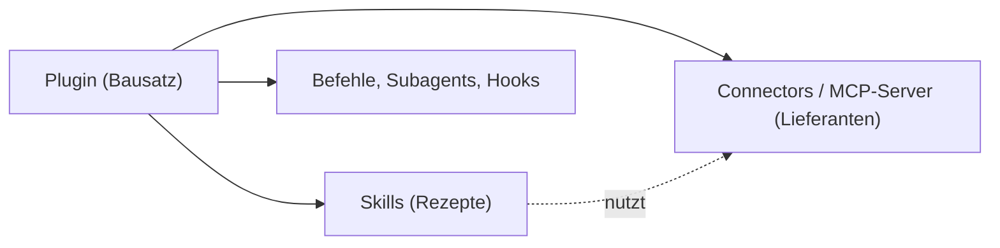

:::tldr
Drei Begriffe, die ständig verwechselt werden: Ein **Skill** ist ein **Rezept** – eine schriftliche Anleitung (ein Ordner mit `SKILL.md`), die Claude bei passender Aufgabe liest und befolgt. Ein **Connector** ist ein **Lieferant** – eine Verbindung (per [[MCP]]) zu deinen Daten und Werkzeugen wie Gmail, Google Drive oder GitHub. Ein **Plugin** ist ein **Bausatz** – ein installierbares Paket, das Skills, Befehle, Subagents, Hooks und Connectors bündelt. Ein Skill bringt Claude bei, **wie** etwas geht; ein Connector gibt Zugang **zu etwas**; ein Plugin liefert beides **in einer Schachtel**.
:::

:::bildlich Die Küche
Claude ist ein talentierter Koch an seinem ersten Tag in deinem Restaurant. **Rezepte** (Skills) sagen ihm, wie euer Haus-Risotto geht – Zutaten, Reihenfolge, der eine Trick. **Lieferanten** (Connectors) bringen die echten Zutaten: deine Mails, deine Dateien, dein Ticketsystem. Ein **Bausatz** (Plugin) ist der Karton mit Rezept, Bestellliste, Spezialwerkzeug und einem Sous-Chef – einmal installiert, alles da.
:::

## Die drei im Vergleich

| | Skill | Connector | Plugin |
|---|---|---|---|
| Bild | Rezept | Lieferant | Bausatz im Karton |
| Was es ist | Ordner mit `SKILL.md`, optional Skripte und Referenzen | Verbindung zu einem externen Dienst über MCP | Paket mit Manifest (`plugin.json`) und Komponenten |
| Was es bringt | **Wissen und Vorgehen**: wie eine Aufgabe gelöst wird | **Zugang**: Daten lesen, Aktionen ausführen | **Bündelung und Verteilung**: alles in einer Installation |
| Wann aktiv | wenn die Beschreibung zur Aufgabe passt oder du `/name` tippst | wenn Claude ein Werkzeug des Dienstes aufruft | seine Komponenten verhalten sich wie einzeln installiert |
| Beispiel | «So erstellen wir Offerten nach Firmenvorlage» | Google Drive, GitHub, Slack | «Treuhand-Plugin»: Offerten-Skill, MWST-Prüf-Befehl, Buchhaltungs-Connector |

## Wie sie zusammenspielen

- Ein **Plugin** kann mehrere Skills, Connectors und weitere Bausteine enthalten.
- Ein **Skill** kann Werkzeuge eines Connectors nutzen («hole die Vorlage aus Google Drive»).
- **Connectors** funktionieren auch ohne Skill – Claude entscheidet dann selbst, wie er sie nutzt.
- **Skills** funktionieren auch ohne Plugin – einzeln hochgeladen oder als Ordner abgelegt.

## Was ein Skill nicht ist

- **Kein Training:** Claude lernt nichts dauerhaft. Der Skill wird gelesen, wenn er gebraucht wird.
- **Kein Programm:** Ein Skill ist hauptsächlich Markdown. Er **kann** Skripte enthalten, die Claude ausführt – aber das Herzstück ist die Anleitung.
- **Keine Magie:** Ein Skill ist so gut wie die Anleitung darin. Ein vager Skill liefert vage Ergebnisse.

:::gem Skills sind übertragbar
Skills folgen einem offenen Format (Agent Skills). Eine gut geschriebene `SKILL.md` funktioniert in der Claude-App, in Claude Code und über die API – und sogar bei anderen Werkzeugen, die das Format unterstützen. Dein Firmenwissen, einmal sauber aufgeschrieben, ist damit nicht an ein Produkt gebunden.
:::

## Wo was läuft (Stand 27.11.2026)

| | Chat (claude.ai, Desktop, Mobile) | Cowork (Desktop) | Claude Code |
|---|---|---|---|
| Skills | ja (hochladen unter Customize) | ja | ja (Ordner `~/.claude/skills/`, `.claude/skills/`) |
| Connectors | ja | ja | ja |
| Plugins | ja – Skills, Befehle und Connectors; **Hooks und Subagents nicht** | ja, inkl. Hooks und Subagents | ja, vollständig |

Plugins, die du in der **Claude-App** hinzufügst, werden in deinem **Konto** gespeichert und stehen auch in Cowork und Claude Code zur Verfügung. Plugins, die du in **Claude Code per Kommandozeile** installierst, bleiben dagegen auf diesem einen Rechner.

:::falle Veraltete Übersichten
Viele Anleitungen aus dem ersten Halbjahr 2026 behaupten «Plugins gehen im Browser nicht». Das stimmt nicht mehr: Plugins lassen sich heute auch im Chat auf claude.ai nutzen – nur Hooks und Subagents laufen dort nicht. Bei Skills und Plugins ändert sich viel und schnell; darum gilt immer: **Stand-Datum prüfen** und im Zweifel die offizielle Doku lesen.
:::

## Wann was?

| Du willst … | Dann … |
|---|---|
| dass Claude eine wiederkehrende Aufgabe **immer gleich gut** löst | **Skill** schreiben |
| dass Claude auf **deine Daten** in einem Dienst zugreift | **Connector** hinzufügen |
| mehrere Skills, Befehle und Connectors **im Team verteilen** und versionieren | **Plugin** bauen |
| nur eine **projektspezifische Regel** festhalten («wir nutzen uv, nicht pip») | **CLAUDE.md** bzw. Projekt-Anweisungen – dafür braucht es keinen Skill |

:::berater Im Kundengespräch
Viele Kunden fragen: «Sollen wir ein Plugin bauen?» Die bessere Frage: «Was soll Claude **können** (Skill), worauf soll es **zugreifen** (Connector), und **wer** soll es bekommen (Plugin)?» Meist beginnt man mit **einem** Skill für die häufigste Aufgabe, ergänzt einen Connector für die wichtigste Datenquelle und bündelt erst dann ein Plugin, wenn mehrere Personen dasselbe Paket brauchen.
:::

:::spickzettel
- **Skill = Rezept**: Ordner mit `SKILL.md` → **wie** etwas geht
- **Connector = Lieferant**: MCP-Verbindung → **Zugang** zu Daten und Werkzeugen
- **Plugin = Bausatz**: Skills + Befehle + Subagents + Hooks + Connectors in **einem** Paket
- Skill ist **kein Training**, kein Programm – eine Anleitung
- Skills funktionieren **ohne** Plugin, Connectors **ohne** Skill
- Plugins im Chat: ja, aber **ohne Hooks und Subagents**
- Plugins aus der **App** → Konto (überall); aus der **CLI** → nur dieser Rechner
- Einfache Projektregel → **CLAUDE.md**, nicht Skill
:::

:::selbstcheck 3
