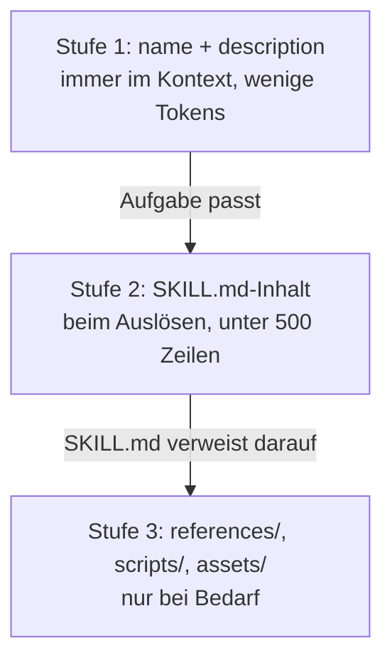

:::tldr
Ein Skill wird in **drei Stufen** geladen: (1) **Name und Description** aller Skills liegen immer im Kontext – nur ein paar Dutzend Wörter pro Skill. (2) Der **Inhalt der `SKILL.md`** kommt erst, wenn der Skill ausgelöst wird. (3) **Zusatzdateien** in `references/`, `scripts/` und `assets/` werden erst geöffnet, wenn sie gebraucht werden – und nur, wenn die `SKILL.md` sie **nennt** und sagt, **wann**. Deshalb kannst du viele Skills installieren, ohne das Kontextfenster zu füllen. Ein nie erwähntes Skript bleibt dagegen für immer ungenutzt.
:::

:::bildlich Die Bibliothek mit Katalog
In einer Bibliothek liest niemand alle Bücher, um eines zu finden. Zuerst schaut man in den **Katalog** (Stufe 1: Titel und Kurzbeschreibung). Passt ein Eintrag, holt man das **Buch** (Stufe 2). Im Buch steht «Details siehe Anhang C» – und erst dann schlägt man den **Anhang** auf (Stufe 3). Steht im Buch nirgends, dass es einen Anhang C gibt, findet ihn niemand.
:::

## Die drei Stufen



| Stufe | Was | Wann geladen | Empfehlung |
|---|---|---|---|
| 1 | `name` + `description` | immer, für alle Skills | knapp und präzise |
| 2 | Body der `SKILL.md` | wenn der Skill ausgelöst wird | **unter 500 Zeilen**; ein schlanker Dirigent |
| 3 | Dateien im Skill-Ordner | wenn Claude sie braucht | beliebig umfangreich; **kosten nichts, bis sie gebraucht werden** |

## Ordnerstruktur

```
offerte-erstellen/
├── SKILL.md          Ablauf, Verweise, Output-Format
├── references/       Nachschlagewissen (Tarife, Richtlinien, lange Beispiele)
│   └── tarife.md
├── scripts/          Code für wiederholte, exakte Arbeit
│   └── berechne.py
└── assets/           Vorlagen, Logos, Schriften für das Ergebnis
    └── vorlage.md
```

**Skripte werden ausgeführt, nicht gelesen.** Ein 300-Zeilen-Rechenskript kostet dadurch kaum Kontext – Claude sieht nur das Ergebnis. Genau darum gehören exakte, wiederholte Berechnungen in `scripts/` statt als Anleitung in den Text.

## «Nur was genannt wird, wird genutzt»

Claude durchsucht den Skill-Ordner nicht auf gut Glück. Eine Datei wird nur genutzt, wenn die `SKILL.md` auf sie verweist – idealerweise mit dem **Wann**:

| Schwach | Stark |
|---|---|
| Datei `scripts/validate.py` liegt im Ordner, wird nirgends erwähnt | «Prüfe die fertige Offerte mit `scripts/validate.py`; bei Fehlern korrigieren und erneut prüfen.» |
| «Siehe references/» | «Für Lohnmandate: Tarife und Sonderfälle in `references/lohn.md` nachschlagen.» |

:::falle Verweisketten und Riesendateien
Zwei typische Fehler: Eine Referenz verweist auf die nächste, die wieder auf eine weitere – Claude verliert den Faden. **Referenzen nur eine Ebene tief**: `SKILL.md` → Referenz, nie Referenz → Referenz → Referenz. Und eine 600-Zeilen-`SKILL.md` ist ein Warnsignal: Details gehören in `references/`, damit der Kern bei jeder Auslösung schlank bleibt. Referenzdateien über rund 300 Zeilen bekommen oben ein **Inhaltsverzeichnis**, damit Claude gezielt springen kann.
:::

## Was nach dem Laden passiert

- Ein ausgelöster Skill **bleibt im Kontext**, auch über mehrere Runden.
- Nach einer automatischen **Kompaktierung** hängt Claude Code die jeweils letzte Auslösung jedes Skills wieder an, aber nur die **ersten 5000 Tokens** pro Skill und höchstens **25 000 Tokens** für alle zusammen (Stand 27.11.2026). Das Wichtigste gehört also **an den Anfang** der `SKILL.md`.

:::gem Aktuelle Daten direkt einspielen
In Claude Code kann ein Skill vor dem Lesen einen Befehl ausführen und dessen Ausgabe einfügen: Eine Zeile `` !`git diff HEAD` `` wird durch die aktuellen Änderungen ersetzt, bevor Claude den Skill sieht. So bekommt ein Review-Skill immer den frischen Stand, ohne dass Claude erst danach fragen muss. Der Befehl unterliegt den normalen Berechtigungsregeln; schlägt er fehl, bricht die Auslösung ab. Mit `${CLAUDE_SKILL_DIR}` verweist du dabei zuverlässig auf Dateien im eigenen Skill-Ordner.
:::

:::berater Im Kundengespräch
Die Sorge «Wenn wir 50 Skills installieren, wird Claude langsam und teuer» lässt sich mit Progressive Disclosure entkräften: Dauerhaft im Kontext sind nur die Beschreibungen. Das echte Risiko bei vielen Skills ist ein anderes – **Überschneidungen**: Zwei Skills, deren Beschreibungen dieselben Anfragen beanspruchen, machen die Auswahl unvorhersehbar (Lektion [Triggering und Trigger-Evals](#/l/skills-plugins/triggering-und-evals)).
:::

:::spickzettel
- **Stufe 1** name + description: **immer**, wenige Tokens
- **Stufe 2** SKILL.md-Body: **beim Auslösen**, unter **500 Zeilen**
- **Stufe 3** `references/`, `scripts/`, `assets/`: **nur bei Bedarf**, kosten bis dahin nichts
- Dateien werden **nur genutzt, wenn SKILL.md sie nennt** – mit dem **Wann**
- **Skripte werden ausgeführt**, nicht gelesen → exakte Arbeit in `scripts/`
- Referenzen **eine Ebene tief**; ab ~300 Zeilen **Inhaltsverzeichnis**
- Nach Kompaktierung: erste **5000 Tokens** je Skill → Wichtiges nach oben
- `` !`befehl` `` spielt aktuelle Daten ein; `${CLAUDE_SKILL_DIR}` für eigene Dateien
:::

:::selbstcheck 3
